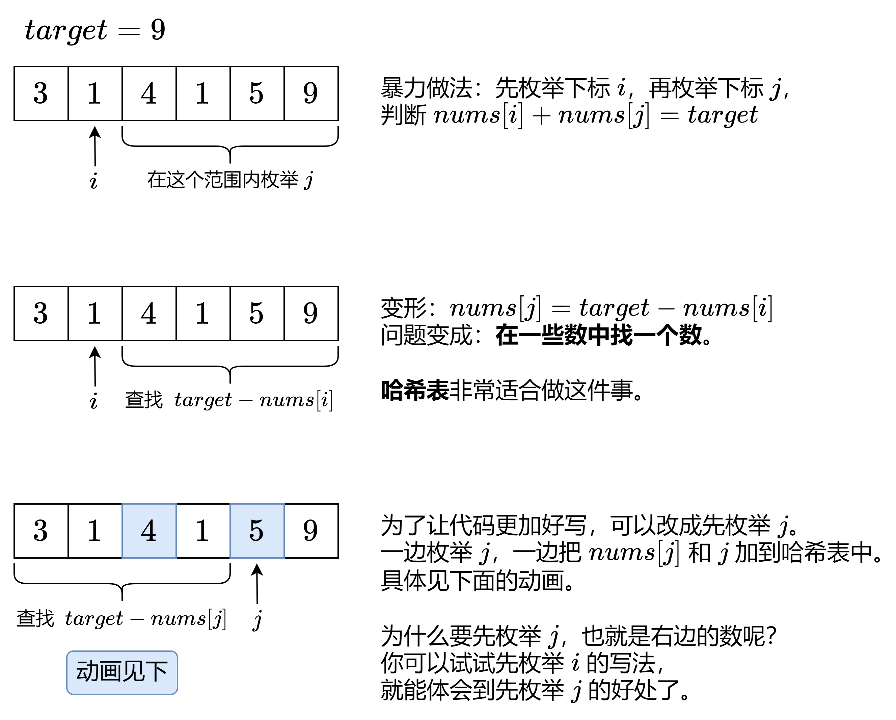
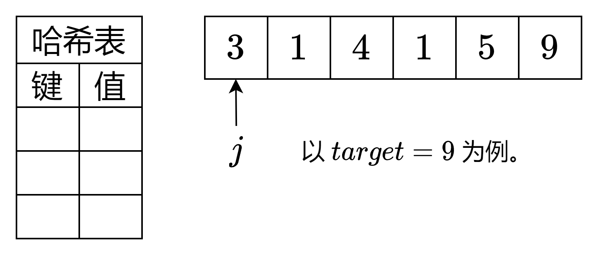
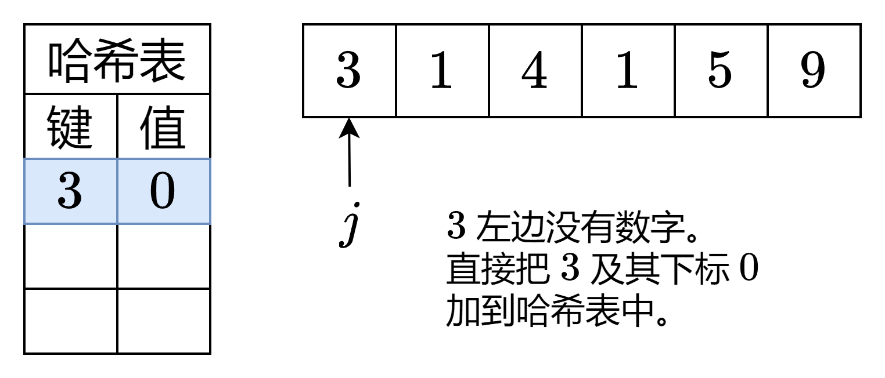
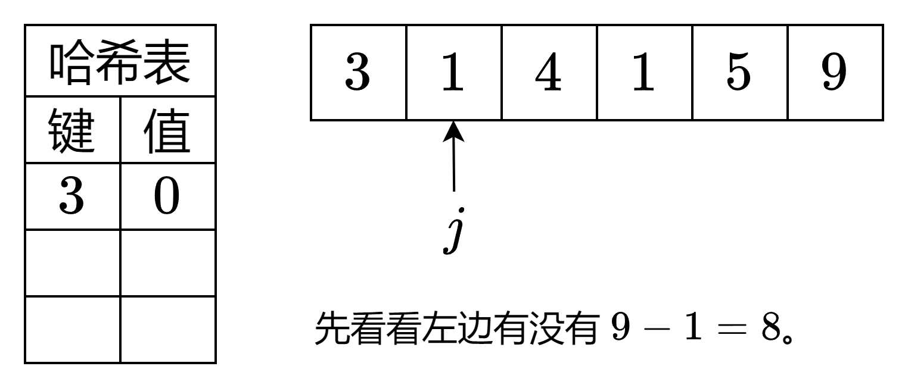
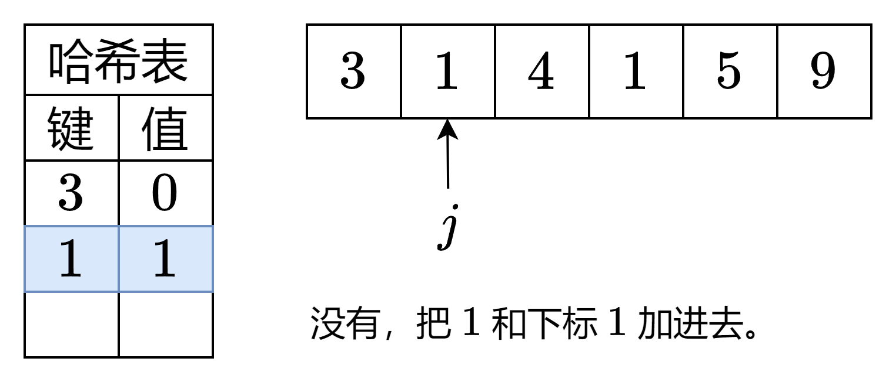
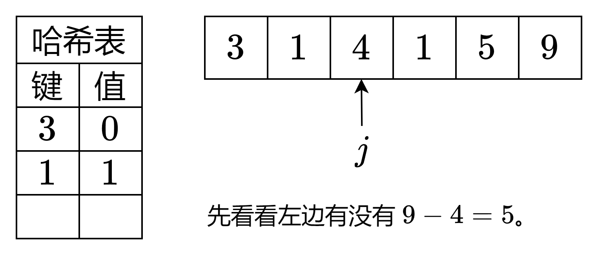
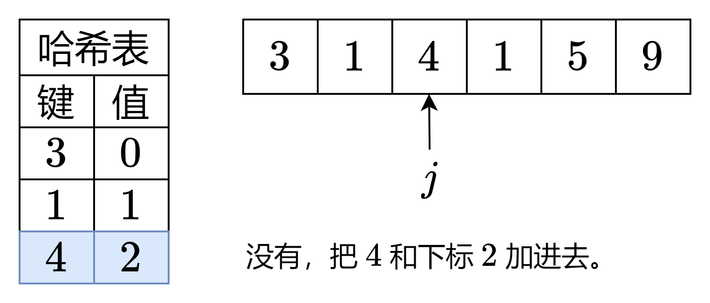
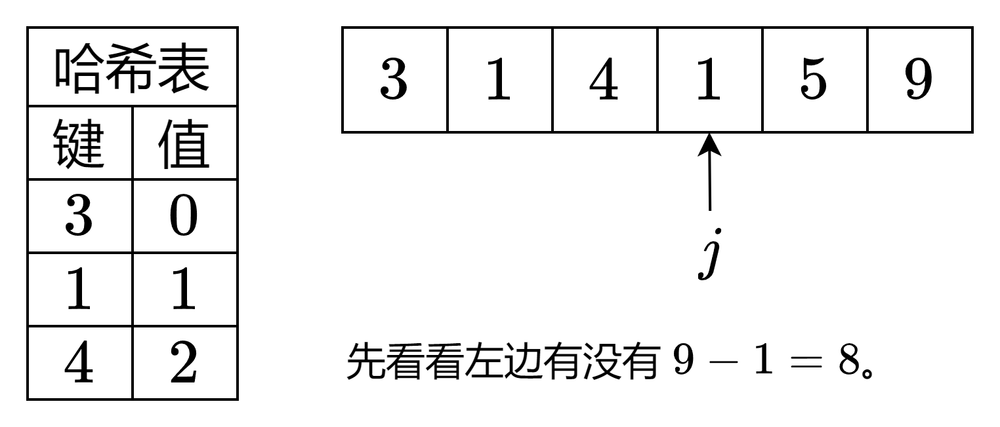
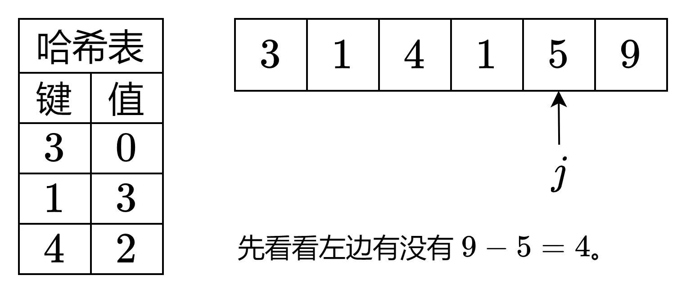
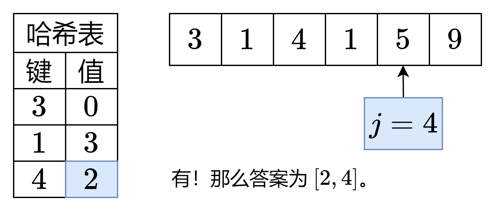

# 【动画】从两数之和中，我们可以学到什么？（Python/Java/C++/C/Go/JS/Rust）

> **[1. 两数之和](https://leetcode.cn/problems/two-sum/solutions/2326193/dong-hua-cong-liang-shu-zhi-he-zhong-wo-0yvmj/) · Easy**

> **所属题单**
> - [常用数据结构 · 零、常用枚举技巧](../../../刷题路径/灵神原版题单/常用数据结构/零、常用枚举技巧.md) · §0.1 枚举右，维护左 · §0.1.1 基础
> - [LeetCode 热题 100 · 哈希](../../../刷题路径/灵神原版题单/LeetCode%20热题%20100/哈希.md)
> - [面试经典 150 题 · 哈希表](../../../刷题路径/灵神原版题单/面试经典%20150%20题/哈希表.md)

> **题目描述**
> 给定一个整数数组 `nums` 和一个整数目标值 `target`，请你在该数组中找出 **和为目标值** <em>`target`</em>  的那 **两个** 整数，并返回它们的数组下标。
>
> 你可以假设每种输入只会对应一个答案，并且你不能使用两次相同的元素。
>
> 你可以按任意顺序返回答案。
>
> **示例 1：**
>
> ```
>
> 输入：nums = [2,7,11,15], target = 9
> 输出：[0,1]
> 解释：因为 nums[0] + nums[1] == 9 ，返回 [0, 1] 。
> ```
>
> **示例 2：**
>
> ```
>
> 输入：nums = [3,2,4], target = 6
> 输出：[1,2]
> ```
>
> **示例 3：**
>
> ```
>
> 输入：nums = [3,3], target = 6
> 输出：[0,1]
> ```
>
> **提示：**
>
> - `2 <= nums.length <= 10⁴`
>
> - `-10⁹ <= nums[i] <= 10⁹`
>
> - `-10⁹ <= target <= 10⁹`
>
> - **只会存在一个有效答案**
>
> **进阶：**你可以想出一个时间复杂度小于 `O(n²)` 的算法吗？

> **题解**
> 
>
> <,,,,,,,,,>
>
> ## 答疑
>
> **问**：是什么原因导致了这两种算法的快慢？
>
> **答**：我用「获取了多少信息」来解释。
>
> 暴力做法每次拿两个数出来相加，和 $\textit{target}$ 比较，那么花费 $\mathcal{O}(1)$ 的时间，只获取了 $\mathcal{O}(1)$ 的信息。
>
> 而哈希表做法，每次查询都能知道 $\mathcal{O}(n)$ 个数中是否有 $\textit{target}-\textit{nums}[j]$，那么花费 $\mathcal{O}(1)$ 的时间，就获取了 $\mathcal{O}(n)$ 的信息。
>
> 这就是为什么我们可以把暴力的 $\mathcal{O}(n^2)$ 优化成 $\mathcal{O}(n)$。
>
> **问**：力扣是如何测试题目的？为什么没有 `main` 函数？
>
> **答**：简单来说，力扣评测机内部有 `main` 函数，里面会调用你写的 `twoSum` 函数（方法），传入相应的测试数据，并对比 `twoSum` 的返回值和正确答案是否一致。如果对于所有测试数据，返回值都与正确答案一致，则判定通过。
>
> 所以，我们**只需编写核心逻辑**，保证返回结果计算正确即可。
>
> **问**：如何在本地测试代码？
>
> **答**：[见此](../../2200-2299/2235%20两整数相加/灵茶山艾府.md)。
>
> ## 暴力写法
>
> ```python
> class Solution:
>     def twoSum(self, nums: List[int], target: int) -> List[int]:
>         for i, x in enumerate(nums):  # x=nums[i]
>             for j in range(i + 1, len(nums)):  # 枚举 i 右边的 j
>                 if x + nums[j] == target:  # 满足要求
>                     return [i, j]  # 返回两个数的下标
>         # 这里无需 return，因为题目保证有解
> ```
>
>
> #### 复杂度分析
>
> - 时间复杂度：$\mathcal{O}(n^2)$，其中 $n$ 为 $\textit{nums}$ 的长度。
> - 空间复杂度：$\mathcal{O}(1)$。仅用到若干额外变量。
>
> ## 哈希表写法
>
> **问**：为什么下面的代码，要先查询 $\textit{idx}$ 是否有 $\textit{target}- \textit{nums}[j] $，再把 $\textit{nums}[j]$ 和 $j$ 加到 $\textit{idx}$ 中？能不能反过来？
>
> **答**：反过来写是错误的。例如 $\textit{nums}=[2,3,1],\ \textit{target}=4$，如果先把 $\textit{nums}[j]$ 和 $j$ 加到 $\textit{idx}$ 中，我们会认为 $2+2=4$，返回 $[0,0]$，而正确答案应该是 $3+1=4$，也就是返回 $[1,2]$。
>
> 原因在于，题目要求「不能使用两次相同的元素」，也就是**两个数的下标必须不同**。我们的做法是枚举右边的数的下标 $j$，去找左边的数的下标 $i$。由于找的是左边的数，如果先把右边的数加到 $\textit{idx}$ 中，找到的数就可能包含右边的数了，不符合题目要求。
>
> ```python
> class Solution:
>     def twoSum(self, nums: List[int], target: int) -> List[int]:
>         idx = {}  # 创建一个空哈希表（字典）
>         for j, x in enumerate(nums):  # x=nums[j]
>             if target - x in idx:  # 在左边找 nums[i]，满足 nums[i]+x=target
>                 return [idx[target - x], j]  # 返回两个数的下标
>             idx[x] = j  # 保存 nums[j] 和 j
> ```
>
>
> #### 复杂度分析
>
> - 时间复杂度：$\mathcal{O}(n)$，其中 $n$ 为 $\textit{nums}$ 的长度。
> - 空间复杂度：$\mathcal{O}(n)$。哈希表需要 $\mathcal{O}(n)$ 的空间。
>
> 相比暴力做法，哈希表多消耗了内存空间，但减少了运行时间，这就是「**空间换时间**」。
>
> ## 总结 · 练习
>
> 很多涉及到「两个变量」的题目，都可以枚举其中一个变量，把它当成**常量**看待，从而转化成「一个变量」的问题。
>
> 代码实现时，通常来说「枚举右，寻找左」是更加好写的。
>
> - [1512. 好数对的数目](https://leetcode.cn/problems/number-of-good-pairs/)
> - [219. 存在重复元素 II](https://leetcode.cn/problems/contains-duplicate-ii/)
> - [1010. 总持续时间可被 60 整除的歌曲](https://leetcode.cn/problems/pairs-of-songs-with-total-durations-divisible-by-60/)
> - [2748. 美丽下标对的数目](https://leetcode.cn/problems/number-of-beautiful-pairs/)
> - 更多相似题目，请看 [数据结构题单](https://leetcode.cn/circle/discuss/mOr1u6/) 第零章。
>
> ## 思考题
>
> 1. 如果 $\textit{nums}$ 是有序的，是否还需要哈希表？换句话说，能否做到 $\mathcal{O}(1)$ 额外空间？
> 2. 如果要求寻找**三个**数，它们的和等于 $\textit{target}$ 呢？
>
> 解答请看[【基础算法精讲】](https://www.bilibili.com/video/BV1bP411c7oJ/)。
>
> ## 分类题单
>
> [如何科学刷题？](https://leetcode.cn/circle/discuss/RvFUtj/)
>
> 1. [滑动窗口与双指针（定长/不定长/单序列/双序列/三指针/分组循环）](https://leetcode.cn/circle/discuss/0viNMK/)
> 2. [二分算法（二分答案/最小化最大值/最大化最小值/第K小）](https://leetcode.cn/circle/discuss/SqopEo/)
> 3. [单调栈（基础/矩形面积/贡献法/最小字典序）](https://leetcode.cn/circle/discuss/9oZFK9/)
> 4. [网格图（DFS/BFS/综合应用）](https://leetcode.cn/circle/discuss/YiXPXW/)
> 5. [位运算（基础/性质/拆位/试填/恒等式/思维）](https://leetcode.cn/circle/discuss/dHn9Vk/)
> 6. [图论算法（DFS/BFS/拓扑排序/基环树/最短路/最小生成树/网络流）](https://leetcode.cn/circle/discuss/01LUak/)
> 7. [动态规划（入门/背包/划分/状态机/区间/状压/数位/数据结构优化/树形/博弈/概率期望）](https://leetcode.cn/circle/discuss/tXLS3i/)
> 8. [常用数据结构（前缀和/差分/栈/队列/堆/字典树/并查集/树状数组/线段树）](https://leetcode.cn/circle/discuss/mOr1u6/)
> 9. [数学算法（数论/组合/概率期望/博弈/计算几何/随机算法）](https://leetcode.cn/circle/discuss/IYT3ss/)
> 10. [贪心与思维（基本贪心策略/反悔/区间/字典序/数学/思维/脑筋急转弯/构造）](https://leetcode.cn/circle/discuss/g6KTKL/)
> 11. [链表、二叉树与回溯（前后指针/快慢指针/DFS/BFS/直径/LCA/一般树）](https://leetcode.cn/circle/discuss/K0n2gO/)
> 12. [字符串（KMP/Z函数/Manacher/字符串哈希/AC自动机/后缀数组/子序列自动机）](https://leetcode.cn/circle/discuss/SJFwQI/)
>
> [我的题解精选（已分类）](https://github.com/EndlessCheng/codeforces-go/blob/master/leetcode/SOLUTIONS.md)
>
> 欢迎关注 [B站@灵茶山艾府](https://space.bilibili.com/206214)
