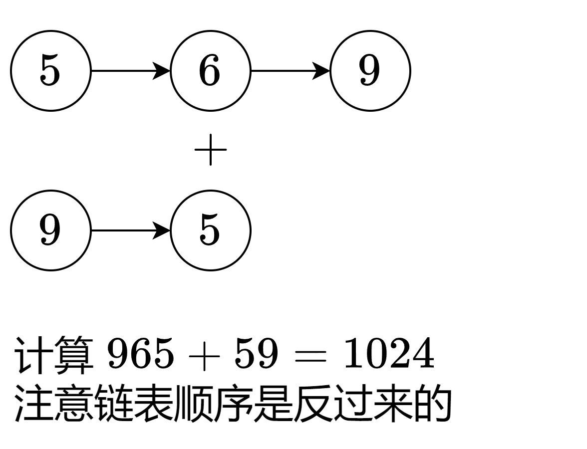
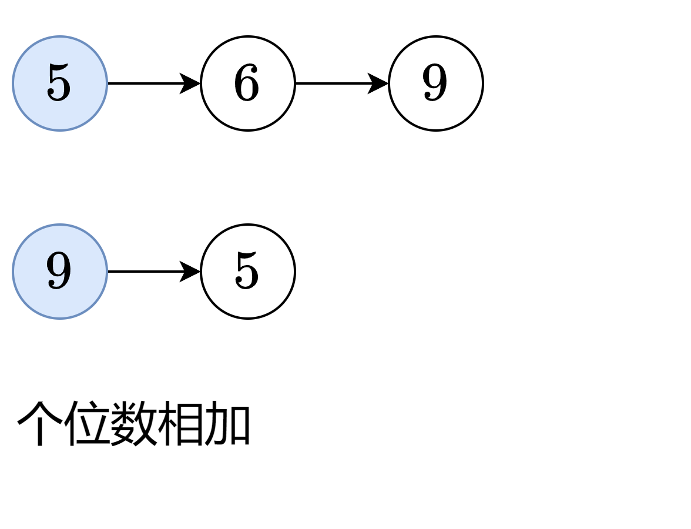
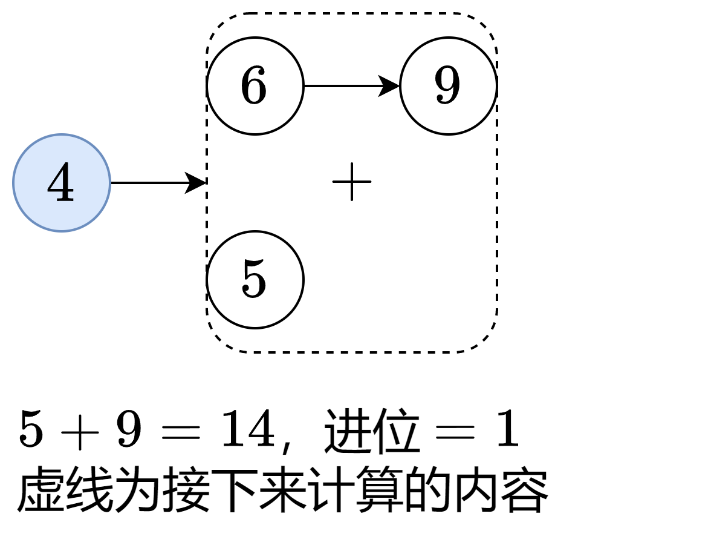
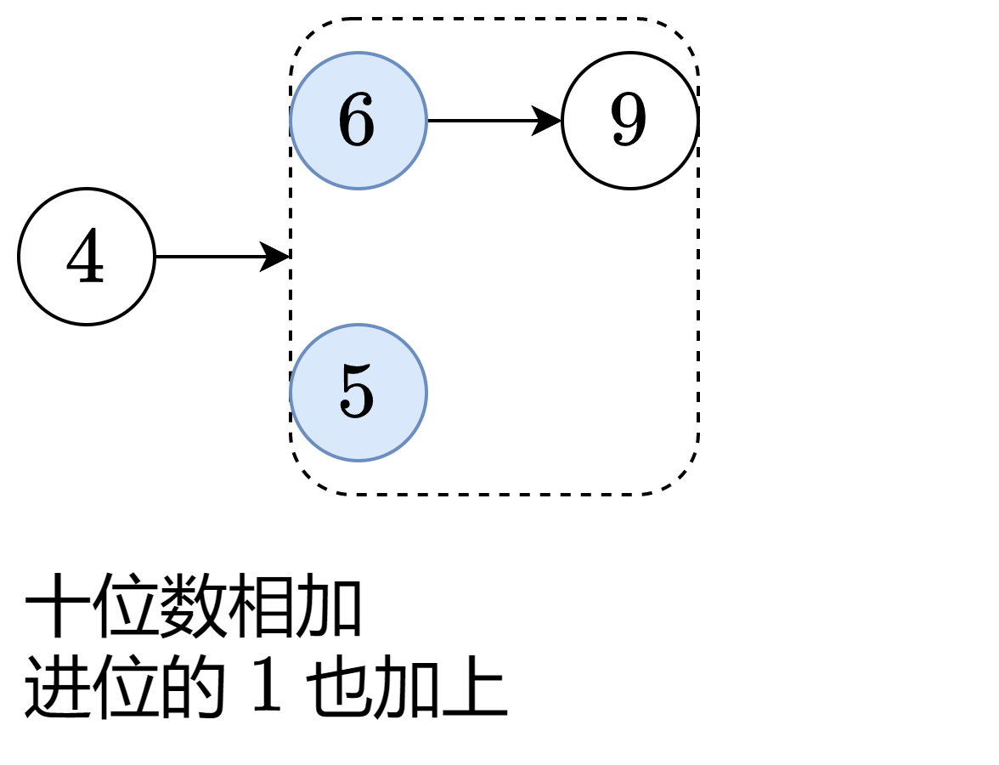
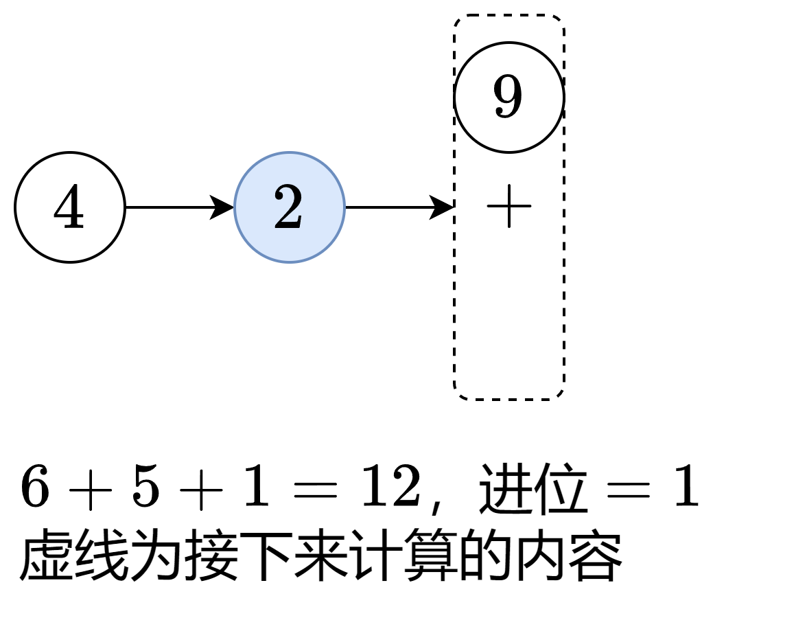
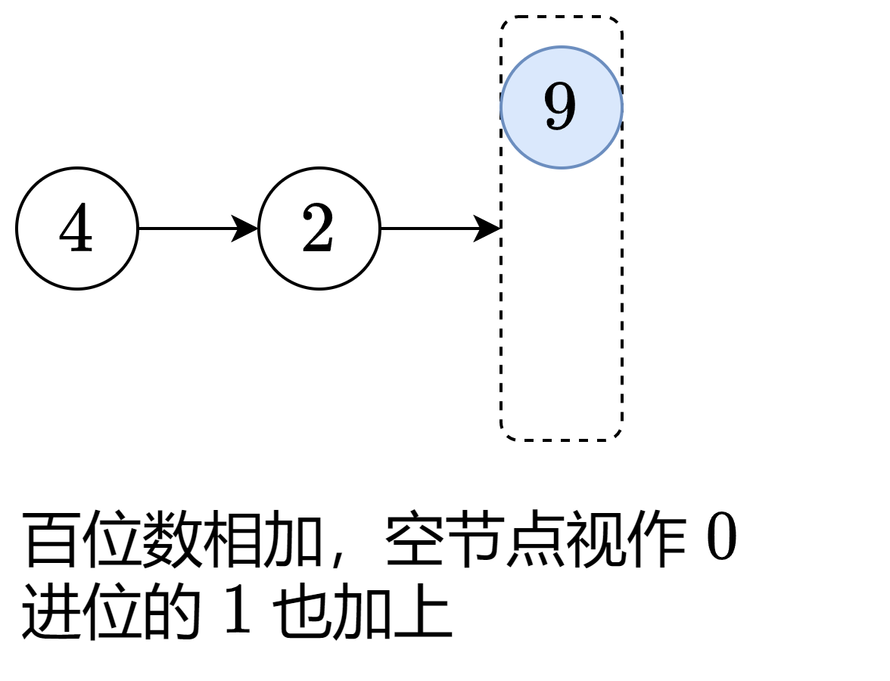
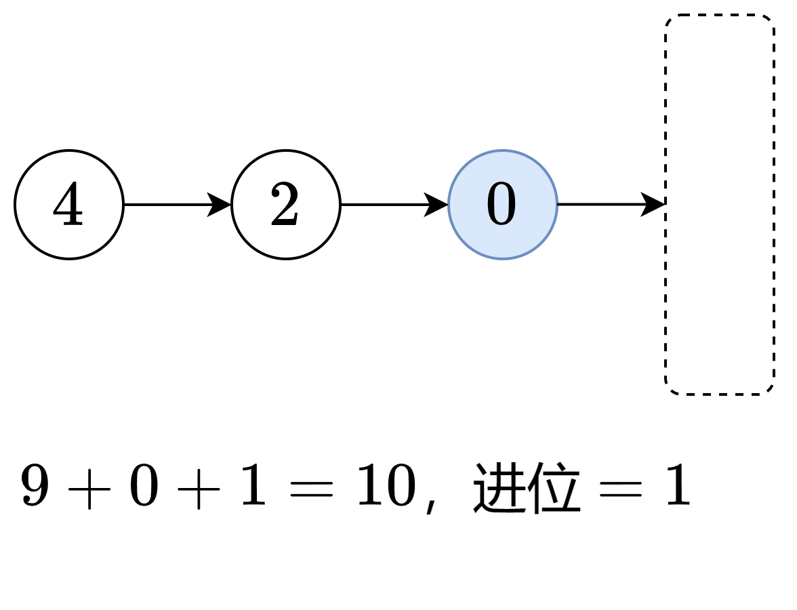
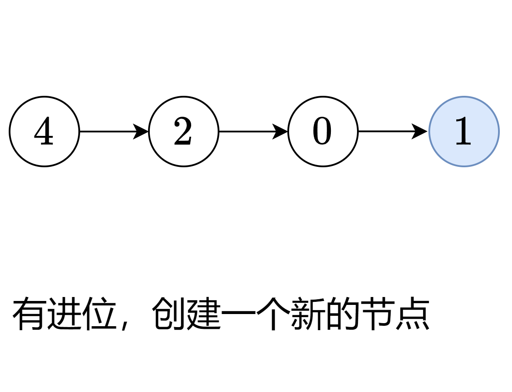

# 【动画】简洁写法！从递归到迭代！（Python/Java/C++/C/Go/JS/Rust）

> **[2. 两数相加](https://leetcode.cn/problems/add-two-numbers/solutions/2327008/dong-hua-jian-ji-xie-fa-cong-di-gui-dao-oe0di/) · Medium**

> **所属题单**
> - [链表、二叉树与回溯 · 一、链表](../../../刷题路径/灵神原版题单/链表、二叉树与回溯/一、链表.md) · §1.8 合并链表
> - [LeetCode 热题 100 · 链表](../../../刷题路径/灵神原版题单/LeetCode%20热题%20100/链表.md)
> - [面试经典 150 题 · 链表](../../../刷题路径/灵神原版题单/面试经典%20150%20题/链表.md)

> **题目描述**
> 给你两个 **非空** 的链表，表示两个非负的整数。它们每位数字都是按照 **逆序** 的方式存储的，并且每个节点只能存储 **一位** 数字。
>
> 请你将两个数相加，并以相同形式返回一个表示和的链表。
>
> 你可以假设除了数字 0 之外，这两个数都不会以 0 开头。
>
> **示例 1：**
>
> 
>
> ```
>
> 输入：l1 = [2,4,3], l2 = [5,6,4]
> 输出：[7,0,8]
> 解释：342 + 465 = 807.
> ```
>
> **示例 2：**
>
> ```
>
> 输入：l1 = [0], l2 = [0]
> 输出：[0]
> ```
>
> **示例 3：**
>
> ```
>
> 输入：l1 = [9,9,9,9,9,9,9], l2 = [9,9,9,9]
> 输出：[8,9,9,9,0,0,0,1]
> ```
>
> **提示：**
>
> - 每个链表中的节点数在范围 `[1, 100]` 内
>
> - `0 <= Node.val <= 9`
>
> - 题目数据保证列表表示的数字不含前导零

> **题解**
> ## 方法一：递归
>
> <,,,,,,,>
>
> 把虚线内要计算的内容，可以理解为一个和原问题相似的，规模更小的子问题，所以非常适合用**递归**解决。
>
> 每次把两个节点值 $l_1.\textit{val},\ l_2.\textit{val}$ 与进位值 $\textit{carry}$ 相加，除以 $10$ 的余数即为当前节点需要保存的数位，除以 $10$ 的商即为新的进位值。
>
> 一遇到递归就头晕？请看[【基础算法精讲 09】](https://www.bilibili.com/video/BV1UD4y1Y769/)。
>
> 不了解链表的同学请看[【基础算法精讲 06】](https://www.bilibili.com/video/BV1sd4y1x7KN/)。
>
> ### 写法一：创建新节点
>
> ```python
> class Solution:
>     # l1 和 l2 为当前遍历的节点，carry 为进位
>     def addTwoNumbers(self, l1: Optional[ListNode], l2: Optional[ListNode], carry=0) -> Optional[ListNode]:
>         if l1 is None and l2 is None and carry == 0:  # 递归边界
>             return None
>
>         s = carry
>         if l1:
>             s += l1.val  # 累加进位与节点值
>             l1 = l1.next
>         if l2:
>             s += l2.val
>             l2 = l2.next
>
>         # s 除以 10 的余数为当前节点值，商为进位
>         return ListNode(s % 10, self.addTwoNumbers(l1, l2, s // 10))
> ```
>
>
> ### 写法二：原地修改
>
> 代码实现时，有一个简化代码的小技巧：如果递归中发现 $l_2$ 的长度比 $l_1$ 更长，那么可以交换 $l_1$ 和 $l_2$，保证 $l_1$ 不是空节点，从而简化代码逻辑。
>
> ```python
> class Solution:
>     # l1 和 l2 为当前遍历的节点，carry 为进位
>     def addTwoNumbers(self, l1: Optional[ListNode], l2: Optional[ListNode], carry=0) -> Optional[ListNode]:
>         if l1 is None and l2 is None:  # 递归边界
>             return ListNode(carry) if carry else None  # 如果进位了，就额外创建一个节点
>         if l1 is None:  # 如果 l1 是空的，那么此时 l2 一定不是空节点
>             l1, l2 = l2, l1  # 交换 l1 与 l2，保证 l1 非空，从而简化代码
>         s = carry + l1.val + (l2.val if l2 else 0)  # 节点值和进位加在一起
>         l1.val = s % 10  # 每个节点保存一个数位（直接修改原链表）
>         l1.next = self.addTwoNumbers(l1.next, l2.next if l2 else None, s // 10)  # 进位
>         return l1
> ```
>
>
> #### 复杂度分析
>
> - 时间复杂度：$\mathcal{O}(n)$，其中 $n$ 为 $l_1$ 长度和 $l_2$ 长度的最大值。
> - 空间复杂度：$\mathcal{O}(n)$。递归需要 $\mathcal{O}(n)$ 的栈空间。
>
> ## 方法二：迭代
>
> 首先请看如何遍历一个链表，代码框架如下：
>
> ```python
> # 遍历链表 l1
> while l1:  # 从链表头节点开始向后遍历，直到遇到空节点
>     print(l1.val)  # 当前节点值
>     l1 = l1.next  # 准备遍历下一个节点
> ```
>
>
> 迭代的思路是，初始化答案为一个「空链表」，每次循环，向该链表末尾添加一个节点（保存一个数位）。
>
> 循环即遍历链表 $l_1$ 和 $l_2$，每次把两个节点值 $l_1.\textit{val},\ l_2.\textit{val}$ 与进位值 $\textit{carry}$ 相加，除以 $10$ 的余数即为当前节点需要保存的数位，除以 $10$ 的商即为新的进位值。
>
> 需要注意的是，在第一次循环时，我们无法往一个空节点的末尾添加节点。这里的技巧是，创建一个**哨兵节点**（dummy node），当成初始的「空链表」。循环结束后，哨兵节点的下一个节点就是最终要返回的链表头节点。
>
> ```python
> class Solution:
>     def addTwoNumbers(self, l1: Optional[ListNode], l2: Optional[ListNode]) -> Optional[ListNode]:
>         cur = dummy = ListNode()  # 哨兵节点
>         carry = 0  # 进位值
>         while l1 or l2 or carry:  # 有一个不是空节点，或者还有进位，就继续迭代
>             s = carry
>             if l1:
>                 s += l1.val  # 节点值和进位加在一起
>                 l1 = l1.next  # 下一个节点
>             if l2:
>                 s += l2.val  # 节点值和进位加在一起
>                 l2 = l2.next  # 下一个节点
>             cur.next = ListNode(s % 10)  # 每个节点保存一个数位
>             carry = s // 10  # 新的进位
>             cur = cur.next  # 下一个节点
>         return dummy.next  # 哨兵节点的下一个节点就是头节点
> ```
>
>
> #### 复杂度分析
>
> - 时间复杂度：$\mathcal{O}(n)$，其中 $n$ 为 $l_1$ 的长度和 $l_2$ 的长度的最大值。
> - 空间复杂度：$\mathcal{O}(1)$。返回值不计入。
>
> ## 思考题
>
> 本题的链表是从数字的最低位开始的，如果改成从最高位开始，要怎么做呢？
>
> - [206. 反转链表](https://leetcode.cn/problems/reverse-linked-list/)
> - [445. 两数相加 II](https://leetcode.cn/problems/add-two-numbers-ii/)
>
> 更多链表题目，见下面的链表题单。
>
> ## 分类题单
>
> [如何科学刷题？](https://leetcode.cn/circle/discuss/RvFUtj/)
>
> 1. [滑动窗口与双指针（定长/不定长/单序列/双序列/三指针/分组循环）](https://leetcode.cn/circle/discuss/0viNMK/)
> 2. [二分算法（二分答案/最小化最大值/最大化最小值/第K小）](https://leetcode.cn/circle/discuss/SqopEo/)
> 3. [单调栈（基础/矩形面积/贡献法/最小字典序）](https://leetcode.cn/circle/discuss/9oZFK9/)
> 4. [网格图（DFS/BFS/综合应用）](https://leetcode.cn/circle/discuss/YiXPXW/)
> 5. [位运算（基础/性质/拆位/试填/恒等式/思维）](https://leetcode.cn/circle/discuss/dHn9Vk/)
> 6. [图论算法（DFS/BFS/拓扑排序/基环树/最短路/最小生成树/网络流）](https://leetcode.cn/circle/discuss/01LUak/)
> 7. [动态规划（入门/背包/划分/状态机/区间/状压/数位/数据结构优化/树形/博弈/概率期望）](https://leetcode.cn/circle/discuss/tXLS3i/)
> 8. [常用数据结构（前缀和/差分/栈/队列/堆/字典树/并查集/树状数组/线段树）](https://leetcode.cn/circle/discuss/mOr1u6/)
> 9. [数学算法（数论/组合/概率期望/博弈/计算几何/随机算法）](https://leetcode.cn/circle/discuss/IYT3ss/)
> 10. [贪心与思维（基本贪心策略/反悔/区间/字典序/数学/思维/脑筋急转弯/构造）](https://leetcode.cn/circle/discuss/g6KTKL/)
> 11. [链表、树与回溯（前后指针/快慢指针/DFS/BFS/直径/LCA）](https://leetcode.cn/circle/discuss/K0n2gO/)
> 12. [字符串（KMP/Z函数/Manacher/字符串哈希/AC自动机/后缀数组/子序列自动机）](https://leetcode.cn/circle/discuss/SJFwQI/)
>
> [我的题解精选（已分类）](https://github.com/EndlessCheng/codeforces-go/blob/master/leetcode/SOLUTIONS.md)
>
> 欢迎关注 [B站@灵茶山艾府](https://space.bilibili.com/206214)
