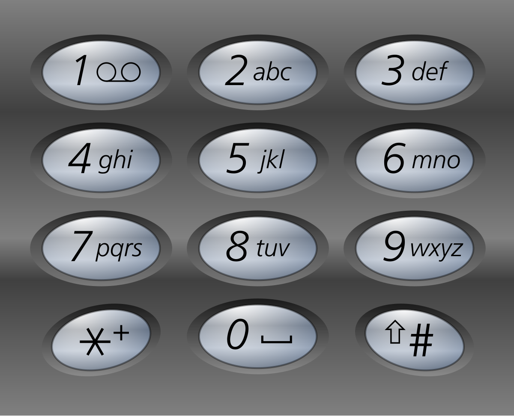

# 17. 电话号码的字母组合

Medium · [力扣原题](https://leetcode.cn/problems/letter-combinations-of-a-phone-number/)

所在刷题路径：labuladong、灵神核心路线、灵神突击、灵神题单·链表树与回溯

| 作者 | 题解 | 动画讲解 |
|---|---|---|
| 灵茶山艾府 | [📄 题解](灵茶山艾府.md) | [▶︎ 0017 电话号码的字母组合 · 灵茶山艾府.mp4](0017%20电话号码的字母组合%20·%20灵茶山艾府.mp4) |
| yiduobo | [📄 题解](yiduobo.md) | [▶︎ 0017 电话号码的字母组合 · yiduobo.mp4](0017%20电话号码的字母组合%20·%20yiduobo.mp4) |

## 题目描述

给定一个仅包含数字 `2-9` 的字符串，返回所有它能表示的字母组合。答案可以按 **任意顺序** 返回。

给出数字到字母的映射如下（与电话按键相同）。注意 1 不对应任何字母。



**示例 1：**

```

输入：digits = "23"
输出：["ad","ae","af","bd","be","bf","cd","ce","cf"]
```

**示例 2：**

```

输入：digits = "2"
输出：["a","b","c"]
```

**提示：**

- `1 <= digits.length <= 4`

- `digits[i]` 是范围 `['2', '9']` 的一个数字。

---
[↑ 返回 0000-0099](../README.md) · [总索引](../../../索引.md) · [仓库首页](../../../README.md)
