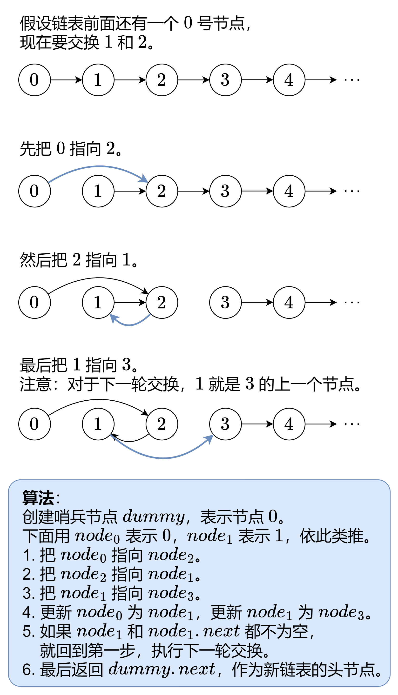

# 【图解】迭代/递归，一张图秒懂！（Python/Java/C++/C/Go/JS）

> **[24. 两两交换链表中的节点](https://leetcode.cn/problems/swap-nodes-in-pairs/solutions/2374872/tu-jie-die-dai-di-gui-yi-zhang-tu-miao-d-51ap/) · Medium**

> **所属题单**
> - [链表、二叉树与回溯 · 一、链表](../../../刷题路径/灵神原版题单/链表、二叉树与回溯/一、链表.md) · §1.4 反转链表
> - [LeetCode 热题 100 · 链表](../../../刷题路径/灵神原版题单/LeetCode%20热题%20100/链表.md)

> **题目描述**
> 给你一个链表，两两交换其中相邻的节点，并返回交换后链表的头节点。你必须在不修改节点内部的值的情况下完成本题（即，只能进行节点交换）。
>
> **示例 1：**
>
> 
>
> ```
>
> 输入：head = [1,2,3,4]
> 输出：[2,1,4,3]
> ```
>
> **示例 2：**
>
> ```
>
> 输入：head = []
> 输出：[]
> ```
>
> **示例 3：**
>
> ```
>
> 输入：head = [1]
> 输出：[1]
> ```
>
> **提示：**
>
> - 链表中节点的数目在范围 `[0, 100]` 内
>
> - `0 <= Node.val <= 100`

> **题解**
> ## 方法一：迭代
>
> ### 前置知识
>
> [认识链表 & 哨兵技巧【基础算法精讲 06】](https://www.bilibili.com/video/BV1sd4y1x7KN/)
>
> 
>
> ```python
> class Solution:
>     def swapPairs(self, head: Optional[ListNode]) -> Optional[ListNode]:
>         node0 = dummy = ListNode(next=head)  # 用哨兵节点简化代码逻辑
>         node1 = head
>         while node1 and node1.next:  # 至少有两个节点
>             node2 = node1.next
>             node3 = node2.next
>
>             node0.next = node2  # 0 -> 2
>             node2.next = node1  # 2 -> 1
>             node1.next = node3  # 1 -> 3
>
>             node0 = node1  # 下一轮交换，0 是 1
>             node1 = node3  # 下一轮交换，1 是 3
>         return dummy.next  # 返回新链表的头节点
> ```
>
>
> #### 复杂度分析
>
> - 时间复杂度：$\mathcal{O}(n)$，其中 $n$ 为链表长度。
> - 空间复杂度：$\mathcal{O}(1)$。仅用到若干额外变量。
>
> ## 方法二：递归
>
> ### 前置知识
>
> [一看递归就晕？带你理解递归的本质！【基础算法精讲 09】](https://www.bilibili.com/video/BV1UD4y1Y769/)
>
> ### 思路
>
> 和方法一类似。这里直接用 `swapPairs` 当作递归函数：
>
> - 递归边界：如果 $\textit{head}$ 或者 $\textit{head}.\textit{next}$ 为空，说明剩余节点不足两个，无需交换，返回 $\textit{head}$。
> - 先交换以 $\textit{node}_3$ 为头节点的链表，即递归调用 `swapPairs(node3)`。
> - 把 $\textit{node}_1$ 指向递归返回的链表头。
> - 把 $\textit{node}_2$ 指向 $\textit{node}_1$。
> - 返回 $\textit{node}_2$，作为交换后的链表头节点。
>
> ```python
> class Solution:
>     def swapPairs(self, head: Optional[ListNode]) -> Optional[ListNode]:
>         if head is None or head.next is None:  # 递归边界
>             return head  # 不足两个节点，无需交换
>
>         node1 = head
>         node2 = head.next
>         node3 = node2.next
>
>         node1.next = self.swapPairs(node3)  # 1 指向递归返回的链表头
>         node2.next = node1  # 2 指向 1
>
>         return node2  # 返回交换后的链表头节点
> ```
>
>
> #### 复杂度分析
>
> - 时间复杂度：$\mathcal{O}(n)$，其中 $n$ 为链表长度。
> - 空间复杂度：$\mathcal{O}(n)$。递归需要 $\mathcal{O}(n)$ 的栈空间。
>
> ## 思考题
>
> 如果改成每 $k$ 个节点一组反转链表呢？
>
> 这题是 [25. K 个一组翻转链表](https://leetcode.cn/problems/reverse-nodes-in-k-group/)，请看 [视频讲解](https://www.bilibili.com/video/BV1sd4y1x7KN/)。
>
> ## 分类题单
>
> [如何科学刷题？](https://leetcode.cn/circle/discuss/RvFUtj/)
>
> 1. [滑动窗口与双指针（定长/不定长/单序列/双序列/三指针）](https://leetcode.cn/circle/discuss/0viNMK/)
> 2. [二分算法（二分答案/最小化最大值/最大化最小值/第K小）](https://leetcode.cn/circle/discuss/SqopEo/)
> 3. [单调栈（基础/矩形面积/贡献法/最小字典序）](https://leetcode.cn/circle/discuss/9oZFK9/)
> 4. [网格图（DFS/BFS/综合应用）](https://leetcode.cn/circle/discuss/YiXPXW/)
> 5. [位运算（基础/性质/拆位/试填/恒等式/思维）](https://leetcode.cn/circle/discuss/dHn9Vk/)
> 6. [图论算法（DFS/BFS/拓扑排序/最短路/最小生成树/二分图/基环树/欧拉路径）](https://leetcode.cn/circle/discuss/01LUak/)
> 7. [动态规划（入门/背包/状态机/划分/区间/状压/数位/数据结构优化/树形/博弈/概率期望）](https://leetcode.cn/circle/discuss/tXLS3i/)
> 8. [常用数据结构（前缀和/差分/栈/队列/堆/字典树/并查集/树状数组/线段树）](https://leetcode.cn/circle/discuss/mOr1u6/)
> 9. [数学算法（数论/组合/概率期望/博弈/计算几何/随机算法）](https://leetcode.cn/circle/discuss/IYT3ss/)
> 10. [贪心与思维（基本贪心策略/反悔/区间/字典序/数学/思维/脑筋急转弯/构造）](https://leetcode.cn/circle/discuss/g6KTKL/)
> 11. [链表、二叉树与一般树（前后指针/快慢指针/DFS/BFS/直径/LCA）](https://leetcode.cn/circle/discuss/K0n2gO/)
> 12. [字符串（KMP/Z函数/Manacher/字符串哈希/AC自动机/后缀数组/子序列自动机）](https://leetcode.cn/circle/discuss/SJFwQI/)
>
> [我的题解精选（已分类）](https://github.com/EndlessCheng/codeforces-go/blob/master/leetcode/SOLUTIONS.md)
>
> 欢迎关注 [B站@灵茶山艾府](https://space.bilibili.com/206214)
