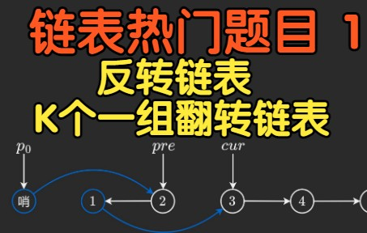

# 【视频讲解】从反转链表到 K 个一组反转（Python/Java/C++/C/Go/JS）

> **[25. K 个一组翻转链表](https://leetcode.cn/problems/reverse-nodes-in-k-group/solutions/1992228/you-xie-cuo-liao-yi-ge-shi-pin-jiang-tou-plfs/) · Hard**

> **所属题单**
> - [链表、二叉树与回溯 · 一、链表](../../../刷题路径/灵神原版题单/链表、二叉树与回溯/一、链表.md) · §1.4 反转链表
> - [LeetCode 热题 100 · 链表](../../../刷题路径/灵神原版题单/LeetCode%20热题%20100/链表.md)
> - [面试经典 150 题 · 链表](../../../刷题路径/灵神原版题单/面试经典%20150%20题/链表.md)

> **题目描述**
> 给你链表的头节点 `head` ，每 `k` 个节点一组进行翻转，请你返回修改后的链表。
>
> `k` 是一个正整数，它的值小于或等于链表的长度。如果节点总数不是 `k` 的整数倍，那么请将最后剩余的节点保持原有顺序。
>
> 你不能只是单纯的改变节点内部的值，而是需要实际进行节点交换。
>
> **示例 1：**
>
> 
>
> ```
>
> 输入：head = [1,2,3,4,5], k = 2
> 输出：[2,1,4,3,5]
> ```
>
> **示例 2：**
>
> 
>
> ```
>
> 输入：head = [1,2,3,4,5], k = 3
> 输出：[3,2,1,4,5]
> ```
>
> **提示：**
>
> - 链表中的节点数目为 `n`
>
> - `1 <= k <= n <= 5000`
>
> - `0 <= Node.val <= 1000`
>
> **进阶：**你可以设计一个只用 `O(1)` 额外内存空间的算法解决此问题吗？

> **题解**
> ## 前置题目
>
> 1. [206. 反转链表](https://leetcode.cn/problems/reverse-linked-list/)
> 2. [92. 反转链表 II](https://leetcode.cn/problems/reverse-linked-list-ii/)
>
> ## 视频讲解
>
> 请看[【基础算法精讲 06】](https://www.bilibili.com/video/BV1sd4y1x7KN/)。制作不易，欢迎点赞~
>
> 
>
> ## 写法一
>
> ```python
> class Solution:
>     def reverseKGroup(self, head: Optional[ListNode], k: int) -> Optional[ListNode]:
>         # 统计节点个数
>         n = 0
>         cur = head
>         while cur:
>             n += 1
>             cur = cur.next
>
>         # last_tail 是上一组翻转后的尾节点
>         last_tail = dummy = ListNode(next=head)
>
>         # k 个一组处理
>         while n >= k:
>             n -= k
>
>             pre = None
>             cur = last_tail.next
>             for _ in range(k):  # 同 92 题
>                 nxt = cur.next
>                 cur.next = pre  # 每次循环只修改一个 next，方便大家理解
>                 pre = cur
>                 cur = nxt
>
>             # 请结合视频中的图理解
>             # 翻转后：
>             # pre 是当前组的头节点
>             # cur 是下一组的起始节点
>             # last_tail 是上一组的尾节点
>             # last_tail.next 是当前组的尾节点
>             tail = last_tail.next
>             tail.next = cur  # 当前组的尾节点指向下一组的起始节点
>             last_tail.next = pre  # 上一组的尾节点指向当前组的头节点
>             last_tail = tail
>
>         return dummy.next
> ```
>
>
> ## 写法二
>
> 不需要先统计节点个数。对于每一组，我们可以先试探性地往前走 $k$ 步，如果发现剩余节点不足 $k$ 个，则直接返回答案。
>
> ```python
> class Solution:
>     def reverseKGroup(self, head: Optional[ListNode], k: int) -> Optional[ListNode]:
>         # last_tail 是上一组翻转后的尾节点
>         last_tail = dummy = ListNode(next=head)
>
>         # k 个一组处理
>         while True:
>             # 看看这一组是否有 k 个节点
>             cur = last_tail
>             for _ in range(k):
>                 cur = cur.next
>                 if cur is None:  # 不足 k 个节点
>                     return dummy.next
>
>             pre = None
>             cur = last_tail.next
>             for _ in range(k):  # 同 92 题
>                 nxt = cur.next
>                 cur.next = pre  # 每次循环只修改一个 next，方便大家理解
>                 pre = cur
>                 cur = nxt
>
>             # 请结合视频中的图理解
>             # 翻转后：
>             # pre 是当前组的头节点
>             # cur 是下一组的起始节点
>             # last_tail 是上一组的尾节点
>             # last_tail.next 是当前组的尾节点
>             tail = last_tail.next
>             tail.next = cur  # 当前组的尾节点指向下一组的起始节点
>             last_tail.next = pre  # 上一组的尾节点指向当前组的头节点
>             last_tail = tail
> ```
>
>
> #### 复杂度分析
>
> - 时间复杂度：$\mathcal{O}(n)$，其中 $n$ 是链表节点个数。
> - 空间复杂度：$\mathcal{O}(1)$。
>
> ## 分类题单
>
> [如何科学刷题？](https://leetcode.cn/discuss/post/3141566/ru-he-ke-xue-shua-ti-by-endlesscheng-q3yd/)
>
> 1. [滑动窗口与双指针（定长/不定长/单序列/双序列/三指针/分组循环）](https://leetcode.cn/discuss/post/3578981/ti-dan-hua-dong-chuang-kou-ding-chang-bu-rzz7/)
> 2. [二分算法（二分答案/最小化最大值/最大化最小值/第K小）](https://leetcode.cn/discuss/post/3579164/ti-dan-er-fen-suan-fa-er-fen-da-an-zui-x-3rqn/)
> 3. [单调栈（基础/矩形面积/贡献法/最小字典序）](https://leetcode.cn/discuss/post/3579480/ti-dan-dan-diao-zhan-ju-xing-xi-lie-zi-d-u4hk/)
> 4. [网格图（DFS/BFS/综合应用）](https://leetcode.cn/discuss/post/3580195/fen-xiang-gun-ti-dan-wang-ge-tu-dfsbfszo-l3pa/)
> 5. [位运算（基础/性质/拆位/试填/恒等式/思维）](https://leetcode.cn/discuss/post/3580371/fen-xiang-gun-ti-dan-wei-yun-suan-ji-chu-nth4/)
> 6. [图论算法（DFS/BFS/拓扑排序/基环树/最短路/最小生成树/网络流）](https://leetcode.cn/discuss/post/3581143/fen-xiang-gun-ti-dan-tu-lun-suan-fa-dfsb-qyux/)
> 7. [动态规划（入门/背包/划分/状态机/区间/状压/数位/数据结构优化/树形/博弈/概率期望）](https://leetcode.cn/discuss/post/3581838/fen-xiang-gun-ti-dan-dong-tai-gui-hua-ru-007o/)
> 8. [常用数据结构（前缀和/差分/栈/队列/堆/字典树/并查集/树状数组/线段树）](https://leetcode.cn/discuss/post/3583665/fen-xiang-gun-ti-dan-chang-yong-shu-ju-j-bvmv/)
> 9. [数学算法（数论/组合/概率期望/博弈/计算几何/随机算法）](https://leetcode.cn/discuss/post/3584388/fen-xiang-gun-ti-dan-shu-xue-suan-fa-shu-gcai/)
> 10. [贪心与思维（基本贪心策略/反悔/区间/字典序/数学/思维/脑筋急转弯/构造）](https://leetcode.cn/discuss/post/3091107/fen-xiang-gun-ti-dan-tan-xin-ji-ben-tan-k58yb/)
> 11. [链表、树与回溯（前后指针/快慢指针/DFS/BFS/直径/LCA）](https://leetcode.cn/discuss/post/3142882/fen-xiang-gun-ti-dan-lian-biao-er-cha-sh-6srp/)
> 12. [字符串（KMP/Z函数/Manacher/字符串哈希/AC自动机/后缀数组/子序列自动机）](https://leetcode.cn/discuss/post/3144832/fen-xiang-gun-ti-dan-zi-fu-chuan-kmpzhan-ugt4/)
>
> [我的题解精选（已分类）](https://github.com/EndlessCheng/codeforces-go/blob/master/leetcode/SOLUTIONS.md)
>
> 欢迎关注 [B站@灵茶山艾府](https://space.bilibili.com/206214)
