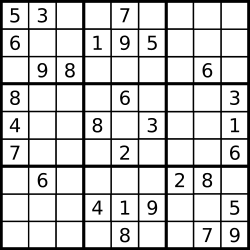

# 数独怎么玩，题目就怎么做：回溯+堆优化（Python/Java/C++/Go/JS/Rust）

> **[37. 解数独](https://leetcode.cn/problems/sudoku-solver/solutions/3767438/shu-du-zen-yao-wan-ti-mu-jiu-zen-yao-zuo-ms2q/) · Hard**

> **所属题单**
> - [链表、二叉树与回溯 · 四、回溯](../../../刷题路径/灵神原版题单/链表、二叉树与回溯/四、回溯.md) · §4.5 排列型回溯

> **题目描述**
> 编写一个程序，通过填充空格来解决数独问题。
>
> 数独的解法需 **遵循如下规则**：
>
> 1. 数字 `1-9` 在每一行只能出现一次。
>
> 2. 数字 `1-9` 在每一列只能出现一次。
>
> 3. 数字 `1-9` 在每一个以粗实线分隔的 `3x3` 宫内只能出现一次。（请参考示例图）
>
> 数独部分空格内已填入了数字，空白格用 `'.'` 表示。
>
> **示例 1：**
>
> 
>
> ```
>
> 输入：board = [["5","3",".",".","7",".",".",".","."],["6",".",".","1","9","5",".",".","."],[".","9","8",".",".",".",".","6","."],["8",".",".",".","6",".",".",".","3"],["4",".",".","8",".","3",".",".","1"],["7",".",".",".","2",".",".",".","6"],[".","6",".",".",".",".","2","8","."],[".",".",".","4","1","9",".",".","5"],[".",".",".",".","8",".",".","7","9"]]
> 输出：[["5","3","4","6","7","8","9","1","2"],["6","7","2","1","9","5","3","4","8"],["1","9","8","3","4","2","5","6","7"],["8","5","9","7","6","1","4","2","3"],["4","2","6","8","5","3","7","9","1"],["7","1","3","9","2","4","8","5","6"],["9","6","1","5","3","7","2","8","4"],["2","8","7","4","1","9","6","3","5"],["3","4","5","2","8","6","1","7","9"]]
> 解释：输入的数独如上图所示，唯一有效的解决方案如下所示：
>
> 
> ```
>
> **提示：**
>
> - `board.length == 9`
>
> - `board[i].length == 9`
>
> - `board[i][j]` 是一位数字或者 `'.'`
>
> - 题目数据 **保证** 输入数独仅有一个解

> **题解**
> ## 前置题目
>
> 1. [36. 有效的数独](https://leetcode.cn/problems/valid-sudoku/)。学会如何把当前位置转化成「宫」的位置。
> 2. [46. 全排列](https://leetcode.cn/problems/permutations/)。视频讲解：[排列型回溯【基础算法精讲 16】](https://www.bilibili.com/video/BV1mY411D7f6/)。
>
> ## 核心思路
>
> 游玩数独的技巧之一是，**优先填待定数字最少的空格子**。
>
> 
>
> 示例 1 如上图。看正中间的空格子 $\textit{board}[4][4]$：
>
> - 横着看，这一行有 $1,3,4,8$。
> - 竖着看，这一列有 $1,2,6,7,8,9$。
> - 正中间的宫有 $2,3,6,8$。
> - 所以我们能填的数字只有 $5$。
>
> 填完 $\textit{board}[4][4]=5$ 后，继续找下一个待定数字最少的空格子。重复上述过程，直到所有格子都填完。
>
> 如果一个格子有多个数字可以填，那么就像 [46. 全排列](https://leetcode.cn/problems/permutations/) 那样，**枚举填入的数字**。
>
> > 注：题目保证输入的数独**有唯一解**。
>
> ## 实现细节
>
> 类似 [36. 有效的数独](https://leetcode.cn/problems/valid-sudoku/)，用三组哈希表（布尔数组）维护：
>
> 1. $\textit{rowSet}[i]$ 维护第 $i$ 行填入的数字。
> 2. $\textit{colSet}[j]$ 维护第 $j$ 列填入的数字。
> 3. $\textit{subBoxSet}[i'][j']$ 维护 $(i',j')$ 宫填入的数字。其中 $\textit{board}[i][j]$ 在 $\left(\left\lfloor\dfrac{i}{3}\right\rfloor, \left\lfloor\dfrac{j}{3}\right\rfloor \right)$ 这个宫。
>
> 为了快速找到待定数字最少的空格子，用一个**最小堆**维护三元组 $(\textit{candidates},i,j)$，其中 $\textit{candidates}$ 等于 $(i,j)$ 这个空格子可以填入的数字个数。那么堆顶就是 $\textit{candidates}$ 最少的空格子。
>
> 然而，当我们把数字填入一个空格子时，同一行、同一列、同一宫的其余空格子的 $\textit{candidates}$ 都会减少 $1$。难道要动态修改堆中元素？
>
> 我们采取一个简单的折中方案：在枚举填入数字的循环中，**重新统计**当前格子 $(i,j)$ 的实际待定数字个数 $\textit{candidates}'$。在恢复现场的时候，把三元组 $(\textit{candidates}',i,j)$ 入堆。
>
> ```python
> class Solution:
>     def solveSudoku(self, board: List[List[str]]) -> None:
>         row_set = [set() for _ in range(9)]  # 每行填入的数字
>         col_set = [set() for _ in range(9)]  # 每列填入的数字
>         sub_box_set = [[set() for _ in range(3)] for _ in range(3)]  # 每宫填入的数字
>         empty_pos = []  # 空格子的位置
>
>         for i, row in enumerate(board):
>             for j, b in enumerate(row):
>                 if b == '.':
>                     empty_pos.append((i, j))  # 记录空格子的位置
>                 else:
>                     x = int(b)
>                     # 标记行、列、宫包含数字 x
>                     row_set[i].add(x)
>                     col_set[j].add(x)
>                     sub_box_set[i // 3][j // 3].add(x)
>
>         # get_candidates(i, j) 计算 (i, j) 这个空格子的待定数字个数，最小的在堆顶
>         get_candidates = lambda i, j: 9 - len(row_set[i] | col_set[j] | sub_box_set[i // 3][j // 3])
>         empty_heap = [(get_candidates(i, j), i, j) for i, j in empty_pos]
>         heapify(empty_heap)
>
>         # 每次递归，选一个空格子，枚举填入的数字
>         def dfs() -> bool:
>             if not empty_heap:  # 所有格子都已填入数字
>                 return True  # 完成数独
>
>             # 数独玩法：优先考虑待定数字个数最少的空格子
>             _, i, j = heappop(empty_heap)
>
>             candidates = 0  # 受之前填入的数字影响，实际待定数字个数可能比入堆时的少，需要重新计算
>             # 枚举 1~9 中没填过的数字 x，填入 board[i][j]
>             for x in range(1, 10):
>                 if x in row_set[i] or x in col_set[j] or x in sub_box_set[i // 3][j // 3]:
>                     continue  # x 填过了
>
>                 # 把数字 x 转成字符，填入 board[i][j]
>                 board[i][j] = digits[x]
>                 # 标记行、列、宫包含数字 x
>                 row_set[i].add(x)
>                 col_set[j].add(x)
>                 sub_box_set[i // 3][j // 3].add(x)
>
>                 # 填下一个空格子
>                 if dfs():
>                     return True  # 完成数独
>
>                 # 恢复现场（撤销）
>                 # 注意 board[i][j] 无需恢复现场，因为我们会直接覆盖掉之前填入的数字
>                 row_set[i].remove(x)
>                 col_set[j].remove(x)
>                 sub_box_set[i // 3][j // 3].remove(x)
>
>                 # 统计待定数字个数
>                 candidates += 1
>
>             # 恢复现场（撤销）
>             heappush(empty_heap, (candidates, i, j))  # 重新入堆（更新待定数字个数）
>             # 所有填法都不行，说明之前（祖先节点）的填法是错的
>             return False
>
>         dfs()
> ```
>
>
> #### 复杂度分析
>
> - 时间复杂度：$\mathcal{O}(9^m\log m)$，其中 $m\le 81$ 是空格的个数。搜索树的高度为 $m$，每个节点至多有 $9$ 个儿子，所以搜索树有 $\mathcal{O}(9^m)$ 个节点。每个节点需要 $\mathcal{O}(\log m)$ 的实际操作堆。注意这只是一个上界，实际复杂度远小于上界。
> - 空间复杂度：$\mathcal{O}(m)$。
>
> 注：还有一些更高级的算法，如 [Dancing Links](https://oi-wiki.org/search/dlx/)。
>
> ## 专题训练
>
> 见下面回溯题单的「**§4.5 排列型回溯**」。
>
> ## 分类题单
>
> [如何科学刷题？](https://leetcode.cn/circle/discuss/RvFUtj/)
>
> 1. [滑动窗口与双指针（定长/不定长/单序列/双序列/三指针/分组循环）](https://leetcode.cn/circle/discuss/0viNMK/)
> 2. [二分算法（二分答案/最小化最大值/最大化最小值/第K小）](https://leetcode.cn/circle/discuss/SqopEo/)
> 3. [单调栈（基础/矩形面积/贡献法/最小字典序）](https://leetcode.cn/circle/discuss/9oZFK9/)
> 4. [网格图（DFS/BFS/综合应用）](https://leetcode.cn/circle/discuss/YiXPXW/)
> 5. [位运算（基础/性质/拆位/试填/恒等式/思维）](https://leetcode.cn/circle/discuss/dHn9Vk/)
> 6. [图论算法（DFS/BFS/拓扑排序/基环树/最短路/最小生成树/网络流）](https://leetcode.cn/circle/discuss/01LUak/)
> 7. [动态规划（入门/背包/划分/状态机/区间/状压/数位/数据结构优化/树形/博弈/概率期望）](https://leetcode.cn/circle/discuss/tXLS3i/)
> 8. [常用数据结构（前缀和/差分/栈/队列/堆/字典树/并查集/树状数组/线段树）](https://leetcode.cn/circle/discuss/mOr1u6/)
> 9. [数学算法（数论/组合/概率期望/博弈/计算几何/随机算法）](https://leetcode.cn/circle/discuss/IYT3ss/)
> 10. [贪心与思维（基本贪心策略/反悔/区间/字典序/数学/思维/脑筋急转弯/构造）](https://leetcode.cn/circle/discuss/g6KTKL/)
> 11. [链表、二叉树与回溯（前后指针/快慢指针/DFS/BFS/直径/LCA/一般树）](https://leetcode.cn/circle/discuss/K0n2gO/)
> 12. [字符串（KMP/Z函数/Manacher/字符串哈希/AC自动机/后缀数组/子序列自动机）](https://leetcode.cn/circle/discuss/SJFwQI/)
>
> [我的题解精选（已分类）](https://github.com/EndlessCheng/codeforces-go/blob/master/leetcode/SOLUTIONS.md)
>
> 欢迎关注 [B站@灵茶山艾府](https://space.bilibili.com/206214)
