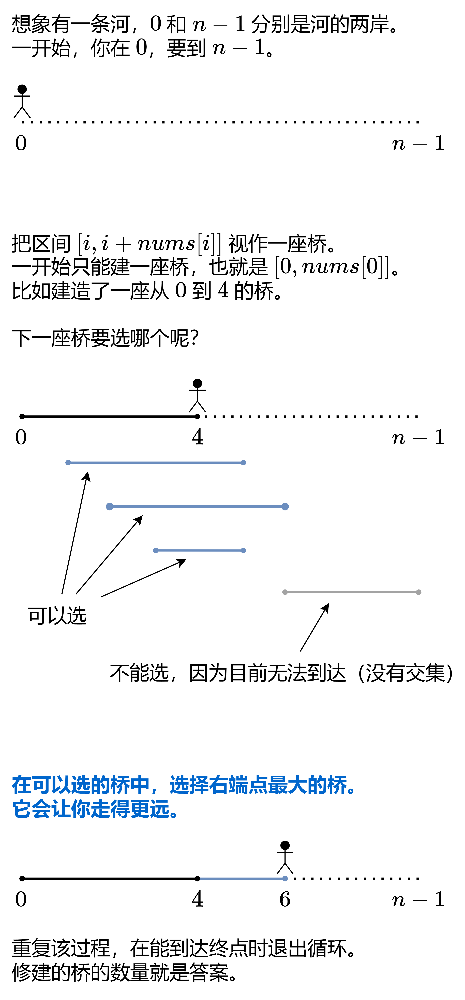

# 【图解】一张图秒懂跳跃游戏！（Python/Java/C++/C/Go/JS/Rust）

> **[45. 跳跃游戏 II](https://leetcode.cn/problems/jump-game-ii/solutions/2926993/tu-jie-yi-zhang-tu-miao-dong-tiao-yue-yo-h2d4/) · Medium · 难度分 1700**

> **所属题单**
> - [贪心算法 · 二、区间贪心](../../../刷题路径/灵神原版题单/贪心算法/二、区间贪心.md) · §2.4 区间覆盖
> - [LeetCode 热题 100 · 贪心算法](../../../刷题路径/灵神原版题单/LeetCode%20热题%20100/贪心算法.md)
> - [面试经典 150 题 · 数组 / 字符串](../../../刷题路径/灵神原版题单/面试经典%20150%20题/数组%20-%20字符串.md)

> **题目描述**
> 给定一个长度为 `n` 的 **0 索引**整数数组 `nums`。初始位置在下标 0。
>
> 每个元素 `nums[i]` 表示从索引 `i` 向后跳转的最大长度。换句话说，如果你在索引 `i` 处，你可以跳转到任意 `(i + j)` 处：
>
> - `0 <= j <= nums[i]` 且
>
> - `i + j < n`
>
> 返回到达 `n - 1` 的最小跳跃次数。测试用例保证可以到达 `n - 1`。
>
> **示例 1:**
>
> ```
>
> 输入: nums = [2,3,1,1,4]
> 输出: 2
> 解释: 跳到最后一个位置的最小跳跃数是 2。
>      从下标为 0 跳到下标为 1 的位置，跳 1 步，然后跳 3 步到达数组的最后一个位置。
> ```
>
> **示例 2:**
>
> ```
>
> 输入: nums = [2,3,0,1,4]
> 输出: 2
> ```
>
> **提示:**
>
> - `1 <= nums.length <= 10⁴`
>
> - `0 <= nums[i] <= 1000`
>
> - 题目保证可以到达 `n - 1`

> **题解**
> {:width=550}
>
> ⚠**注意**：不是在无路可走的那个位置造桥，而是当发现无路可走的时候，回到能跳到最远点的那个位置造桥。**在无路可走之前，我们只是在默默地收集信息**。当发现无路可走的时候，才从收集到的信息中，选择最远点造桥。所建造的这座桥的左端点（实际起跳位置）可能在我们当前走的这座桥的中间。
>
> ## 答疑
>
> **问**：为什么这个贪心策略是对的？
>
> **答**：其实这个做法是对暴力的优化。题目让我们计算到达 $n-1$ 的最小跳跃次数，暴力的做法是，用暴力搜索（或者 BFS）算出跳一次最远可以到哪，跳两次最远可以到哪，跳三次最远可以到哪……跳到 $n-1$ 的最小跳跃次数就是答案。设跳 $k$ 次最远可以到达 $\textit{curEnd}$，那么下标在 $[0,\textit{curEnd}]$ 中的最大的 $i+\textit{nums}[i]$，就是跳 $k+1$ 次最远可以到达的位置 $\textit{nextEnd}$。当我们遍历到 $i=\textit{curEnd}$ 时，通过计算遍历过的 $i+\textit{nums}[i]$ 的最大值，可以算出再跳一步最远能到哪里。这本质是一个递推式（$k\to k+1$），根据这个递推式，就能从跳 $k=0$ 步开始（此时最远到达 $0$），依次递推算出跳 $k=1,2,3,\ldots$ 步后的最远位置。
>
> **问**：为什么代码只遍历到 $n-2$？
>
> **答**：这题 $n-1$ 是终点，$\textit{nums}[n-1]$ 这个数没有任何意义，完全可以把这个数删了，在长为 $n-1$ 的数组上跑这个算法。或者说，遍历到 $\textit{nums}[n-2]$ 时，要么已经可以到达终点，要么需要造最后一座桥。$n-1$ 已经是终点了，不需要造桥。
>
> **问**：如果题目没有保证一定能到达 $n-1$，代码要怎么改？
>
> **答**：见 [1326. 灌溉花园的最少水龙头数目](https://leetcode.cn/problems/minimum-number-of-taps-to-open-to-water-a-garden/)，[我的题解](../../1300-1399/1326%20灌溉花园的最少水龙头数目/灵茶山艾府.md)。
>
> ```python
> class Solution:
>     def jump(self, nums: List[int]) -> int:
>         ans = 0
>         cur_end = 0  # 已建造的桥的右端点
>         next_end = 0  # 下一座桥的右端点的最大值
>         for i in range(len(nums) - 1):
>             # 遍历的过程中，记录下一座桥的最远点
>             next_end = max(next_end, i + nums[i])
>             if i == cur_end:  # 无路可走，必须建桥
>                 cur_end = next_end  # 建桥后，最远可以到达 next_end
>                 ans += 1
>         return ans
> ```
>
>
> #### 复杂度分析
>
> - 时间复杂度：$\mathcal{O}(n)$。其中 $n$ 是 $\textit{nums}$ 的长度。
> - 空间复杂度：$\mathcal{O}(1)$。
>
> ## 思考题
>
> 如果要输出具体的跳跃方案（每一步跳到哪个位置），怎么做？
>
> 欢迎在评论区分享你的思路/代码。
>
> 更多相似题目，见下面贪心题单中的「**区间贪心**」。
>
> ## 分类题单
>
> [如何科学刷题？](https://leetcode.cn/discuss/post/3141566/ru-he-ke-xue-shua-ti-by-endlesscheng-q3yd/)
>
> 1. [滑动窗口与双指针（定长/不定长/单序列/双序列/三指针/分组循环）](https://leetcode.cn/discuss/post/3578981/ti-dan-hua-dong-chuang-kou-ding-chang-bu-rzz7/)
> 2. [二分算法（二分答案/最小化最大值/最大化最小值/第K小）](https://leetcode.cn/discuss/post/3579164/ti-dan-er-fen-suan-fa-er-fen-da-an-zui-x-3rqn/)
> 3. [单调栈（基础/矩形面积/贡献法/最小字典序）](https://leetcode.cn/discuss/post/3579480/ti-dan-dan-diao-zhan-ju-xing-xi-lie-zi-d-u4hk/)
> 4. [网格图（DFS/BFS/综合应用）](https://leetcode.cn/discuss/post/3580195/fen-xiang-gun-ti-dan-wang-ge-tu-dfsbfszo-l3pa/)
> 5. [位运算（基础/性质/拆位/试填/恒等式/思维）](https://leetcode.cn/discuss/post/3580371/fen-xiang-gun-ti-dan-wei-yun-suan-ji-chu-nth4/)
> 6. [图论算法（DFS/BFS/拓扑排序/基环树/最短路/最小生成树/网络流）](https://leetcode.cn/discuss/post/3581143/fen-xiang-gun-ti-dan-tu-lun-suan-fa-dfsb-qyux/)
> 7. [动态规划（入门/背包/划分/状态机/区间/状压/数位/数据结构优化/树形/博弈/概率期望）](https://leetcode.cn/discuss/post/3581838/fen-xiang-gun-ti-dan-dong-tai-gui-hua-ru-007o/)
> 8. [常用数据结构（前缀和/差分/栈/队列/堆/字典树/并查集/树状数组/线段树）](https://leetcode.cn/discuss/post/3583665/fen-xiang-gun-ti-dan-chang-yong-shu-ju-j-bvmv/)
> 9. [数学算法（数论/组合/概率期望/博弈/计算几何/随机算法）](https://leetcode.cn/discuss/post/3584388/fen-xiang-gun-ti-dan-shu-xue-suan-fa-shu-gcai/)
> 10. [贪心与思维（基本贪心策略/反悔/区间/字典序/数学/思维/脑筋急转弯/构造）](https://leetcode.cn/discuss/post/3091107/fen-xiang-gun-ti-dan-tan-xin-ji-ben-tan-k58yb/)
> 11. [链表、树与回溯（前后指针/快慢指针/DFS/BFS/直径/LCA）](https://leetcode.cn/discuss/post/3142882/fen-xiang-gun-ti-dan-lian-biao-er-cha-sh-6srp/)
> 12. [字符串（KMP/Z函数/Manacher/字符串哈希/AC自动机/后缀数组/子序列自动机）](https://leetcode.cn/discuss/post/3144832/fen-xiang-gun-ti-dan-zi-fu-chuan-kmpzhan-ugt4/)
>
> [我的题解精选（已分类）](https://github.com/EndlessCheng/codeforces-go/blob/master/leetcode/SOLUTIONS.md)
>
> 欢迎关注 [B站@灵茶山艾府](https://space.bilibili.com/206214)
