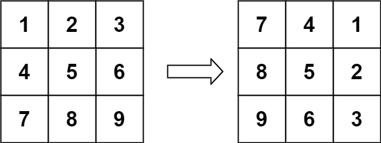

# 数学本质：两次翻转等于一次旋转（Python/Java/C++/C/Go/JS/Rust）

> **[48. 旋转图像](https://leetcode.cn/problems/rotate-image/solutions/3655166/shu-xue-ben-zhi-liang-ci-fan-zhuan-deng-aon4a/) · Medium**

> **所属题单**
> - [LeetCode 热题 100 · 矩阵](../../../刷题路径/灵神原版题单/LeetCode%20热题%20100/矩阵.md)
> - [面试经典 150 题 · 矩阵](../../../刷题路径/灵神原版题单/面试经典%20150%20题/矩阵.md)

> **题目描述**
> 给定一个 <em>n</em> × <em>n</em> 的二维矩阵 `matrix` 表示一个图像。请你将图像顺时针旋转 90 度。
>
> 你必须在**[ 原地](https://baike.baidu.com/item/%E5%8E%9F%E5%9C%B0%E7%AE%97%E6%B3%95)** 旋转图像，这意味着你需要直接修改输入的二维矩阵。**请不要** 使用另一个矩阵来旋转图像。
>
> **示例 1：**
>
> 
>
> ```
>
> 输入：matrix = [[1,2,3],[4,5,6],[7,8,9]]
> 输出：[[7,4,1],[8,5,2],[9,6,3]]
> ```
>
> **示例 2：**
>
> 
>
> ```
>
> 输入：matrix = [[5,1,9,11],[2,4,8,10],[13,3,6,7],[15,14,12,16]]
> 输出：[[15,13,2,5],[14,3,4,1],[12,6,8,9],[16,7,10,11]]
> ```
>
> **提示：**
>
> - `n == matrix.length == matrix[i].length`
>
> - `1 <= n <= 20`
>
> - `-1000 <= matrix[i][j] <= 1000`

> **题解**
> ## 题意
>
> 把一个方阵（$n\times n$ 的矩阵）顺时针旋转 $90^\circ$。
>
> 要求：不能创建另一个矩阵，空间复杂度必须是 $\mathcal{O}(1)$。
>
> ## 分析
>
> 
>
> 顺时针旋转 $90^\circ$ 后，位于 $(i,j)$ 的元素去哪了？
>
> 竖着看：
>
> - 第一列的元素去到第一行。
> - 第二列的元素去到第二行。
> - ……
> - 第 $j$ 列的元素去到第 $j$ 行。
>
> 横着看：
>
> - 第一行的元素去到最后一列。
> - 第二行的元素去到倒数第二列。
> - ……
> - 第 $i$ 行的元素去到第 $n-1-i$ 列。（$i$ 从 $0$ 开始）
>
> 所以位于 $i$ 行 $j$ 列的元素，去到 $j$ 行 $n-1-i$ 列，即 $(i,j)\to (j,n-1-i)$。
>
> ## 两次翻转等于一次旋转
>
> $(i,j)\to (j,n-1-i)$ 可以通过两次翻转操作得到：
>
> $$
> (i,j)\xrightarrow{转置} (j,i) \xrightarrow{行翻转} (j,n-1-i)
> $$
>
> 1. **转置**：把矩阵按照主对角线翻转，位于 $(i,j)$ 的元素去到 $(j,i)$。
> 2. **行翻转**：把每一行翻转，位于 $(j,i)$ 的元素去到 $(j,n-1-i)$。
>
> 示例 1 的操作过程如下：
>
> $$
> \begin{bmatrix}
> 1 & 2 & 3 \\
> 4 & 5 & 6 \\
> 7 & 8 & 9 \\
> \end{bmatrix}
> \xrightarrow{转置}
> \begin{bmatrix}
> 1 & 4 & 7 \\
> 2 & 5 & 8 \\
> 3 & 6 & 9 \\
> \end{bmatrix}
> \xrightarrow{行翻转}
> \begin{bmatrix}
> 7 & 4 & 1 \\
> 8 & 5 & 2 \\
> 9 & 6 & 3 \\
> \end{bmatrix}
> $$
>
> > **注**：一般地，把一个点绕 $O$ 旋转任意 $\theta$ 角度，可以通过两个翻转操作实现。要求这两条翻转的对称轴，交点为 $O$ 且夹角为 $\dfrac{\theta}{2}$。对于本题，每个元素需要绕矩阵中心顺时针旋转 $90^\circ$，这可以通过关于主对角线翻转，关于垂直中轴翻转实现。这两条对称轴的交点为矩阵中心，且夹角为 $45^\circ$。
>
> ## 实现
>
> 1. **转置**：把主对角线下面的元素 $\textit{matrix}[i][j]$ 和（关于主对角线）对称位置的元素 $\textit{matrix}[j][i]$ 交换。
> 2. **行翻转**：遍历每一行 $\textit{row}=\textit{matrix}[i]$，把左半边的元素 $\textit{row}[j]$ 和（关于垂直中轴）对称位置的元素 $\textit{row}[n-1-j]$ 交换。或者，使用库函数翻转 $\textit{row}$。
>
> 这两步操作都可以原地实现。
>
> ## 写法一
>
> ```python
> class Solution:
>     def rotate(self, matrix: List[List[int]]) -> None:
>         n = len(matrix)
>         # 第一步：转置
>         for i in range(n):
>             for j in range(i):  # 遍历对角线下方元素
>                 matrix[i][j], matrix[j][i] = matrix[j][i], matrix[i][j]
>
>         # 第二步：行翻转
>         for row in matrix:
>             row.reverse()
> ```
>
>
> ## 写法二
>
> 把两个循环合并成一个循环。
>
> 需要把遍历顺序调整为遍历对角线上方元素，这样每行遍历完后，这一行的元素后面不会再访问到，可以直接做行翻转。
>
> ```python
> class Solution:
>     def rotate(self, matrix: List[List[int]]) -> None:
>         n = len(matrix)
>         for i, row in enumerate(matrix):
>             for j in range(i + 1, n):  # 遍历对角线上方元素，做转置
>                 row[j], matrix[j][i] = matrix[j][i], row[j]
>             row.reverse()  # 行翻转
> ```
>
>
> #### 复杂度分析
>
> - 时间复杂度：$\mathcal{O}(n^2)$，其中 $n$ 是 $\textit{matrix}$ 的行数和列数。
> - 空间复杂度：$\mathcal{O}(1)$。
>
> ## 思考题
>
> 1. 改成顺时针旋转 $180^\circ$，要怎么做？
> 2. 改成顺时针旋转 $270^\circ$（逆时针旋转 $90^\circ$），要怎么做？
>
> 欢迎在评论区分享你的思路/代码。
>
> ## 相似题目
>
> [189. 轮转数组](https://leetcode.cn/problems/rotate-array/)
>
> ## 分类题单
>
> [如何科学刷题？](https://leetcode.cn/circle/discuss/RvFUtj/)
>
> 1. [滑动窗口与双指针（定长/不定长/单序列/双序列/三指针/分组循环）](https://leetcode.cn/circle/discuss/0viNMK/)
> 2. [二分算法（二分答案/最小化最大值/最大化最小值/第K小）](https://leetcode.cn/circle/discuss/SqopEo/)
> 3. [单调栈（基础/矩形面积/贡献法/最小字典序）](https://leetcode.cn/circle/discuss/9oZFK9/)
> 4. [网格图（DFS/BFS/综合应用）](https://leetcode.cn/circle/discuss/YiXPXW/)
> 5. [位运算（基础/性质/拆位/试填/恒等式/思维）](https://leetcode.cn/circle/discuss/dHn9Vk/)
> 6. [图论算法（DFS/BFS/拓扑排序/基环树/最短路/最小生成树/网络流）](https://leetcode.cn/circle/discuss/01LUak/)
> 7. [动态规划（入门/背包/划分/状态机/区间/状压/数位/数据结构优化/树形/博弈/概率期望）](https://leetcode.cn/circle/discuss/tXLS3i/)
> 8. [常用数据结构（前缀和/差分/栈/队列/堆/字典树/并查集/树状数组/线段树）](https://leetcode.cn/circle/discuss/mOr1u6/)
> 9. [数学算法（数论/组合/概率期望/博弈/计算几何/随机算法）](https://leetcode.cn/circle/discuss/IYT3ss/)
> 10. [贪心与思维（基本贪心策略/反悔/区间/字典序/数学/思维/脑筋急转弯/构造）](https://leetcode.cn/circle/discuss/g6KTKL/)
> 11. [链表、树与回溯（前后指针/快慢指针/DFS/BFS/直径/LCA）](https://leetcode.cn/circle/discuss/K0n2gO/)
> 12. [字符串（KMP/Z函数/Manacher/字符串哈希/AC自动机/后缀数组/子序列自动机）](https://leetcode.cn/circle/discuss/SJFwQI/)
>
> [我的题解精选（已分类）](https://github.com/EndlessCheng/codeforces-go/blob/master/leetcode/SOLUTIONS.md)
>
> 欢迎关注 [B站@灵茶山艾府](https://space.bilibili.com/206214)
