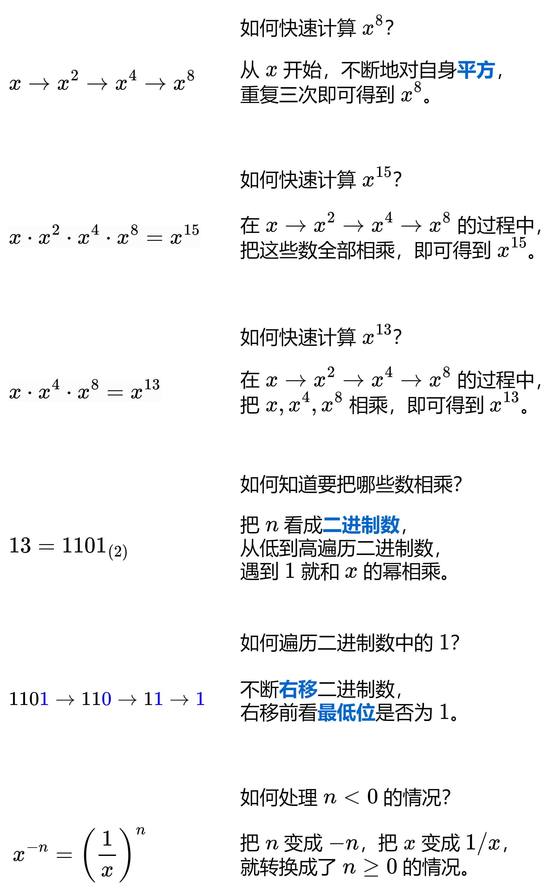

# 【图解】一张图秒懂快速幂！（Python/Java/C++/C/Go/JS/Rust）

> **[50. Pow(x, n)](https://leetcode.cn/problems/powx-n/solutions/2858114/tu-jie-yi-zhang-tu-miao-dong-kuai-su-mi-ykp3i/) · Medium**

> **所属题单**
> - [面试经典 150 题 · 数学](../../../刷题路径/灵神原版题单/面试经典%20150%20题/数学.md)

> **题目描述**
> 实现 [pow(<em>x</em>, <em>n</em>)](https://www.cplusplus.com/reference/valarray/pow/) ，即计算 `x` 的整数 `n` 次幂函数（即，`x^n`<sup> </sup>）。
>
> **示例 1：**
>
> ```
>
> 输入：x = 2.00000, n = 10
> 输出：1024.00000
> ```
>
> **示例 2：**
>
> ```
>
> 输入：x = 2.10000, n = 3
> 输出：9.26100
> ```
>
> **示例 3：**
>
> ```
>
> 输入：x = 2.00000, n = -2
> 输出：0.25000
> 解释：2⁻² = 1/2² = 1/4 = 0.25
> ```
>
> **提示：**
>
> - `-100.0 < x < 100.0`
>
> - `-2³¹ <= n <= 2³¹-1`
>
> - `n` 是一个整数
>
> - 要么 `x` 不为零，要么 `n > 0` 。
>
> - `-10⁴ <= x^n <= 10⁴`

> **题解**
> ## 方法一：迭代
>
> 
>
> ⚠部分语言需要注意，当 $n=-2^{31}$ 时，$-n=2^{31}$ 比 $32$ 位整数的最大值还大，溢出了。可以转成 $64$ 位整数解决。
>
> ```python
> class Solution:
>     def myPow(self, x: float, n: int) -> float:
>         ans = 1
>         if n < 0:  # x^-n = (1/x)^n
>             n = -n
>             x = 1 / x
>         while n:  # 从低到高枚举 n 的每个比特位
>             if n & 1:  # 这个比特位是 1
>                 ans *= x  # 把 x 乘到 ans 中
>             x *= x  # x 自身平方
>             n >>= 1  # 继续枚举下一个比特位
>         return ans
> ```
>
>
> #### 复杂度分析
>
> - 时间复杂度：$\mathcal{O}(\log |n|)$。
> - 空间复杂度：$\mathcal{O}(1)$。
>
> ## 方法二：递归
>
> 当 $n<0$ 时，$x^n = (x^{-1})^{-n} = \left(\dfrac{1}{x}\right)^{-n}$。
>
> 当 $n\ge 0$ 时，我们有
>
> $$
> x^n =
> \begin{cases}
> (x^{n/2})^2, & n\bmod 2 = 0     \\
> (x^{\lfloor n/2\rfloor})^2\cdot x, & n\bmod 2 = 1     \\
> \end{cases}
> $$
>
> 根据上式递归计算 $x^n$。
>
> 递归边界：$x^0 = 1$。
>
> ```python
> class Solution:
>     def myPow(self, x: float, n: int) -> float:
>         if n < 0:
>             return self.myPow(1 / x, -n)
>         if n == 0:
>             return 1.0
>         return self.myPow(x, n // 2) ** 2 * (x if n % 2 else 1.0)
> ```
>
>
> #### 复杂度分析
>
> - 时间复杂度：$\mathcal{O}(\log |n|)$。
> - 空间复杂度：$\mathcal{O}(\log |n|)$。递归需要 $\mathcal{O}(\log |n|)$ 的栈开销。
>
> ## 分类题单
>
> [如何科学刷题？](https://leetcode.cn/circle/discuss/RvFUtj/)
>
> 1. [滑动窗口与双指针（定长/不定长/单序列/双序列/三指针/分组循环）](https://leetcode.cn/circle/discuss/0viNMK/)
> 2. [二分算法（二分答案/最小化最大值/最大化最小值/第K小）](https://leetcode.cn/circle/discuss/SqopEo/)
> 3. [单调栈（基础/矩形面积/贡献法/最小字典序）](https://leetcode.cn/circle/discuss/9oZFK9/)
> 4. [网格图（DFS/BFS/综合应用）](https://leetcode.cn/circle/discuss/YiXPXW/)
> 5. [位运算（基础/性质/拆位/试填/恒等式/思维）](https://leetcode.cn/circle/discuss/dHn9Vk/)
> 6. [图论算法（DFS/BFS/拓扑排序/基环树/最短路/最小生成树/网络流）](https://leetcode.cn/circle/discuss/01LUak/)
> 7. [动态规划（入门/背包/划分/状态机/区间/状压/数位/数据结构优化/树形/博弈/概率期望）](https://leetcode.cn/circle/discuss/tXLS3i/)
> 8. [常用数据结构（前缀和/差分/栈/队列/堆/字典树/并查集/树状数组/线段树）](https://leetcode.cn/circle/discuss/mOr1u6/)
> 9. [数学算法（数论/组合/概率期望/博弈/计算几何/随机算法）](https://leetcode.cn/circle/discuss/IYT3ss/)
> 10. [贪心与思维（基本贪心策略/反悔/区间/字典序/数学/思维/脑筋急转弯/构造）](https://leetcode.cn/circle/discuss/g6KTKL/)
> 11. [链表、二叉树与回溯（前后指针/快慢指针/DFS/BFS/直径/LCA/一般树）](https://leetcode.cn/circle/discuss/K0n2gO/)
> 12. [字符串（KMP/Z函数/Manacher/字符串哈希/AC自动机/后缀数组/子序列自动机）](https://leetcode.cn/circle/discuss/SJFwQI/)
>
> [我的题解精选（已分类）](https://github.com/EndlessCheng/codeforces-go/blob/master/leetcode/SOLUTIONS.md)
>
> 欢迎关注 [B站@灵茶山艾府](https://space.bilibili.com/206214)
