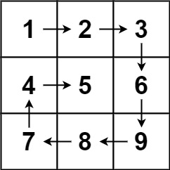
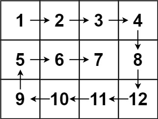

# 两种方法，简洁高效（Python/Java/C++/C/Go/JS/Rust）

> **[54. 螺旋矩阵](https://leetcode.cn/problems/spiral-matrix/solutions/2966229/liang-chong-fang-fa-jian-ji-gao-xiao-pyt-4wzk/) · Medium**

> **所属题单**
> - [LeetCode 热题 100 · 矩阵](../../../刷题路径/灵神原版题单/LeetCode%20热题%20100/矩阵.md)
> - [面试经典 150 题 · 矩阵](../../../刷题路径/灵神原版题单/面试经典%20150%20题/矩阵.md)

> **题目描述**
> 给你一个 `m` 行 `n` 列的矩阵 `matrix` ，请按照 **顺时针螺旋顺序** ，返回矩阵中的所有元素。
>
> **示例 1：**
>
> 
>
> ```
>
> 输入：matrix = [[1,2,3],[4,5,6],[7,8,9]]
> 输出：[1,2,3,6,9,8,7,4,5]
> ```
>
> **示例 2：**
>
> 
>
> ```
>
> 输入：matrix = [[1,2,3,4],[5,6,7,8],[9,10,11,12]]
> 输出：[1,2,3,4,8,12,11,10,9,5,6,7]
> ```
>
> **提示：**
>
> - `m == matrix.length`
>
> - `n == matrix[i].length`
>
> - `1 <= m, n <= 10`
>
> - `-100 <= matrix[i][j] <= 100`

> **题解**
> ## 总体思路
>
> 
>
> 根据题意，我们从左上角 $(0,0)$ 出发，按照「右下左上」的顺序前进：
>
> - 首先向右走，如果到达矩阵边界，则向右转 $90^\circ$，前进方向变为向下。
> - 然后向下走，如果到达矩阵边界，则向右转 $90^\circ$，前进方向变为向左。
> - 然后向左走，如果到达矩阵边界，则向右转 $90^\circ$，前进方向变为向上。
> - 然后向上走，先从 $7$ 走到 $4$，然后从 $4$ 准备向上走，但上面的 $1$ 是一个已经访问过的数字，那么向右转 $90^\circ$，前进方向变为向右。
> - 重复上述过程，直到答案的长度为 $mn$。
>
> ## 方法一：标记
>
> 1. 对于已经访问过的数字，可将其标记为 $\infty$ 或者空，从而避免重复访问。
> 2. 用一个长为 $4$ 的方向数组 $\textit{DIRS} = [(0, 1), (1, 0), (0, -1), (-1, 0)]$ 分别表示右下左上 $4$ 个方向。同时用一个下标 $\textit{di}$ 表示当前方向，初始值为 $0$，表示一开始向右。
> 3. 每次移动，相当于把行号增加 $\textit{DIRS}[\textit{di}][0]$，把列号增加 $\textit{DIRS}[\textit{di}][1]$。
> 4. 向右转 $90^\circ$，相当于把 $\textit{di}$ 增加 $1$，但在 $\textit{di}=3$ 时要回到 $\textit{di}=0$。两种情况合二为一，把 $\textit{di}$ 更新为 $(\textit{di}+1)\bmod 4$。
>
> ```python
> DIRS = (0, 1), (1, 0), (0, -1), (-1, 0)  # 右下左上
>
> class Solution:
>     def spiralOrder(self, matrix: List[List[int]]) -> List[int]:
>         m, n = len(matrix), len(matrix[0])
>         ans = []
>         i = j = di = 0
>         for _ in range(m * n):  # 一共走 mn 步
>             ans.append(matrix[i][j])
>             matrix[i][j] = None  # 标记，表示已经访问过（已经加入答案）
>             x, y = i + DIRS[di][0], j + DIRS[di][1]  # 下一步的位置
>             # 如果 (x, y) 出界或者已经访问过
>             if x < 0 or x >= m or y < 0 or y >= n or matrix[x][y] is None:
>                 di = (di + 1) % 4  # 右转 90°
>             i += DIRS[di][0]
>             j += DIRS[di][1]  # 走一步
>         return ans
> ```
>
>
> #### 复杂度分析
>
> - 时间复杂度：$\mathcal{O}(mn)$，其中 $m$ 和 $n$ 分别为 $\textit{matrix}$ 的行数和列数。
> - 空间复杂度：$\mathcal{O}(1)$。返回值不计入。
>
> ## 方法二：不标记
>
> 上面的做法需要修改 $\textit{matrix}$，能否不修改呢？
>
> 
>
> 示例 2 这 $12$ 个数字，可以分为以下 $5$ 组：
>
> - $1\rightarrow 2\rightarrow 3\rightarrow 4$
> - $8\rightarrow 12$
> - $11\rightarrow 10\rightarrow 9$
> - $5$
> - $6\rightarrow 7$
>
> 其中第 $1,3,5$ 组都是向右或者向左走的，长度依次为 $4,3,2$，这是一个从 $n=4$ 开始的逐渐递减的序列。
>
> 其中第 $2,4$ 组都是向下或者向上走的，长度依次为 $2,1$，这是一个从 $m-1=2$ 开始的逐渐递减的序列。
>
> 由于走的步数是有规律的，我们可以**精确地**控制在每个方向上要走多少步，无需判断是否出界、是否重复访问：
>
> - 从 $(0,-1)$ 开始。
> - 一开始，向右走 $n$ 步，每次先走一步，再把数字加入答案。走 $n$ 步即 $1\rightarrow 2\rightarrow 3\rightarrow 4$，矩阵第一排的数都加入了答案。
> - 然后向下走 $m-1$ 步，即 $8\rightarrow 12$。
> - 然后向左走 $n-1$ 步，即 $11\rightarrow 10\rightarrow 9$。
> - 然后向上走 $m-2$ 步，即 $5$。
> - 然后向右走 $n-2$ 步，即 $6\rightarrow 7$。
> - 重复上述过程，直到答案的长度等于 $mn$。
>
> 代码实现时，可以这样简化代码：
>
> - 一开始走 $n$ 步。
> - 把 $m,n$ 分别更新为 $n,m-1$，这样下一轮循环又可以走 $n$ 步（相当于走了 $m-1$ 步），无需修改其他逻辑。相当于撕掉矩阵的第一行，把矩阵旋转 $90^\circ$ 后，对这个 $n$ 行 $m-1$ 列的新矩阵继续做同样的操作。
> - 把 $m,n$ 分别更新为 $n,m-1$，这样下一轮循环又可以走 $n$ 步（相当于走了 $n-1$ 步）。
> - 把 $m,n$ 分别更新为 $n,m-1$，这样下一轮循环又可以走 $n$ 步（相当于走了 $m-2$ 步）。
> - 依此类推，每次只需把 $m,n$ 分别更新为 $n,m-1$ 即可。
>
> ### 答疑
>
> **问**：如何说明这个规律的正确性？
>
> **答**：在上文的例子中，我们把示例 2 分成了 $5$ 组。一般地，每 $4$ 组，我们会把矩阵最外面一圈去掉（就像剥洋葱），矩阵的行数会减少 $2$，列数会减少 $2$。所以行列的减少是有规律的。
>
> ```python
> DIRS = (0, 1), (1, 0), (0, -1), (-1, 0)  # 右下左上
>
> class Solution:
>     def spiralOrder(self, matrix: List[List[int]]) -> List[int]:
>         m, n = len(matrix), len(matrix[0])
>         size = m * n
>         ans = []
>         i, j, di = 0, -1, 0  # 从 (0, -1) 开始
>         while len(ans) < size:
>             dx, dy = DIRS[di]
>             for _ in range(n):  # 走 n 步（注意 n 会减少）
>                 i += dx
>                 j += dy  # 先走一步
>                 ans.append(matrix[i][j])  # 再加入答案
>             di = (di + 1) % 4  # 右转 90°
>             m, n = n, m - 1  # 减少后面的循环次数（步数）
>         return ans
> ```
>
>
> #### 复杂度分析
>
> - 时间复杂度：$\mathcal{O}(mn)$，其中 $m$ 和 $n$ 分别为 $\textit{matrix}$ 的行数和列数。
> - 空间复杂度：$\mathcal{O}(1)$。返回值不计入。
>
> ## 思考题
>
> 假如 $m\le 10^9,\ n\le 10^9$。
>
> 输出走了 $k$ 步之后，你所在的格子的坐标（行列编号）。
>
> 你能用 $\mathcal{O}(\log)$ 或者 $\mathcal{O}(1)$ 时间解决吗？
>
> 欢迎在评论区分享你的思路/代码。
>
> ## 相似题目（数字表示难度分）
>
> - [1041. 困于环中的机器人](https://leetcode.cn/problems/robot-bounded-in-circle/) 1521
> - [874. 模拟行走机器人](https://leetcode.cn/problems/walking-robot-simulation/) 1846
> - [2069. 模拟行走机器人 II](https://leetcode.cn/problems/walking-robot-simulation-ii/) 1919
>
> ## 分类题单
>
> [如何科学刷题？](https://leetcode.cn/circle/discuss/RvFUtj/)
>
> 1. [滑动窗口与双指针（定长/不定长/单序列/双序列/三指针/分组循环）](https://leetcode.cn/circle/discuss/0viNMK/)
> 2. [二分算法（二分答案/最小化最大值/最大化最小值/第K小）](https://leetcode.cn/circle/discuss/SqopEo/)
> 3. [单调栈（基础/矩形面积/贡献法/最小字典序）](https://leetcode.cn/circle/discuss/9oZFK9/)
> 4. [网格图（DFS/BFS/综合应用）](https://leetcode.cn/circle/discuss/YiXPXW/)
> 5. [位运算（基础/性质/拆位/试填/恒等式/思维）](https://leetcode.cn/circle/discuss/dHn9Vk/)
> 6. [图论算法（DFS/BFS/拓扑排序/基环树/最短路/最小生成树/网络流）](https://leetcode.cn/circle/discuss/01LUak/)
> 7. [动态规划（入门/背包/划分/状态机/区间/状压/数位/数据结构优化/树形/博弈/概率期望）](https://leetcode.cn/circle/discuss/tXLS3i/)
> 8. [常用数据结构（前缀和/差分/栈/队列/堆/字典树/并查集/树状数组/线段树）](https://leetcode.cn/circle/discuss/mOr1u6/)
> 9. [数学算法（数论/组合/概率期望/博弈/计算几何/随机算法）](https://leetcode.cn/circle/discuss/IYT3ss/)
> 10. [贪心与思维（基本贪心策略/反悔/区间/字典序/数学/思维/脑筋急转弯/构造）](https://leetcode.cn/circle/discuss/g6KTKL/)
> 11. [链表、树与回溯（前后指针/快慢指针/DFS/BFS/直径/LCA）](https://leetcode.cn/circle/discuss/K0n2gO/)
> 12. [字符串（KMP/Z函数/Manacher/字符串哈希/AC自动机/后缀数组/子序列自动机）](https://leetcode.cn/circle/discuss/SJFwQI/)
>
> [我的题解精选（已分类）](https://github.com/EndlessCheng/codeforces-go/blob/master/leetcode/SOLUTIONS.md)
>
> 欢迎关注 [B站@灵茶山艾府](https://space.bilibili.com/206214)
