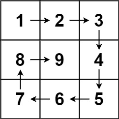

# 59. 螺旋矩阵 II

Medium · [力扣原题](https://leetcode.cn/problems/spiral-matrix-ii/)

所在刷题路径：labuladong

| 作者 | 题解 | 动画讲解 |
|---|---|---|
| 灵茶山艾府 | [📄 题解](灵茶山艾府.md) | [▶︎ 0059 螺旋矩阵 II · 灵茶山艾府.mp4](0059%20螺旋矩阵%20II%20·%20灵茶山艾府.mp4) |
| yiduobo | [📄 题解](yiduobo.md) | [▶︎ 0059 螺旋矩阵 II · yiduobo.mp4](0059%20螺旋矩阵%20II%20·%20yiduobo.mp4) |

## 题目描述

给你一个正整数 `n` ，生成一个包含 `1` 到 `n²` 所有元素，且元素按顺时针顺序螺旋排列的 `n x n` 正方形矩阵 `matrix` 。

**示例 1：**



```

输入：n = 3
输出：[[1,2,3],[8,9,4],[7,6,5]]
```

**示例 2：**

```

输入：n = 1
输出：[[1]]
```

**提示：**

- `1 <= n <= 20`

---
[↑ 返回 0000-0099](../README.md) · [总索引](../../../索引.md) · [仓库首页](../../../README.md)
