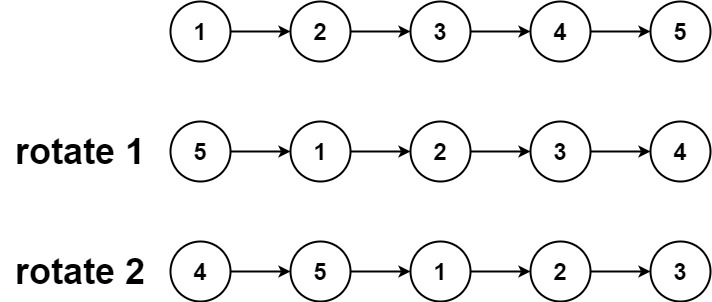
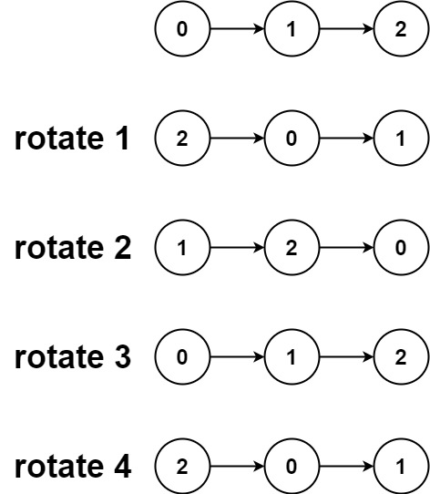

# 首尾相连再断开（Python/Java/C++/C/Go/JS/Rust）

> **[61. 旋转链表](https://leetcode.cn/problems/rotate-list/solutions/3963045/shou-wei-xiang-lian-zai-duan-kai-pythonj-24ti/) · Medium**

> **所属题单**
> - [链表、二叉树与回溯 · 一、链表](../../../刷题路径/灵神原版题单/链表、二叉树与回溯/一、链表.md) · §1.11 其他
> - [面试经典 150 题 · 链表](../../../刷题路径/灵神原版题单/面试经典%20150%20题/链表.md)

> **题目描述**
> 给你一个链表的头节点 `head` ，旋转链表，将链表每个节点向右移动 `k` 个位置。
>
> **示例 1：**
>
> 
>
> ```
>
> 输入：head = [1,2,3,4,5], k = 2
> 输出：[4,5,1,2,3]
> ```
>
> **示例 2：**
>
> 
>
> ```
>
> 输入：head = [0,1,2], k = 4
> 输出：[2,0,1]
> ```
>
> **提示：**
>
> - 链表中节点的数目在范围 `[0, 500]` 内
>
> - `-100 <= Node.val <= 100`
>
> - `0 <= k <= 2 * 10⁹`

> **题解**
> 
>
> 示例 1 的链表长为 $5$，$k=2$。旋转后，原链表的倒数第 $k$ 个节点，成为新链表的头节点。
>
> 把 $1\to 2\to 3\to 4\to 5$ 变成 $4\to 5\to 1\to 2\to 3$，我们需要：
>
> 1. 首尾相连，把 $5$ 和 $1$ 连起来。遍历链表即可找到尾节点。
> 2. 断开倒数第 $k+1$ 个节点和倒数第 $k$ 个节点，即断开 $3\to 4$。
>
> 本题 $k$ 可能很大，我们需要先求出链表的长度 $n$，然后把 $k$ 更新为 $k\bmod n$。这是因为链表旋转 $n$ 次没变，旋转 $n+1$ 次等同于旋转 $1$ 次，依此类推，旋转 $k$ 次等价于旋转 $k\bmod n$ 次。
>
> 倒数第 $k+1$ 个节点即正数第 $n-k$ 个节点。从头节点开始，向后移动 $n-k-1$ 次，即为正数第 $n-k$ 个节点。
>
> ```python
> class Solution:
>     def rotateRight(self, head: Optional[ListNode], k: int) -> Optional[ListNode]:
>         if head is None:
>             return None
>
>         # 1. 计算链表长度，并找到尾节点
>         length = 1
>         tail = head
>         while tail.next:
>             length += 1
>             tail = tail.next
>         k %= length
>
>         # 2. 首尾相连
>         tail.next = head
>
>         # 3. 找倒数第 k+1 个节点，作为新链表的尾节点
>         new_tail = head
>         for _ in range(length - k - 1):
>             new_tail = new_tail.next
>
>         # 4. 断开倒数第 k+1 个节点（new_tail）和倒数第 k 个节点（new_head）
>         new_head = new_tail.next
>         new_tail.next = None
>         return new_head
> ```
>
>
> #### 复杂度分析
>
> - 时间复杂度：$\mathcal{O}(n)$，其中 $n$ 是链表的长度。
> - 空间复杂度：$\mathcal{O}(1)$。
>
> ## 分类题单
>
> [如何科学刷题？](https://leetcode.cn/circle/discuss/RvFUtj/)
>
> 1. [滑动窗口与双指针（定长/不定长/单序列/双序列/三指针/分组循环）](https://leetcode.cn/circle/discuss/0viNMK/)
> 2. [二分算法（二分答案/最小化最大值/最大化最小值/第K小）](https://leetcode.cn/circle/discuss/SqopEo/)
> 3. [单调栈（基础/矩形面积/贡献法/最小字典序）](https://leetcode.cn/circle/discuss/9oZFK9/)
> 4. [网格图（DFS/BFS/综合应用）](https://leetcode.cn/circle/discuss/YiXPXW/)
> 5. [位运算（基础/性质/拆位/试填/恒等式/思维）](https://leetcode.cn/circle/discuss/dHn9Vk/)
> 6. [图论算法（DFS/BFS/拓扑排序/基环树/最短路/最小生成树/网络流）](https://leetcode.cn/circle/discuss/01LUak/)
> 7. [动态规划（入门/背包/划分/状态机/区间/状压/数位/数据结构优化/树形/博弈/概率期望）](https://leetcode.cn/circle/discuss/tXLS3i/)
> 8. [常用数据结构（前缀和/差分/栈/队列/堆/字典树/并查集/树状数组/线段树）](https://leetcode.cn/circle/discuss/mOr1u6/)
> 9. [数学算法（数论/组合/概率期望/博弈/计算几何/随机算法）](https://leetcode.cn/circle/discuss/IYT3ss/)
> 10. [贪心与思维（基本贪心策略/反悔/区间/字典序/数学/思维/脑筋急转弯/构造）](https://leetcode.cn/circle/discuss/g6KTKL/)
> 11. [链表、树与回溯（前后指针/快慢指针/DFS/BFS/直径/LCA）](https://leetcode.cn/circle/discuss/K0n2gO/)
> 12. [字符串（KMP/Z函数/Manacher/字符串哈希/AC自动机/后缀数组/子序列自动机）](https://leetcode.cn/circle/discuss/SJFwQI/)
>
> [我的题解精选（已分类）](https://github.com/EndlessCheng/codeforces-go/blob/master/leetcode/SOLUTIONS.md)
>
> 欢迎关注 [B站@灵茶山艾府](https://space.bilibili.com/206214)
