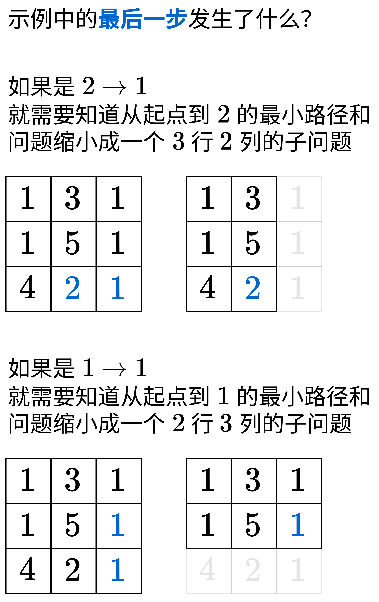

# 教你一步步思考 DP：从记忆化搜索到递推到空间优化！（Python/Java/C++/Go）

> **[64. 最小路径和](https://leetcode.cn/problems/minimum-path-sum/solutions/3045828/jiao-ni-yi-bu-bu-si-kao-dpcong-ji-yi-hua-zfb2/) · Medium**

> **所属题单**
> - [动态规划 · 二、网格图 DP](../../../刷题路径/灵神原版题单/动态规划/二、网格图%20DP.md) · §2.1 基础
> - [LeetCode 热题 100 · 多维动态规划](../../../刷题路径/灵神原版题单/LeetCode%20热题%20100/多维动态规划.md)
> - [面试经典 150 题 · 多维动态规划](../../../刷题路径/灵神原版题单/面试经典%20150%20题/多维动态规划.md)

> **题目描述**
> 给定一个包含非负整数的 `m x n` 网格 `grid` ，请找出一条从左上角到右下角的路径，使得路径上的数字总和为最小。
>
> **说明：**每次只能向下或者向右移动一步。
>
> **示例 1：**
>
> 
>
> ```
>
> 输入：grid = [[1,3,1],[1,5,1],[4,2,1]]
> 输出：7
> 解释：因为路径 1→3→1→1→1 的总和最小。
> ```
>
> **示例 2：**
>
> ```
>
> 输入：grid = [[1,2,3],[4,5,6]]
> 输出：12
> ```
>
> **提示：**
>
> - `m == grid.length`
>
> - `n == grid[i].length`
>
> - `1 <= m, n <= 200`
>
> - `0 <= grid[i][j] <= 200`

> **题解**
> 对于不少动态规划问题，「如何想出状态定义和状态转移方程」是有套路的。我在 [动态规划入门：从记忆化搜索到递推](https://www.bilibili.com/video/BV1Xj411K7oF/) 中讲了「递归->记忆化搜索->递推」的思考套路。本文将遵照这个过程，来讲讲怎么从递归开始，一步步写出最后的递推代码。
>
> ## 一、寻找子问题
>
> 怎么把一个大问题变成小问题？
>
> {:width=450px}
>
> **见微知著，想清楚最后一步发生了什么，就想清楚每一步发生了什么。**
>
> 受上图启发，定义 $\textit{dfs}(i,j)$ 表示从左上角到第 $i$ 行第 $j$ 列这个格子（记作 $(i,j)$）的最小价值和。
>
> 分类讨论怎么到达 $(i,j)$：
>
> - 如果是从左边过来，那么必须先到达 $(i,j-1)$，我们需要知道从左上角到 $(i,j-1)$ 的最小价值和，再加上 $\textit{grid}[i][j]$，得到 $\textit{dfs}(i,j-1) + \textit{grid}[i][j]$。
> - 如果是从上边过来，那么必须先到达 $(i-1,j)$，我们需要知道从左上角到 $(i-1,j)$ 的最小价值和，再加上 $\textit{grid}[i][j]$，得到 $\textit{dfs}(i-1,j) + \textit{grid}[i][j]$。
>
> 二者取最小值，得到**状态转移方程**：
>
> $$
> \textit{dfs}(i,j) = \min(\textit{dfs}(i,j-1), \textit{dfs}(i-1,j)) + \textit{grid}[i][j]
> $$
>
> **递归边界**：
>
> - $\textit{dfs}(-1,j)=\textit{dfs}(i,-1)=\infty$。用 $\infty$ 表示不合法（出界）的状态，从而保证 $\min$ 不会取到不合法的状态。
> - $\textit{dfs}(0,0)=\textit{grid}[0][0]$。
>
> **递归入口**：$\textit{dfs}(m-1,n-1)$，这是原问题，也是答案。
>
> #### 答疑
>
> **问**：看上去，这计算的是从右下角到左上角的最小价值和？
>
> **答**：注意加法运算发生在递归返回后，即递归的「归」的时候我们才**开始**计算最小价值和，所以计算顺序是从左上角到右下角。
>
> **问**：为什么要倒着思考？
>
> **答**：方便后面 1:1 地翻译成递推。
>
> ```python
> # 会超时的递归写法
> class Solution:
>     def minPathSum(self, grid: List[List[int]]) -> int:
>         def dfs(i: int, j: int) -> int:
>             if i < 0 or j < 0:
>                 return inf
>             if i == 0 and j == 0:
>                 return grid[i][j]
>             return min(dfs(i, j - 1), dfs(i - 1, j)) + grid[i][j]
>         return dfs(len(grid) - 1, len(grid[0]) - 1)
> ```
>
>
> #### 复杂度分析
>
> - 时间复杂度：$\mathcal{O}(2^{m+n})$，其中 $m$ 和 $n$ 分别为 $\textit{grid}$ 的行数和列数。搜索树可以近似为一棵二叉树，树高为 $\mathcal{O}(m+n)$，即从 $\textit{grid}$ 左上角到右下角经过的格子数，所以节点个数为 $\mathcal{O}(2^{m+n})$。
> - 空间复杂度：$\mathcal{O}(m+n)$。递归需要 $\mathcal{O}(m+n)$ 的栈空间。
>
> ## 二、用记忆化搜索优化
>
> 举个例子，对于 $\textit{dfs}(2,2)$ 来说，「先左再上」和「先上再左」，都会调用 $\textit{dfs}(1,1)$。
>
> 考虑到整个递归过程中有大量重复递归调用（递归入参相同）。由于递归函数没有副作用，同样的入参无论计算多少次，算出来的结果都是一样的，因此可以用**记忆化搜索**来优化：
>
> - 如果一个状态（递归入参）是第一次遇到，那么可以在返回前，把状态及其结果记到一个 $\textit{memo}$ 数组中。
> - 如果一个状态不是第一次遇到（$\textit{memo}$ 中保存的结果不等于 $\textit{memo}$ 的初始值），那么可以直接返回 $\textit{memo}$ 中保存的结果。
>
> **注意**：$\textit{memo}$ 数组的**初始值**一定不能等于要记忆化的值！例如初始值设置为 $0$，并且要记忆化的 $\textit{dfs}(i,j)$ 也等于 $0$，那就没法判断 $0$ 到底表示第一次遇到这个状态，还是表示之前遇到过了，从而导致记忆化失效。一般把初始值设置为 $-1$。
>
> > Python 用户可以无视上面这段，直接用 `@cache` 装饰器。
>
> ```python
> class Solution:
>     def minPathSum(self, grid: List[List[int]]) -> int:
>         @cache  # 缓存装饰器，避免重复计算 dfs 的结果（记忆化）
>         def dfs(i: int, j: int) -> int:
>             if i < 0 or j < 0:
>                 return inf
>             if i == 0 and j == 0:
>                 return grid[i][j]
>             return min(dfs(i, j - 1), dfs(i - 1, j)) + grid[i][j]
>         return dfs(len(grid) - 1, len(grid[0]) - 1)
> ```
>
>
> #### 复杂度分析
>
> - 时间复杂度：$\mathcal{O}(mn)$，其中 $m$ 和 $n$ 分别为 $\textit{grid}$ 的行数和列数。由于每个状态只会计算一次，动态规划的时间复杂度 $=$ 状态个数 $\times$ 单个状态的计算时间。本题状态个数等于 $\mathcal{O}(mn)$，单个状态的计算时间为 $\mathcal{O}(1)$，所以总的时间复杂度为 $\mathcal{O}(mn)$。
> - 空间复杂度：$\mathcal{O}(mn)$。保存多少状态，就需要多少空间。
>
> ## 三、1:1 翻译成递推
>
> 我们可以去掉递归中的「递」，只保留「归」的部分，即自底向上计算。
>
> 具体来说，$f[i+1][j+1]$ 的定义和 $\textit{dfs}(i,j)$ 的定义是一样的，都表示从左上角到第 $i$ 行第 $j$ 列这个格子（记作 $(i,j)$）的最小价值和。这里 $+1$ 是为了把 $\textit{dfs}(-1,j)$ 和 $\textit{dfs}(i,-1)$ 这些状态也翻译过来，这样我们可以把 $f[0][j]$ 和 $f[i][0]$ 作为初始值。
>
> 相应的递推式（状态转移方程）也和 $\textit{dfs}$ 一样：
>
> $$
> f[i+1][j+1] = \min(f[i+1][j], f[i][j+1]) + \textit{grid}[i][j]
> $$
>
> > 问：为什么 $\textit{grid}[i][j]$ 的下标不用变？
> >
> > 答：既然是在 $f$ 的最左边和最上边插入一排状态，那么就只需要修改和 $f$ 有关的下标，其余任何逻辑都无需修改。或者说，如果把 $\textit{grid}[i][j]$ 也改成 $\textit{grid}[i+1][j+1]$，那么当 $i=m-1$ 或者 $j=n-1$ 时 $\textit{grid}[i+1][j+1]$ 会下标越界，这显然是错误的。
>
> 初始值：
>
> - $f[0][j]=f[i][0]=\infty$，翻译自递归边界 $\textit{dfs}(-1,j)=\textit{dfs}(i,-1)=\infty$。
> - $f[1][1]=\textit{grid}[0][0]$，翻译自递归边界 $\textit{dfs}(0,0)=\textit{grid}[0][0]$。
>
> 答案为 $f[m][n]$，翻译自递归入口 $\textit{dfs}(m-1,n-1)$。
>
> ### 写法一
>
> ```python
> class Solution:
>     def minPathSum(self, grid: List[List[int]]) -> int:
>         m, n = len(grid), len(grid[0])
>         f = [[inf] * (n + 1) for _ in range(m + 1)]
>         for i, row in enumerate(grid):
>             for j, x in enumerate(row):
>                 if i == j == 0:
>                     f[1][1] = x
>                 else:
>                     f[i + 1][j + 1] = min(f[i + 1][j], f[i][j + 1]) + x
>         return f[m][n]
> ```
>
>
> ### 写法二
>
> 把 $f[0][1]$（或者 $f[1][0]$）初始化成 $0$，这样 $f[1][1]$ 也可以用递推式计算了，无需特判。
>
> ```python
> class Solution:
>     def minPathSum(self, grid: List[List[int]]) -> int:
>         m, n = len(grid), len(grid[0])
>         f = [[inf] * (n + 1) for _ in range(m + 1)]
>         f[0][1] = 0
>         for i, row in enumerate(grid):
>             for j, x in enumerate(row):
>                 f[i + 1][j + 1] = min(f[i + 1][j], f[i][j + 1]) + x
>         return f[m][n]
> ```
>
>
> #### 复杂度分析
>
> - 时间复杂度：$\mathcal{O}(mn)$，其中 $m$ 和 $n$ 分别为 $\textit{grid}$ 的行数和列数。
> - 空间复杂度：$\mathcal{O}(mn)$。
>
> ## 四、空间优化
>
> 举个例子，在计算 $f[1][1]$ 时，会用到 $f[0][1]$，但是之后就不再用到了。那么干脆把 $f[1][1]$ 记到 $f[0][1]$ 中，这样对于 $f[1][2]$ 来说，它需要的数据就在 $f[0][1]$ 和 $f[0][2]$ 中。$f[1][2]$ 算完后也可以同样记到 $f[0][2]$ 中。
>
> 所以只需要一个长为 $n+1$ 的一维数组就够了。
>
> 具体可以看[【基础算法精讲 18】](https://www.bilibili.com/video/BV16Y411v7Y6/)中的讲解。本题的转移方程类似完全背包，故采用正序遍历。
>
> #### 答疑
>
> **问**：可以初始化 $f[0] = 0$ 吗？
>
> **答**：这会导致所有 $f[i][0]$ 都是 $0$。但对于 $i>1$ 的情况，$f[i][0]$ 必须是 $\infty$。如果 $f[i][0]=0\ (i>1)$，相当于出界也是合法的，这就搞错了。
>
> ```python
> class Solution:
>     def minPathSum(self, grid: List[List[int]]) -> int:
>         f = [inf] * (len(grid[0]) + 1)
>         f[1] = 0
>         for row in grid:
>             for j, x in enumerate(row):
>                 f[j + 1] = min(f[j], f[j + 1]) + x
>         return f[-1]
> ```
>
>
> #### 复杂度分析
>
> - 时间复杂度：$\mathcal{O}(mn)$，其中 $m$ 和 $n$ 分别为 $\textit{grid}$ 的行数和列数。
> - 空间复杂度：$\mathcal{O}(n)$。
>
> ## 五、空间优化（原地修改）
>
> 直接用 $\textit{grid}[0]$ 当作 $f$ 数组，可以做到 $\mathcal{O}(1)$ 额外空间。
>
> 由于 $\textit{grid}[0]$ 的长度只有 $n$，所以要按照
>
> $$
> f[i][j] = \min(f[i][j-1] , f[i-1][j]) +\textit{grid}[i][j]
> $$
>
> 的方式来转移。
>
> $i=0$ 和 $j=0$ 的情况要单独计算：
>
> - $i=0$ 时，上式为 $f[i][j] = f[i][j-1]+\textit{grid}[i][j]$；用一个数组时，为 $f[j] = f[j-1]+\textit{grid}[0][j]=f[j-1]+f[j]$（$\textit{grid}[0]$ 就是 $f$ 数组）。
> - $j=0$ 时，上式为 $f[i][j] = f[i-1][j]+\textit{grid}[i][j]$；用一个数组时，为 $f[0] = f[0]+\textit{grid}[i][0]$。
>
> > 注：对比上下两份代码，你会发现长为 $n+1$ 的数组写起来是更加简洁的，因为可以避免特判位于边界的情况。
>
> ```python
> class Solution:
>     def minPathSum(self, grid: List[List[int]]) -> int:
>         m, n = len(grid), len(grid[0])
>         f = grid[0]  # 这里没有拷贝，f 和 grid[0] 都持有同一段内存
>         for j in range(1, n):
>             f[j] += f[j - 1]
>         for i in range(1, m):
>             f[0] += grid[i][0]
>             for j in range(1, n):
>                 f[j] = min(f[j - 1], f[j]) + grid[i][j]
>         return f[-1]
> ```
>
>
> #### 复杂度分析
>
> - 时间复杂度：$\mathcal{O}(mn)$，其中 $m$ 和 $n$ 分别为 $\textit{grid}$ 的行数和列数。
> - 空间复杂度：$\mathcal{O}(1)$。
>
> ## 分类题单
>
> [如何科学刷题？](https://leetcode.cn/circle/discuss/RvFUtj/)
>
> 1. [滑动窗口与双指针（定长/不定长/单序列/双序列/三指针/分组循环）](https://leetcode.cn/circle/discuss/0viNMK/)
> 2. [二分算法（二分答案/最小化最大值/最大化最小值/第K小）](https://leetcode.cn/circle/discuss/SqopEo/)
> 3. [单调栈（基础/矩形面积/贡献法/最小字典序）](https://leetcode.cn/circle/discuss/9oZFK9/)
> 4. [网格图（DFS/BFS/综合应用）](https://leetcode.cn/circle/discuss/YiXPXW/)
> 5. [位运算（基础/性质/拆位/试填/恒等式/思维）](https://leetcode.cn/circle/discuss/dHn9Vk/)
> 6. [图论算法（DFS/BFS/拓扑排序/基环树/最短路/最小生成树/网络流）](https://leetcode.cn/circle/discuss/01LUak/)
> 7. [动态规划（入门/背包/划分/状态机/区间/状压/数位/数据结构优化/树形/博弈/概率期望）](https://leetcode.cn/circle/discuss/tXLS3i/)
> 8. [常用数据结构（前缀和/差分/栈/队列/堆/字典树/并查集/树状数组/线段树）](https://leetcode.cn/circle/discuss/mOr1u6/)
> 9. [数学算法（数论/组合/概率期望/博弈/计算几何/随机算法）](https://leetcode.cn/circle/discuss/IYT3ss/)
> 10. [贪心与思维（基本贪心策略/反悔/区间/字典序/数学/思维/脑筋急转弯/构造）](https://leetcode.cn/circle/discuss/g6KTKL/)
> 11. [链表、树与回溯（前后指针/快慢指针/DFS/BFS/直径/LCA）](https://leetcode.cn/circle/discuss/K0n2gO/)
> 12. [字符串（KMP/Z函数/Manacher/字符串哈希/AC自动机/后缀数组/子序列自动机）](https://leetcode.cn/circle/discuss/SJFwQI/)
>
> [我的题解精选（已分类）](https://github.com/EndlessCheng/codeforces-go/blob/master/leetcode/SOLUTIONS.md)
>
> 欢迎关注 [B站@灵茶山艾府](https://space.bilibili.com/206214)
