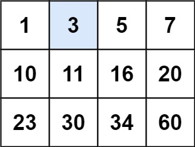
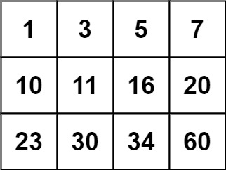

# 把二维矩阵拉成一维数组，二分查找（Python/Java/C++/C/Go/JS/Rust）

> **[74. 搜索二维矩阵](https://leetcode.cn/problems/search-a-2d-matrix/solutions/2783931/liang-chong-fang-fa-er-fen-cha-zhao-pai-39d74/) · Medium**

> **所属题单**
> - [二分算法 · 一、二分查找](../../../刷题路径/灵神原版题单/二分算法/一、二分查找.md) · §1.2 进阶
> - [LeetCode 热题 100 · 二分查找](../../../刷题路径/灵神原版题单/LeetCode%20热题%20100/二分查找.md)
> - [面试经典 150 题 · 二分查找](../../../刷题路径/灵神原版题单/面试经典%20150%20题/二分查找.md)

> **题目描述**
> 给你一个满足下述两条属性的 `m x n` 整数矩阵：
>
> - 每行中的整数从左到右按非严格递增顺序排列。
>
> - 每行的第一个整数大于前一行的最后一个整数。
>
> 给你一个整数 `target` ，如果 `target` 在矩阵中，返回 `true` ；否则，返回 `false` 。
>
> 你必须编写一个时间复杂度为 `O(log(m * n))` 的解决方案。
>
> **示例 1：**
>
> 
>
> ```
>
> 输入：matrix = [[1,3,5,7],[10,11,16,20],[23,30,34,60]], target = 3
> 输出：true
> ```
>
> **示例 2：**
>
> 
>
> ```
>
> 输入：matrix = [[1,3,5,7],[10,11,16,20],[23,30,34,60]], target = 13
> 输出：false
> ```
>
> **提示：**
>
> - `m == matrix.length`
>
> - `n == matrix[i].length`
>
> - `1 <= m, n <= 100`
>
> - `-10⁴ <= matrix[i][j], target <= 10⁴`

> **题解**
> 由于矩阵的每一行是递增的，且每行的第一个数大于前一行的最后一个数，如果把矩阵每一行拼在一起，我们可以得到一个递增数组。
>
> 
>
> 例如示例 1，三行拼在一起得
>
> $$
> a = [1,3,5,7,10,11,16,20,23,30,34,60]
> $$
>
> 由于这是一个有序数组，我们可以用二分查找判断 $\textit{target}$ 是否在 $\textit{matrix}$ 中。
>
> 代码实现时，并不需要真的拼成一个长为 $mn$ 的数组 $a$，而是将 $a[i]$ 转换成矩阵中的行号和列号。例如示例 1，$i=9$ 对应的 $a[i]=30$，由于矩阵有 $n=4$ 列，所以 $a[i]$ 在 $\left\lfloor\dfrac{i}{n}\right\rfloor=2$ 行，在 $i\bmod n = 1$ 列。
>
> 一般地，有
>
> $$
> a[i] = \textit{matrix}[\lfloor i/n\rfloor][i\bmod n]
> $$
>
> 关于二分查找的原理，请看视频讲解：[二分查找 红蓝染色法【基础算法精讲 04】](https://www.bilibili.com/video/BV1AP41137w7/)
>
> 下面用的开区间二分，其它写法也可以。
>
> ```python
> class Solution:
>     def searchMatrix(self, matrix: List[List[int]], target: int) -> bool:
>         m, n = len(matrix), len(matrix[0])
>         left, right = -1, m * n
>         while left + 1 < right:
>             mid = (left + right) // 2
>             x = matrix[mid // n][mid % n]
>             if x == target:
>                 return True
>             if x < target:
>                 left = mid
>             else:
>                 right = mid
>         return False
> ```
>
> > [!example]- Py3 库函数
> > ```python
> > class Solution:
> >     def searchMatrix(self, matrix: List[List[int]], target: int) -> bool:
> >         m, n = len(matrix), len(matrix[0])
> >         # 注：range 不是 list，是一个对象，创建 range 和下标访问都是 O(1) 的
> >         i = bisect_left(range(m * n), target, key=lambda i: matrix[i // n][i % n])
> >         return i < m * n and matrix[i // n][i % n] == target
> > ```
>
>
> #### 复杂度分析
>
> - 时间复杂度：$\mathcal{O}(\log (mn))$，其中 $m$ 和 $n$ 分别为 $\textit{matrix}$ 的行数和列数。
> - 空间复杂度：$\mathcal{O}(1)$。
>
> ## 变形题
>
> 去掉「每行的第一个整数大于前一行的最后一个整数」的性质，添加「每列的元素从上到下升序排列」的性质，怎么做？
>
> 这题是 [240. 搜索二维矩阵 II](https://leetcode.cn/problems/search-a-2d-matrix-ii/)，请看 [我的题解](../../0200-0299/0240%20搜索二维矩阵%20II/灵茶山艾府.md)。
>
> ## 分类题单
>
> [如何科学刷题？](https://leetcode.cn/circle/discuss/RvFUtj/)
>
> 1. [滑动窗口与双指针（定长/不定长/单序列/双序列/三指针/分组循环）](https://leetcode.cn/circle/discuss/0viNMK/)
> 2. [二分算法（二分答案/最小化最大值/最大化最小值/第K小）](https://leetcode.cn/circle/discuss/SqopEo/)
> 3. [单调栈（基础/矩形面积/贡献法/最小字典序）](https://leetcode.cn/circle/discuss/9oZFK9/)
> 4. [网格图（DFS/BFS/综合应用）](https://leetcode.cn/circle/discuss/YiXPXW/)
> 5. [位运算（基础/性质/拆位/试填/恒等式/思维）](https://leetcode.cn/circle/discuss/dHn9Vk/)
> 6. [图论算法（DFS/BFS/拓扑排序/基环树/最短路/最小生成树/网络流）](https://leetcode.cn/circle/discuss/01LUak/)
> 7. [动态规划（入门/背包/划分/状态机/区间/状压/数位/数据结构优化/树形/博弈/概率期望）](https://leetcode.cn/circle/discuss/tXLS3i/)
> 8. [常用数据结构（前缀和/差分/栈/队列/堆/字典树/并查集/树状数组/线段树）](https://leetcode.cn/circle/discuss/mOr1u6/)
> 9. [数学算法（数论/组合/概率期望/博弈/计算几何/随机算法）](https://leetcode.cn/circle/discuss/IYT3ss/)
> 10. [贪心与思维（基本贪心策略/反悔/区间/字典序/数学/思维/脑筋急转弯/构造）](https://leetcode.cn/circle/discuss/g6KTKL/)
> 11. [链表、树与回溯（前后指针/快慢指针/DFS/BFS/直径/LCA）](https://leetcode.cn/circle/discuss/K0n2gO/)
> 12. [字符串（KMP/Z函数/Manacher/字符串哈希/AC自动机/后缀数组/子序列自动机）](https://leetcode.cn/circle/discuss/SJFwQI/)
>
> [我的题解精选（已分类）](https://github.com/EndlessCheng/codeforces-go/blob/master/leetcode/SOLUTIONS.md)
>
> 欢迎关注 [B站@灵茶山艾府](https://space.bilibili.com/206214)
