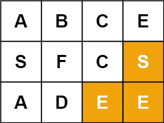

# 79. 单词搜索

Medium · [力扣原题](https://leetcode.cn/problems/word-search/)

所在刷题路径：labuladong、灵神核心路线、灵神突击、灵神题单·链表树与回溯

| 作者 | 题解 | 动画讲解 |
|---|---|---|
| 灵茶山艾府 | [📄 题解](灵茶山艾府.md) | [▶︎ 0079 单词搜索 · 灵茶山艾府.mp4](0079%20单词搜索%20·%20灵茶山艾府.mp4) |
| yiduobo | [📄 题解](yiduobo.md) | [▶︎ 0079 单词搜索 · yiduobo.mp4](0079%20单词搜索%20·%20yiduobo.mp4) |

## 题目描述

给定一个 `m x n` 二维字符网格 `board` 和一个字符串单词 `word` 。如果 `word` 存在于网格中，返回 `true` ；否则，返回 `false` 。

单词必须按照字母顺序，通过相邻的单元格内的字母构成，其中“相邻”单元格是那些水平相邻或垂直相邻的单元格。同一个单元格内的字母不允许被重复使用。

**示例 1：**


```

输入：board = [['A','B','C','E'],['S','F','C','S'],['A','D','E','E']], word = "ABCCED"
输出：true
```

**示例 2：**



```

输入：board = [['A','B','C','E'],['S','F','C','S'],['A','D','E','E']], word = "SEE"
输出：true
```

**示例 3：**


```

输入：board = [['A','B','C','E'],['S','F','C','S'],['A','D','E','E']], word = "ABCB"
输出：false
```

**提示：**

- `m == board.length`

- `n = board[i].length`

- `1 <= m, n <= 6`

- `1 <= word.length <= 15`

- `board` 和 `word` 仅由大小写英文字母组成

**进阶：**你可以使用搜索剪枝的技术来优化解决方案，使其在 `board` 更大的情况下可以更快解决问题？

---
[↑ 返回 0000-0099](../README.md) · [总索引](../../../索引.md) · [仓库首页](../../../README.md)
