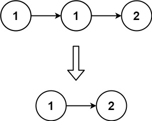

# 83. 删除排序链表中的重复元素

Easy · [力扣原题](https://leetcode.cn/problems/remove-duplicates-from-sorted-list/)

所在刷题路径：labuladong、灵神题单·链表树与回溯

| 作者 | 题解 | 动画讲解 |
|---|---|---|
| 灵茶山艾府 | [📄 题解](灵茶山艾府.md) | [▶︎ 动画（GIF）](0083%20删除排序链表中的重复元素%20·%20灵茶山艾府.gif) · [mp4 文件](0083%20删除排序链表中的重复元素%20·%20灵茶山艾府.mp4) |
| yiduobo | [📄 题解](yiduobo.md) | [▶︎ 动画（GIF）](0083%20删除排序链表中的重复元素%20·%20yiduobo.gif) · [mp4 文件](0083%20删除排序链表中的重复元素%20·%20yiduobo.mp4) |

## 动画讲解

> 动图会循环播放；想暂停、拖进度条请下载上面表格里的 mp4 文件。

### 灵茶山艾府


### yiduobo


## 题目描述

给定一个已排序的链表的头 `head` ， <em>删除所有重复的元素，使每个元素只出现一次</em> 。返回 <em>已排序的链表</em> 。

**示例 1：**



```

输入：head = [1,1,2]
输出：[1,2]
```

**示例 2：**


```

输入：head = [1,1,2,3,3]
输出：[1,2,3]
```

**提示：**

- 链表中节点数目在范围 `[0, 300]` 内

- `-100 <= Node.val <= 100`

- 题目数据保证链表已经按升序 **排列**

---
[↑ 返回 0000-0099](../README.md) · [总索引](../../../索引.md) · [仓库首页](../../../README.md)
