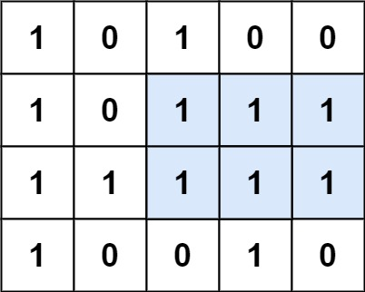

# 85. 最大矩形

Hard · [力扣原题](https://leetcode.cn/problems/maximal-rectangle/)

所在刷题路径：灵神题单·单调栈

| 作者 | 题解 | 动画讲解 |
|---|---|---|
| 灵茶山艾府 | [📄 题解](灵茶山艾府.md) | [▶︎ 动画（GIF）](0085%20最大矩形%20·%20灵茶山艾府.gif) · [mp4 文件](0085%20最大矩形%20·%20灵茶山艾府.mp4) |
| yiduobo | [📄 题解](yiduobo.md) | [▶︎ 动画（GIF）](0085%20最大矩形%20·%20yiduobo.gif) · [mp4 文件](0085%20最大矩形%20·%20yiduobo.mp4) |

## 动画讲解

> 动图会循环播放；想暂停、拖进度条请下载上面表格里的 mp4 文件。

### 灵茶山艾府


### yiduobo


## 题目描述

给定一个仅包含 `0` 和 `1` 、大小为 `rows x cols` 的二维二进制矩阵，找出只包含 `1` 的最大矩形，并返回其面积。

**示例 1：**



```

输入：matrix = [["1","0","1","0","0"],["1","0","1","1","1"],["1","1","1","1","1"],["1","0","0","1","0"]]
输出：6
解释：最大矩形如上图所示。
```

**示例 2：**

```

输入：matrix = [["0"]]
输出：0
```

**示例 3：**

```

输入：matrix = [["1"]]
输出：1
```

**提示：**

- `rows == matrix.length`

- `cols == matrix[0].length`

- `1 <= rows, cols <= 200`

- `matrix[i][j]` 为 `'0'` 或 `'1'`

---
[↑ 返回 0000-0099](../README.md) · [总索引](../../../索引.md) · [仓库首页](../../../README.md)
