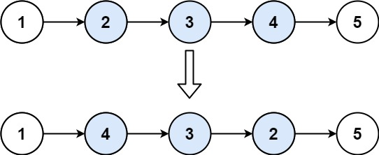

# 【视频讲解】反转链表 O(1) 空间写法（Python/Java/C++/C/Go/JS）

> **[92. 反转链表 II](https://leetcode.cn/problems/reverse-linked-list-ii/solutions/1992226/you-xie-cuo-liao-yi-ge-shi-pin-jiang-tou-teqq/) · Medium**

> **所属题单**
> - [链表、二叉树与回溯 · 一、链表](../../../刷题路径/灵神原版题单/链表、二叉树与回溯/一、链表.md) · §1.4 反转链表
> - [面试经典 150 题 · 链表](../../../刷题路径/灵神原版题单/面试经典%20150%20题/链表.md)

> **题目描述**
> 给你单链表的头指针 `head` 和两个整数 `left` 和 `right` ，其中 `left <= right` 。请你反转从位置 `left` 到位置 `right` 的链表节点，返回 **反转后的链表** 。
>
> **示例 1：**
>
> 
>
> ```
>
> 输入：head = [1,2,3,4,5], left = 2, right = 4
> 输出：[1,4,3,2,5]
> ```
>
> **示例 2：**
>
> ```
>
> 输入：head = [5], left = 1, right = 1
> 输出：[5]
> ```
>
> **提示：**
>
> - 链表中节点数目为 `n`
>
> - `1 <= n <= 500`
>
> - `-500 <= Node.val <= 500`
>
> - `1 <= left <= right <= n`
>
> **进阶：** 你可以使用一趟扫描完成反转吗？

> **题解**
> **前置题目**：[206. 反转链表](https://leetcode.cn/problems/reverse-linked-list/)
>
> **视频讲解**：请看 [【基础算法精讲 06】](https://www.bilibili.com/video/BV1sd4y1x7KN/)，制作不易，欢迎点赞~
>
> ⚠**注意**：$\textit{left}$ 和 $\textit{right}$ 是**位置范围**，不是元素值的范围。
>
> ```python
> class Solution:
>     def reverseBetween(self, head: Optional[ListNode], left: int, right: int) -> Optional[ListNode]:
>         p0 = dummy = ListNode(next=head)
>         # 把 p0 移到 left 的上一个节点
>         for _ in range(left - 1):
>             p0 = p0.next
>
>         pre = None
>         cur = p0.next
>         for _ in range(right - left + 1):
>             nxt = cur.next
>             cur.next = pre  # 每次循环只修改一个 next，方便大家理解
>             pre = cur
>             cur = nxt
>
>         # 见视频
>         p0.next.next = cur
>         p0.next = pre
>         return dummy.next
> ```
>
>
> #### 复杂度分析
>
> - 时间复杂度：$\mathcal{O}(\textit{right})$。
> - 空间复杂度：$\mathcal{O}(1)$。
>
> ## 分类题单
>
> [如何科学刷题？](https://leetcode.cn/discuss/post/3141566/ru-he-ke-xue-shua-ti-by-endlesscheng-q3yd/)
>
> 1. [滑动窗口与双指针（定长/不定长/单序列/双序列/三指针/分组循环）](https://leetcode.cn/discuss/post/3578981/ti-dan-hua-dong-chuang-kou-ding-chang-bu-rzz7/)
> 2. [二分算法（二分答案/最小化最大值/最大化最小值/第K小）](https://leetcode.cn/discuss/post/3579164/ti-dan-er-fen-suan-fa-er-fen-da-an-zui-x-3rqn/)
> 3. [单调栈（基础/矩形面积/贡献法/最小字典序）](https://leetcode.cn/discuss/post/3579480/ti-dan-dan-diao-zhan-ju-xing-xi-lie-zi-d-u4hk/)
> 4. [网格图（DFS/BFS/综合应用）](https://leetcode.cn/discuss/post/3580195/fen-xiang-gun-ti-dan-wang-ge-tu-dfsbfszo-l3pa/)
> 5. [位运算（基础/性质/拆位/试填/恒等式/思维）](https://leetcode.cn/discuss/post/3580371/fen-xiang-gun-ti-dan-wei-yun-suan-ji-chu-nth4/)
> 6. [图论算法（DFS/BFS/拓扑排序/基环树/最短路/最小生成树/网络流）](https://leetcode.cn/discuss/post/3581143/fen-xiang-gun-ti-dan-tu-lun-suan-fa-dfsb-qyux/)
> 7. [动态规划（入门/背包/划分/状态机/区间/状压/数位/数据结构优化/树形/博弈/概率期望）](https://leetcode.cn/discuss/post/3581838/fen-xiang-gun-ti-dan-dong-tai-gui-hua-ru-007o/)
> 8. [常用数据结构（前缀和/差分/栈/队列/堆/字典树/并查集/树状数组/线段树）](https://leetcode.cn/discuss/post/3583665/fen-xiang-gun-ti-dan-chang-yong-shu-ju-j-bvmv/)
> 9. [数学算法（数论/组合/概率期望/博弈/计算几何/随机算法）](https://leetcode.cn/discuss/post/3584388/fen-xiang-gun-ti-dan-shu-xue-suan-fa-shu-gcai/)
> 10. [贪心与思维（基本贪心策略/反悔/区间/字典序/数学/思维/脑筋急转弯/构造）](https://leetcode.cn/discuss/post/3091107/fen-xiang-gun-ti-dan-tan-xin-ji-ben-tan-k58yb/)
> 11. [链表、树与回溯（前后指针/快慢指针/DFS/BFS/直径/LCA）](https://leetcode.cn/discuss/post/3142882/fen-xiang-gun-ti-dan-lian-biao-er-cha-sh-6srp/)
> 12. [字符串（KMP/Z函数/Manacher/字符串哈希/AC自动机/后缀数组/子序列自动机）](https://leetcode.cn/discuss/post/3144832/fen-xiang-gun-ti-dan-zi-fu-chuan-kmpzhan-ugt4/)
>
> [我的题解精选（已分类）](https://github.com/EndlessCheng/codeforces-go/blob/master/leetcode/SOLUTIONS.md)
>
> 欢迎关注 [B站@灵茶山艾府](https://space.bilibili.com/206214)
