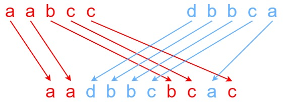

# 97. 交错字符串

Medium · [力扣原题](https://leetcode.cn/problems/interleaving-string/)

所在刷题路径：灵神核心路线、灵神突击、灵神题单·动态规划

| 作者 | 题解 | 动画讲解 |
|---|---|---|
| 灵茶山艾府 | [📄 题解](灵茶山艾府.md) | [▶︎ 0097 交错字符串 · 灵茶山艾府.mp4](0097%20交错字符串%20·%20灵茶山艾府.mp4) |
| yiduobo | [📄 题解](yiduobo.md) | [▶︎ 0097 交错字符串 · yiduobo.mp4](0097%20交错字符串%20·%20yiduobo.mp4) |

## 题目描述

给定三个字符串 `s1`、`s2`、`s3`，请你帮忙验证 `s3` 是否是由 `s1` 和 `s2` **交错** 组成的。

两个字符串 `s` 和 `t` **交错** 的定义与过程如下，其中每个字符串都会被分割成若干 **非空** 子字符串：

- `s = s₁ + s₂ + ... + s_n`

- `t = t₁ + t₂ + ... + t_m`

- `|n - m| <= 1`

- **交错** 是 `s₁ + t₁ + s₂ + t₂ + s₃ + t₃ + ...` 或者 `t₁ + s₁ + t₂ + s₂ + t₃ + s₃ + ...`

**注意：**`a + b` 意味着字符串 `a` 和 `b` 连接。

**示例 1：**



```

输入：s1 = "aabcc", s2 = "dbbca", s3 = "aadbbcbcac"
输出：true
```

**示例 2：**

```

输入：s1 = "aabcc", s2 = "dbbca", s3 = "aadbbbaccc"
输出：false
```

**示例 3：**

```

输入：s1 = "", s2 = "", s3 = ""
输出：true
```

**提示：**

- `0 <= s1.length, s2.length <= 100`

- `0 <= s3.length <= 200`

- `s1`、`s2`、和 `s3` 都由小写英文字母组成

**进阶：**您能否仅使用 `O(s2.length)` 额外的内存空间来解决它?

---
[↑ 返回 0000-0099](../README.md) · [总索引](../../../索引.md) · [仓库首页](../../../README.md)
