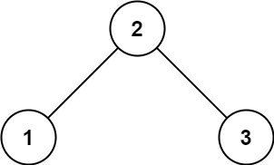

# 98. 验证二叉搜索树

Medium · [力扣原题](https://leetcode.cn/problems/validate-binary-search-tree/)

所在刷题路径：labuladong、灵神突击、灵神题单·链表树与回溯

| 作者 | 题解 | 动画讲解 |
|---|---|---|
| 灵茶山艾府 | [📄 题解](灵茶山艾府.md) | [▶︎ 0098 验证二叉搜索树 · 灵茶山艾府.mp4](0098%20验证二叉搜索树%20·%20灵茶山艾府.mp4) |
| yiduobo | [📄 题解](yiduobo.md) | [▶︎ 0098 验证二叉搜索树 · yiduobo.mp4](0098%20验证二叉搜索树%20·%20yiduobo.mp4) |

## 题目描述

给你一个二叉树的根节点 `root` ，判断其是否是一个有效的二叉搜索树。

**有效** 二叉搜索树定义如下：

- 节点的左子树只包含 **严格小于** 当前节点的数。

- 节点的右子树只包含 **严格大于** 当前节点的数。

- 所有左子树和右子树自身必须也是二叉搜索树。

**示例 1：**



```

输入：root = [2,1,3]
输出：true
```

**示例 2：**


```

输入：root = [5,1,4,null,null,3,6]
输出：false
解释：根节点的值是 5 ，但是右子节点的值是 4 。
```

**提示：**

- 树中节点数目范围在`[1, 10⁴]` 内

- `-2³¹ <= Node.val <= 2³¹ - 1`

---
[↑ 返回 0000-0099](../README.md) · [总索引](../../../索引.md) · [仓库首页](../../../README.md)
