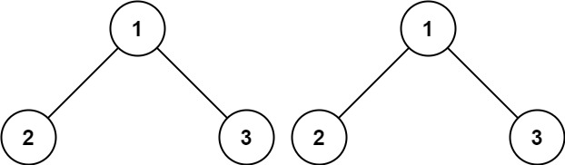

# 100. 相同的树

Easy · [力扣原题](https://leetcode.cn/problems/same-tree/)

所在刷题路径：灵神核心路线、灵神突击、灵神题单·链表树与回溯

| 作者 | 题解 | 动画讲解 |
|---|---|---|
| 灵茶山艾府 | [📄 题解](灵茶山艾府.md) | [▶︎ 0100 相同的树 · 灵茶山艾府.mp4](0100%20相同的树%20·%20灵茶山艾府.mp4) |
| yiduobo | [📄 题解](yiduobo.md) | [▶︎ 0100 相同的树 · yiduobo.mp4](0100%20相同的树%20·%20yiduobo.mp4) |

## 题目描述

给你两棵二叉树的根节点 `p` 和 `q` ，编写一个函数来检验这两棵树是否相同。

如果两个树在结构上相同，并且节点具有相同的值，则认为它们是相同的。

**示例 1：**



```

输入：p = [1,2,3], q = [1,2,3]
输出：true
```

**示例 2：**


```

输入：p = [1,2], q = [1,null,2]
输出：false
```

**示例 3：**


```

输入：p = [1,2,1], q = [1,1,2]
输出：false
```

**提示：**

- 两棵树上的节点数目都在范围 `[0, 100]` 内

- `-10⁴ <= Node.val <= 10⁴`

---
[↑ 返回 0100-0199](../README.md) · [总索引](../../../索引.md) · [仓库首页](../../../README.md)
