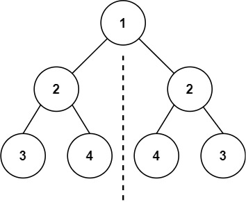
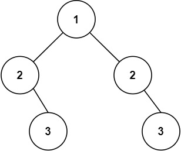

# 101. 对称二叉树

Easy · [力扣原题](https://leetcode.cn/problems/symmetric-tree/)

所在刷题路径：labuladong、灵神核心路线、灵神突击、灵神题单·链表树与回溯

| 作者 | 题解 | 动画讲解 |
|---|---|---|
| 灵茶山艾府 | [📄 题解](灵茶山艾府.md) | [▶︎ 0101 对称二叉树 · 灵茶山艾府.mp4](0101%20对称二叉树%20·%20灵茶山艾府.mp4) |
| yiduobo | [📄 题解](yiduobo.md) | [▶︎ 0101 对称二叉树 · yiduobo.mp4](0101%20对称二叉树%20·%20yiduobo.mp4) |

## 题目描述

给你一个二叉树的根节点 `root` ， 检查它是否轴对称。

**示例 1：**



```

输入：root = [1,2,2,3,4,4,3]
输出：true
```

**示例 2：**



```

输入：root = [1,2,2,null,3,null,3]
输出：false
```

**提示：**

- 树中节点数目在范围 `[1, 1000]` 内

- `-100 <= Node.val <= 100`

**进阶：**你可以运用递归和迭代两种方法解决这个问题吗？

---
[↑ 返回 0100-0199](../README.md) · [总索引](../../../索引.md) · [仓库首页](../../../README.md)
