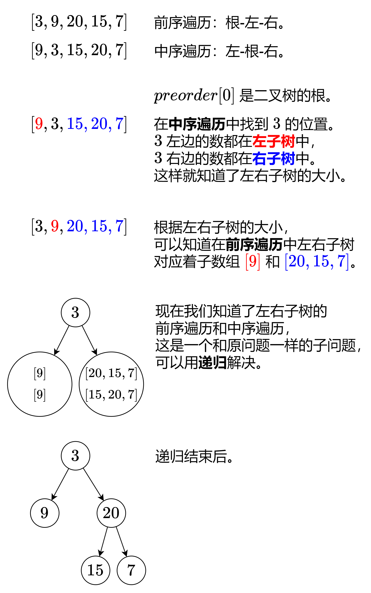

# 【图解】从 O(n^2) 到 O(n)（Python/Java/C++/Go/JS/Rust）

> **[105. 从前序与中序遍历序列构造二叉树](https://leetcode.cn/problems/construct-binary-tree-from-preorder-and-inorder-traversal/solutions/2646359/tu-jie-cong-on2-dao-onpythonjavacgojsrus-aob8/) · Medium**

> **所属题单**
> - [链表、二叉树与回溯 · 二、二叉树](../../../刷题路径/灵神原版题单/链表、二叉树与回溯/二、二叉树.md) · §2.10 创建二叉树
> - [LeetCode 热题 100 · 二叉树](../../../刷题路径/灵神原版题单/LeetCode%20热题%20100/二叉树.md)
> - [面试经典 150 题 · 二叉树](../../../刷题路径/灵神原版题单/面试经典%20150%20题/二叉树.md)

> **题目描述**
> 给定两个整数数组 `preorder` 和 `inorder` ，其中 `preorder` 是二叉树的**先序遍历**， `inorder` 是同一棵树的**中序遍历**，请构造二叉树并返回其根节点。
>
> **示例 1:**
>
> 
>
> ```
>
> 输入: preorder = [3,9,20,15,7], inorder = [9,3,15,20,7]
> 输出: [3,9,20,null,null,15,7]
> ```
>
> **示例 2:**
>
> ```
>
> 输入: preorder = [-1], inorder = [-1]
> 输出: [-1]
> ```
>
> **提示:**
>
> - `1 <= preorder.length <= 3000`
>
> - `inorder.length == preorder.length`
>
> - `-3000 <= preorder[i], inorder[i] <= 3000`
>
> - `preorder` 和 `inorder` 均 **无重复** 元素
>
> - `inorder` 均出现在 `preorder`
>
> - `preorder` **保证** 为二叉树的前序遍历序列
>
> - `inorder` **保证** 为二叉树的中序遍历序列

> **题解**
> **前序遍历**：按照「根-左子树-右子树」的顺序遍历二叉树。
>
> **中序遍历**：按照「左子树-根-右子树」的顺序遍历二叉树。
>
> 我们来看看示例 1 是怎么生成这棵二叉树的。
>
> 
>
> **递归边界**：如果 $\textit{preorder}$ 的长度是 $0$，对应着空节点，返回空。
>
> 晕递归的同学推荐先看这期视频：[深入理解递归【基础算法精讲 09】](https://www.bilibili.com/video/BV1UD4y1Y769/)
>
> ## 写法一
>
> ```python
> class Solution:
>     def buildTree(self, preorder: List[int], inorder: List[int]) -> Optional[TreeNode]:
>         if not preorder:  # 空节点
>             return None
>         left_size = inorder.index(preorder[0])  # 左子树的大小
>         left = self.buildTree(preorder[1: 1 + left_size], inorder[:left_size])
>         right = self.buildTree(preorder[1 + left_size:], inorder[1 + left_size:])
>         return TreeNode(preorder[0], left, right)
> ```
>
>
> #### 复杂度分析
>
> - 时间复杂度：$\mathcal{O}(n^2)$，其中 $n$ 为 $\textit{preorder}$ 的长度。最坏情况下二叉树是一条链，我们需要递归 $\mathcal{O}(n)$ 次，每次都需要 $\mathcal{O}(n)$ 的时间查找 $\textit{preorder}[0]$ 和复制数组。
> - 空间复杂度：$\mathcal{O}(n^2)$。
>
> ## 写法二
>
> 上面的写法有两个优化点：
>
> 1. 用一个哈希表（或者数组）预处理 $\textit{inorder}$ 每个元素的下标，这样就可以 $\mathcal{O}(1)$ 查到 $\textit{preorder}[0]$ 在 $\textit{inorder}$ 的位置，从而 $\mathcal{O}(1)$ 知道左子树的大小。
> 2. 把递归参数改成子数组下标区间（**左闭右开区间**）的左右端点，从而避免复制数组。
>
> ```python
> class Solution:
>     def buildTree(self, preorder: List[int], inorder: List[int]) -> Optional[TreeNode]:
>         index = {x: i for i, x in enumerate(inorder)}
>
>         # 根据 preorder[pre_l:pre_r] 和 inorder[in_l:in_r] 生成二叉树，其中 in_r 没用到，可以省略
>         def dfs(pre_l: int, pre_r: int, in_l: int) -> Optional[TreeNode]:
>             if pre_l == pre_r:  # 空节点
>                 return None
>             left_size = index[preorder[pre_l]] - in_l  # 左子树的大小
>             left = dfs(pre_l + 1, pre_l + 1 + left_size, in_l)
>             right = dfs(pre_l + 1 + left_size, pre_r, in_l + 1 + left_size)
>             return TreeNode(preorder[pre_l], left, right)
>
>         return dfs(0, len(preorder), 0)  # 左闭右开区间
> ```
>
>
> #### 复杂度分析
>
> - 时间复杂度：$\mathcal{O}(n)$，其中 $n$ 为 $\textit{preorder}$ 的长度。递归 $\mathcal{O}(n)$ 次，每次只需要 $\mathcal{O}(1)$ 的时间。
> - 空间复杂度：$\mathcal{O}(n)$。
>
> > 注：由于哈希表常数比数组大，实际运行效率可能不如写法一。
>
> ## 构造系列
>
> 这三题都可以用本文讲的套路解决。
>
> - [105. 从前序与中序遍历序列构造二叉树](https://leetcode.cn/problems/construct-binary-tree-from-preorder-and-inorder-traversal/)
> - [106. 从中序与后序遍历序列构造二叉树](https://leetcode.cn/problems/construct-binary-tree-from-inorder-and-postorder-traversal/)
> - [889. 根据前序和后序遍历构造二叉树](https://leetcode.cn/problems/construct-binary-tree-from-preorder-and-postorder-traversal/)
>
> ## 分类题单
>
> [如何科学刷题？](https://leetcode.cn/circle/discuss/RvFUtj/)
>
> 1. [滑动窗口与双指针（定长/不定长/单序列/双序列/三指针/分组循环）](https://leetcode.cn/circle/discuss/0viNMK/)
> 2. [二分算法（二分答案/最小化最大值/最大化最小值/第K小）](https://leetcode.cn/circle/discuss/SqopEo/)
> 3. [单调栈（基础/矩形面积/贡献法/最小字典序）](https://leetcode.cn/circle/discuss/9oZFK9/)
> 4. [网格图（DFS/BFS/综合应用）](https://leetcode.cn/circle/discuss/YiXPXW/)
> 5. [位运算（基础/性质/拆位/试填/恒等式/思维）](https://leetcode.cn/circle/discuss/dHn9Vk/)
> 6. [图论算法（DFS/BFS/拓扑排序/基环树/最短路/最小生成树/网络流）](https://leetcode.cn/circle/discuss/01LUak/)
> 7. [动态规划（入门/背包/划分/状态机/区间/状压/数位/数据结构优化/树形/博弈/概率期望）](https://leetcode.cn/circle/discuss/tXLS3i/)
> 8. [常用数据结构（前缀和/差分/栈/队列/堆/字典树/并查集/树状数组/线段树）](https://leetcode.cn/circle/discuss/mOr1u6/)
> 9. [数学算法（数论/组合/概率期望/博弈/计算几何/随机算法）](https://leetcode.cn/circle/discuss/IYT3ss/)
> 10. [贪心与思维（基本贪心策略/反悔/区间/字典序/数学/思维/脑筋急转弯/构造）](https://leetcode.cn/circle/discuss/g6KTKL/)
> 11. [链表、树与回溯（前后指针/快慢指针/DFS/BFS/直径/LCA）](https://leetcode.cn/circle/discuss/K0n2gO/)
> 12. [字符串（KMP/Z函数/Manacher/字符串哈希/AC自动机/后缀数组/子序列自动机）](https://leetcode.cn/circle/discuss/SJFwQI/)
>
> [我的题解精选（已分类）](https://github.com/EndlessCheng/codeforces-go/blob/master/leetcode/SOLUTIONS.md)
>
> 欢迎关注 [B站@灵茶山艾府](https://space.bilibili.com/206214)
