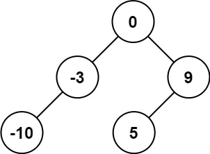
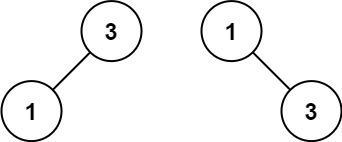

# 入门递归，从二叉树开始（Python/Java/C++/C/Go/JS/Rust）

> **[108. 将有序数组转换为二叉搜索树](https://leetcode.cn/problems/convert-sorted-array-to-binary-search-tree/solutions/2927064/ru-men-di-gui-cong-er-cha-shu-kai-shi-py-inu6/) · Easy**

> **所属题单**
> - [链表、二叉树与回溯 · 二、二叉树](../../../刷题路径/灵神原版题单/链表、二叉树与回溯/二、二叉树.md) · §2.10 创建二叉树
> - [LeetCode 热题 100 · 二叉树](../../../刷题路径/灵神原版题单/LeetCode%20热题%20100/二叉树.md)
> - [面试经典 150 题 · 分治](../../../刷题路径/灵神原版题单/面试经典%20150%20题/分治.md)

> **题目描述**
> 给你一个整数数组 `nums` ，其中元素已经按 **升序** 排列，请你将其转换为一棵 平衡 二叉搜索树。
>
> **示例 1：**
>
> 
>
> ```
>
> 输入：nums = [-10,-3,0,5,9]
> 输出：[0,-3,9,-10,null,5]
> 解释：[0,-10,5,null,-3,null,9] 也将被视为正确答案：
>
> 
> ```
>
> **示例 2：**
>
> 
>
> ```
>
> 输入：nums = [1,3]
> 输出：[3,1]
> 解释：[1,null,3] 和 [3,1] 都是高度平衡二叉搜索树。
> ```
>
> **提示：**
>
> - `1 <= nums.length <= 10⁴`
>
> - `-10⁴ <= nums[i] <= 10⁴`
>
> - `nums` 按 **严格递增** 顺序排列

> **题解**
> 示例 1 $\textit{nums}=[-10,-3,0,5,9]$，我们从数组正中间的数 $\textit{nums}[2]=0$ 开始，把数组一分为二，得到两个小数组：
>
> - 左：$[-10,-3]$。
> - 右：$[5,9]$。
>
> 答案由三部分组成：
>
> - 根节点：节点值为 $\textit{nums}[2]=0$。
> - 把 $\textit{nums}[2]$ 左边的 $[-10,-3]$ 转换成一棵平衡二叉搜索树，作为答案的左儿子。这是一个和原问题相似的子问题，可以递归解决。
> - 把 $\textit{nums}[2]$ 右边的 $[5,9]$ 转换成一棵平衡二叉搜索树，作为答案的右儿子。这是一个和原问题相似的子问题，可以递归解决。
>
> 递归边界：如果数组长度等于 $0$，返回空节点。
>
> 晕递归的同学，可以看视频讲解[【基础算法精讲 09】](https://www.bilibili.com/video/BV1UD4y1Y769/)，带你理解递归的本质。
>
> ⚠**注意**：答案可能不是唯一的。如果 $n$ 是偶数，我们可以取数组正中间左边那个数作为根节点的值，也可以取数组正中间右边那个数作为根节点的值。下面代码取的是正中间右边那个数，即下标为 $\dfrac{n}{2}$ 的数（当 $n$ 是偶数时）。
>
> ```python
> class Solution:
>     def sortedArrayToBST(self, nums: List[int]) -> Optional[TreeNode]:
>         if not nums:
>             return None
>         m = len(nums) // 2
>         left = self.sortedArrayToBST(nums[:m])
>         right = self.sortedArrayToBST(nums[m + 1:])
>         return TreeNode(nums[m], left, right)
> ```
>
> > [!example]- Python3 写法二
> > ```python
> > class Solution:
> >     def sortedArrayToBST(self, nums: List[int]) -> Optional[TreeNode]:
> >         # 把 nums[left:right] 转成平衡二叉搜索树
> >         def dfs(left: int, right: int) -> Optional[TreeNode]:
> >             if left == right:
> >                 return None
> >             m = (left + right) // 2
> >             return TreeNode(nums[m], dfs(left, m), dfs(m + 1, right))
> >         return dfs(0, len(nums))
> > ```
>
>
> #### 复杂度分析
>
> - 时间复杂度：$\mathcal{O}(n)$，其中 $n$ 是 $\textit{nums}$ 的长度。每次递归要么返回空节点，要么把 $\textit{nums}$ 的一个数转成一个节点，所以递归次数是 $\mathcal{O}(n)$ 的，所以时间复杂度是 $\mathcal{O}(n)$。需要注意，Python 的第一种写法有切片的复制开销，二叉树的每一层都需要花费 $\mathcal{O}(n)$ 的时间，一共有 $\mathcal{O}(\log n)$ 层，所以时间复杂度是 $\mathcal{O}(n\log n)$；第二种写法避免了切片的复制开销，时间复杂度是 $\mathcal{O}(n)$。
> - 空间复杂度：$\mathcal{O}(n)$。如果不计入返回值和切片的空间，那么空间复杂度为 $\mathcal{O}(\log n)$，即递归栈的开销。
>
> 更多相似题目，见下面的**二叉树题单**。
>
> ## 分类题单
>
> [如何科学刷题？](https://leetcode.cn/circle/discuss/RvFUtj/)
>
> 1. [滑动窗口与双指针（定长/不定长/单序列/双序列/三指针/分组循环）](https://leetcode.cn/circle/discuss/0viNMK/)
> 2. [二分算法（二分答案/最小化最大值/最大化最小值/第K小）](https://leetcode.cn/circle/discuss/SqopEo/)
> 3. [单调栈（基础/矩形面积/贡献法/最小字典序）](https://leetcode.cn/circle/discuss/9oZFK9/)
> 4. [网格图（DFS/BFS/综合应用）](https://leetcode.cn/circle/discuss/YiXPXW/)
> 5. [位运算（基础/性质/拆位/试填/恒等式/思维）](https://leetcode.cn/circle/discuss/dHn9Vk/)
> 6. [图论算法（DFS/BFS/拓扑排序/最短路/最小生成树/二分图/基环树/欧拉路径）](https://leetcode.cn/circle/discuss/01LUak/)
> 7. [动态规划（入门/背包/状态机/划分/区间/状压/数位/数据结构优化/树形/博弈/概率期望）](https://leetcode.cn/circle/discuss/tXLS3i/)
> 8. [常用数据结构（前缀和/差分/栈/队列/堆/字典树/并查集/树状数组/线段树）](https://leetcode.cn/circle/discuss/mOr1u6/)
> 9. [数学算法（数论/组合/概率期望/博弈/计算几何/随机算法）](https://leetcode.cn/circle/discuss/IYT3ss/)
> 10. [贪心与思维（基本贪心策略/反悔/区间/字典序/数学/思维/脑筋急转弯/构造）](https://leetcode.cn/circle/discuss/g6KTKL/)
> 11. 【本题相关】[链表、二叉树与回溯（前后指针/快慢指针/DFS/BFS/直径/LCA/一般树）](https://leetcode.cn/circle/discuss/K0n2gO/)
> 12. [字符串（KMP/Z函数/Manacher/字符串哈希/AC自动机/后缀数组/子序列自动机）](https://leetcode.cn/circle/discuss/SJFwQI/)
>
> [我的题解精选（已分类）](https://github.com/EndlessCheng/codeforces-go/blob/master/leetcode/SOLUTIONS.md)
>
> 欢迎关注 [B站@灵茶山艾府](https://space.bilibili.com/206214)
