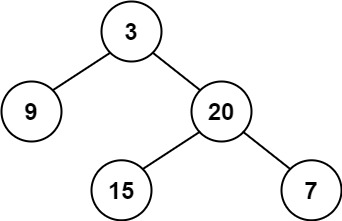
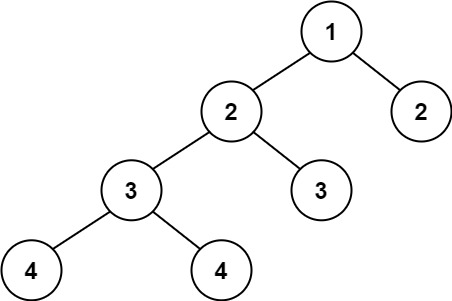

# 110. 平衡二叉树

Easy · [力扣原题](https://leetcode.cn/problems/balanced-binary-tree/)

所在刷题路径：灵神核心路线、灵神题单·链表树与回溯

| 作者 | 题解 | 动画讲解 |
|---|---|---|
| 灵茶山艾府 | [📄 题解](灵茶山艾府.md) | [▶︎ 0110 平衡二叉树 · 灵茶山艾府.mp4](0110%20平衡二叉树%20·%20灵茶山艾府.mp4) |
| yiduobo | [📄 题解](yiduobo.md) | [▶︎ 0110 平衡二叉树 · yiduobo.mp4](0110%20平衡二叉树%20·%20yiduobo.mp4) |

## 题目描述

给定一个二叉树，判断它是否是 平衡二叉树

**示例 1：**



```

输入：root = [3,9,20,null,null,15,7]
输出：true
```

**示例 2：**



```

输入：root = [1,2,2,3,3,null,null,4,4]
输出：false
```

**示例 3：**

```

输入：root = []
输出：true
```

**提示：**

- 树中的节点数在范围 `[0, 5000]` 内

- `-10⁴ <= Node.val <= 10⁴`

---
[↑ 返回 0100-0199](../README.md) · [总索引](../../../索引.md) · [仓库首页](../../../README.md)
