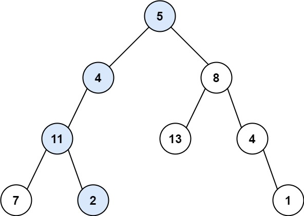
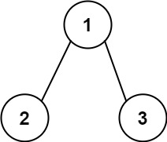

# 112. 路径总和

Easy · [力扣原题](https://leetcode.cn/problems/path-sum/)

所在刷题路径：灵神核心路线、灵神突击、灵神题单·链表树与回溯

| 作者 | 题解 | 动画讲解 |
|---|---|---|
| 灵茶山艾府 | [📄 题解](灵茶山艾府.md) | [▶︎ 0112 路径总和 · 灵茶山艾府.mp4](0112%20路径总和%20·%20灵茶山艾府.mp4) |
| yiduobo | [📄 题解](yiduobo.md) | [▶︎ 0112 路径总和 · yiduobo.mp4](0112%20路径总和%20·%20yiduobo.mp4) |

## 题目描述

给你二叉树的根节点 `root` 和一个表示目标和的整数 `targetSum` 。判断该树中是否存在 **根节点到叶子节点** 的路径，这条路径上所有节点值相加等于目标和 `targetSum` 。如果存在，返回 `true` ；否则，返回 `false` 。

**叶子节点** 是指没有子节点的节点。

**示例 1：**



```

输入：root = [5,4,8,11,null,13,4,7,2,null,null,null,1], targetSum = 22
输出：true
解释：等于目标和的根节点到叶节点路径如上图所示。
```

**示例 2：**



```

输入：root = [1,2,3], targetSum = 5
输出：false
解释：树中存在两条根节点到叶子节点的路径：
(1 --> 2): 和为 3
(1 --> 3): 和为 4
不存在 sum = 5 的根节点到叶子节点的路径。
```

**示例 3：**

```

输入：root = [], targetSum = 0
输出：false
解释：由于树是空的，所以不存在根节点到叶子节点的路径。
```

**提示：**

- 树中节点的数目在范围 `[0, 5000]` 内

- `-1000 <= Node.val <= 1000`

- `-1000 <= targetSum <= 1000`

---
[↑ 返回 0100-0199](../README.md) · [总索引](../../../索引.md) · [仓库首页](../../../README.md)
