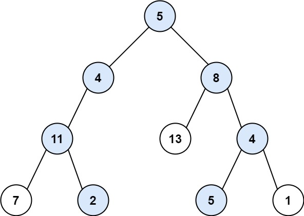

# 113. 路径总和 II

Medium · [力扣原题](https://leetcode.cn/problems/path-sum-ii/)

所在刷题路径：灵神题单·链表树与回溯

| 作者 | 题解 | 动画讲解 |
|---|---|---|
| 灵茶山艾府 | [📄 题解](灵茶山艾府.md) | [▶︎ 动画（GIF）](0113%20路径总和%20II%20·%20灵茶山艾府.gif) · [mp4 文件](0113%20路径总和%20II%20·%20灵茶山艾府.mp4) |
| yiduobo | [📄 题解](yiduobo.md) | [▶︎ 动画（GIF）](0113%20路径总和%20II%20·%20yiduobo.gif) · [mp4 文件](0113%20路径总和%20II%20·%20yiduobo.mp4) |

## 动画讲解

> 动图会循环播放；想暂停、拖进度条请下载上面表格里的 mp4 文件。

### 灵茶山艾府


### yiduobo


## 题目描述

给你二叉树的根节点 `root` 和一个整数目标和 `targetSum` ，找出所有 **从根节点到叶子节点** 路径总和等于给定目标和的路径。

**叶子节点** 是指没有子节点的节点。

**示例 1：**



```

输入：root = [5,4,8,11,null,13,4,7,2,null,null,5,1], targetSum = 22
输出：[[5,4,11,2],[5,8,4,5]]
```

**示例 2：**


```

输入：root = [1,2,3], targetSum = 5
输出：[]
```

**示例 3：**

```

输入：root = [1,2], targetSum = 0
输出：[]
```

**提示：**

- 树中节点总数在范围 `[0, 5000]` 内

- `-1000 <= Node.val <= 1000`

- `-1000 <= targetSum <= 1000`

---
[↑ 返回 0100-0199](../README.md) · [总索引](../../../索引.md) · [仓库首页](../../../README.md)
