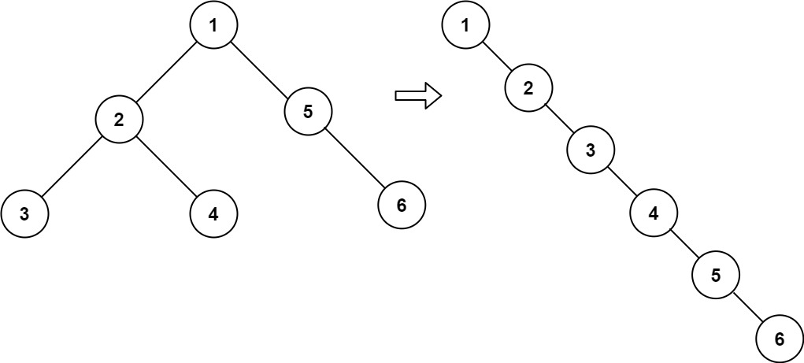

# 两种方法：头插法/分治（Python/Java/C++/C/Go/JS/Rust）

> **[114. 二叉树展开为链表](https://leetcode.cn/problems/flatten-binary-tree-to-linked-list/solutions/2992172/liang-chong-fang-fa-tou-cha-fa-fen-zhi-p-h9bg/) · Medium**

> **所属题单**
> - [链表、二叉树与回溯 · 二、二叉树](../../../刷题路径/灵神原版题单/链表、二叉树与回溯/二、二叉树.md) · §2.14 链表+二叉树
> - [LeetCode 热题 100 · 二叉树](../../../刷题路径/灵神原版题单/LeetCode%20热题%20100/二叉树.md)
> - [面试经典 150 题 · 二叉树](../../../刷题路径/灵神原版题单/面试经典%20150%20题/二叉树.md)

> **题目描述**
> 给你二叉树的根结点 `root` ，请你将它展开为一个单链表：
>
> - 展开后的单链表应该同样使用 `TreeNode` ，其中 `right` 子指针指向链表中下一个结点，而左子指针始终为 `null` 。
>
> - 展开后的单链表应该与二叉树 [**先序遍历**](https://baike.baidu.com/item/%E5%85%88%E5%BA%8F%E9%81%8D%E5%8E%86/6442839?fr=aladdin) 顺序相同。
>
> **示例 1：**
>
> 
>
> ```
>
> 输入：root = [1,2,5,3,4,null,6]
> 输出：[1,null,2,null,3,null,4,null,5,null,6]
> ```
>
> **示例 2：**
>
> ```
>
> 输入：root = []
> 输出：[]
> ```
>
> **示例 3：**
>
> ```
>
> 输入：root = [0]
> 输出：[0]
> ```
>
> **提示：**
>
> - 树中结点数在范围 `[0, 2000]` 内
>
> - `-100 <= Node.val <= 100`
>
> **进阶：**你可以使用原地算法（`O(1)` 额外空间）展开这棵树吗？

> **题解**
> ## 方法一：头插法
>
> 
>
> 采用**头插法**构建链表，也就是从节点 $6$ 开始，在 $6$ 的前面插入 $5$，在 $5$ 的前面插入 $4$，依此类推。
>
> 为此，要按照 $6\to 5\to 4\to 3\to 2\to 1$ 的顺序访问节点。如何遍历二叉树，才能实现这个顺序？
>
> 既然 $1\to 2\to 3\to 4\to 5\to 6$ 是先序遍历，那么 $6\to 5\to 4\to 3\to 2\to 1$ 就是先序遍历的逆序，即按照**右 - 左 - 根**的顺序遍历二叉树。
>
> 遍历的同时执行头插法，把当前节点插在链表头节点 $\textit{head}$ 的前面，然后更新 $\textit{head}$ 为当前节点。一开始 $\textit{head}$ 是空节点。
>
> ```python
> class Solution:
>     head = None
>
>     def flatten(self, root: Optional[TreeNode]) -> None:
>         if root is None:
>             return
>         # 右 - 左 - 根
>         self.flatten(root.right)
>         self.flatten(root.left)
>         root.left = None
>         root.right = self.head  # 在头节点 head 的前面插入 root
>         self.head = root  # 现在头节点是 root
> ```
>
>
> #### 复杂度分析
>
> - 时间复杂度：$\mathcal{O}(n)$，其中 $n$ 是二叉树的节点个数。
> - 空间复杂度：$\mathcal{O}(n)$。递归需要 $\mathcal{O}(n)$ 的栈空间。
>
> ## 方法二：分治
>
> 方法一需要用到一个在 DFS 之外的变量 $\textit{head}$，能否只在 DFS 中解决呢？
>
> 
>
> 考虑分治，假如我们计算出了 $\textit{root} = 1$ 左子树的链表 $2\to 3\to 4$，以及右子树的链表 $5\to 6$，那么接下来只需要穿针引线，把节点 $1$ 和两条链表连起来：
>
> 1. 先把 $2\to 3\to 4$ 和 $5\to 6$ 连起来，也就是左子树链表尾节点 $4$ 的 $\textit{right}$ 更新为节点 $5$（即 $\textit{root}.\textit{right}$），得到 $2\to 3\to 4\to 5\to 6$。
> 2. 然后把 $1$ 和 $2\to 3\to 4\to 5\to 6$ 连起来，也就是节点 $1$ 的 $\textit{right}$ 更新为节点 $2$（即 $\textit{root}.\textit{left}$），得到 $1\to 2\to 3\to 4\to 5\to 6$。
> 3. 最后把 $\textit{root}.\textit{left}$ 置为空。
>
> 上面的过程，我们需要知道左子树链表的尾节点 $4$。所以 DFS 需要返回链表的尾节点。
>
> 链表合并完成后，返回合并后的链表的尾节点，也就是右子树链表的尾节点。如果右子树是空的，则返回左子树链表的尾节点。如果左右子树都是空的，返回当前节点。
>
> ```python
> class Solution:
>     def flatten(self, root: Optional[TreeNode]) -> Optional[TreeNode]:
>         if root is None:
>             return None
>         left_tail = self.flatten(root.left)
>         right_tail = self.flatten(root.right)
>         if left_tail:
>             left_tail.right = root.right  # 左子树链表的尾节点 -> 右子树链表的头节点
>             root.right = root.left  # root -> 左子树链表的头节点
>             root.left = None
>         return right_tail or left_tail or root
> ```
>
>
> #### 复杂度分析
>
> - 时间复杂度：$\mathcal{O}(n)$，其中 $n$ 是二叉树的节点个数。
> - 空间复杂度：$\mathcal{O}(n)$。递归需要 $\mathcal{O}(n)$ 的栈空间。
>
> ## 分类题单
>
> [如何科学刷题？](https://leetcode.cn/circle/discuss/RvFUtj/)
>
> 1. [滑动窗口与双指针（定长/不定长/单序列/双序列/三指针/分组循环）](https://leetcode.cn/circle/discuss/0viNMK/)
> 2. [二分算法（二分答案/最小化最大值/最大化最小值/第K小）](https://leetcode.cn/circle/discuss/SqopEo/)
> 3. [单调栈（基础/矩形面积/贡献法/最小字典序）](https://leetcode.cn/circle/discuss/9oZFK9/)
> 4. [网格图（DFS/BFS/综合应用）](https://leetcode.cn/circle/discuss/YiXPXW/)
> 5. [位运算（基础/性质/拆位/试填/恒等式/思维）](https://leetcode.cn/circle/discuss/dHn9Vk/)
> 6. [图论算法（DFS/BFS/拓扑排序/最短路/最小生成树/二分图/基环树/欧拉路径）](https://leetcode.cn/circle/discuss/01LUak/)
> 7. [动态规划（入门/背包/状态机/划分/区间/状压/数位/数据结构优化/树形/博弈/概率期望）](https://leetcode.cn/circle/discuss/tXLS3i/)
> 8. [常用数据结构（前缀和/差分/栈/队列/堆/字典树/并查集/树状数组/线段树）](https://leetcode.cn/circle/discuss/mOr1u6/)
> 9. [数学算法（数论/组合/概率期望/博弈/计算几何/随机算法）](https://leetcode.cn/circle/discuss/IYT3ss/)
> 10. [贪心与思维（基本贪心策略/反悔/区间/字典序/数学/思维/脑筋急转弯/构造）](https://leetcode.cn/circle/discuss/g6KTKL/)
> 11. 【本题相关】[链表、二叉树与回溯（前后指针/快慢指针/DFS/BFS/直径/LCA/一般树）](https://leetcode.cn/circle/discuss/K0n2gO/)
> 12. [字符串（KMP/Z函数/Manacher/字符串哈希/AC自动机/后缀数组/子序列自动机）](https://leetcode.cn/circle/discuss/SJFwQI/)
>
> [我的题解精选（已分类）](https://github.com/EndlessCheng/codeforces-go/blob/master/leetcode/SOLUTIONS.md)
>
> 欢迎关注 [B站@灵茶山艾府](https://space.bilibili.com/206214)
