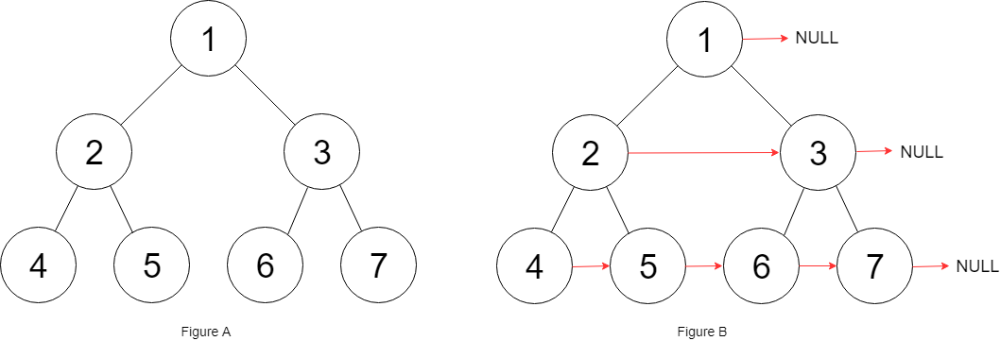

# 116. 填充每个节点的下一个右侧节点指针

Medium · [力扣原题](https://leetcode.cn/problems/populating-next-right-pointers-in-each-node/)

所在刷题路径：labuladong、灵神题单·链表树与回溯

| 作者 | 题解 | 动画讲解 |
|---|---|---|
| 灵茶山艾府 | [📄 题解](灵茶山艾府.md) | [▶︎ 0116 填充每个节点的下一个右侧节点指针 · 灵茶山艾府.mp4](0116%20填充每个节点的下一个右侧节点指针%20·%20灵茶山艾府.mp4) |
| yiduobo | [📄 题解](yiduobo.md) | [▶︎ 0116 填充每个节点的下一个右侧节点指针 · yiduobo.mp4](0116%20填充每个节点的下一个右侧节点指针%20·%20yiduobo.mp4) |

## 题目描述

给定一个 **完美二叉树** ，其所有叶子节点都在同一层，每个父节点都有两个子节点。二叉树定义如下：

```

struct Node {
  int val;
  Node *left;
  Node *right;
  Node *next;
}
```

填充它的每个 next 指针，让这个指针指向其下一个右侧节点。如果找不到下一个右侧节点，则将 next 指针设置为 `NULL`。

初始状态下，所有 next 指针都被设置为 `NULL`。

**示例 1：**



```

输入：root = [1,2,3,4,5,6,7]
输出：[1,#,2,3,#,4,5,6,7,#]
解释：给定二叉树如图 A 所示，你的函数应该填充它的每个 next 指针，以指向其下一个右侧节点，如图 B 所示。序列化的输出按层序遍历排列，同一层节点由 next 指针连接，'#' 标志着每一层的结束。
```

**示例 2:**

```

输入：root = []
输出：[]
```

**提示：**

- 树中节点的数量在 `[0, 2¹² - 1]` 范围内

- `-1000 <= node.val <= 1000`

**进阶：**

- 你只能使用常量级额外空间。

- 使用递归解题也符合要求，本题中递归程序占用的栈空间不算做额外的空间复杂度。

---
[↑ 返回 0100-0199](../README.md) · [总索引](../../../索引.md) · [仓库首页](../../../README.md)
