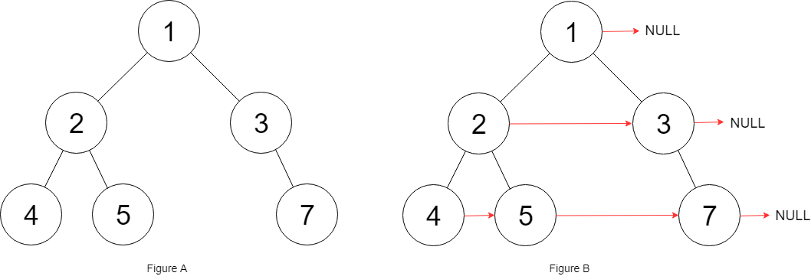

# 三种方法：DFS/BFS/BFS+链表（Python/Java/C++/Go/JS）

> **[117. 填充每个节点的下一个右侧节点指针 II](https://leetcode.cn/problems/populating-next-right-pointers-in-each-node-ii/solutions/2510360/san-chong-fang-fa-dfsbfsbfslian-biao-fu-1bmqp/) · Medium**

> **所属题单**
> - [链表、二叉树与回溯 · 二、二叉树](../../../刷题路径/灵神原版题单/链表、二叉树与回溯/二、二叉树.md) · §2.14 链表+二叉树
> - [面试经典 150 题 · 二叉树](../../../刷题路径/灵神原版题单/面试经典%20150%20题/二叉树.md)

> **题目描述**
> 给定一个二叉树：
>
> ```
>
> struct Node {
>   int val;
>   Node *left;
>   Node *right;
>   Node *next;
> }
> ```
>
> 填充它的每个 next 指针，让这个指针指向其下一个右侧节点。如果找不到下一个右侧节点，则将 next 指针设置为 `NULL` 。
>
> 初始状态下，所有 next 指针都被设置为 `NULL` 。
>
> **示例 1：**
>
> 
>
> ```
>
> 输入：root = [1,2,3,4,5,null,7]
> 输出：[1,#,2,3,#,4,5,7,#]
> 解释：给定二叉树如图 A 所示，你的函数应该填充它的每个 next 指针，以指向其下一个右侧节点，如图 B 所示。序列化输出按层序遍历顺序（由 next 指针连接），'#' 表示每层的末尾。
> ```
>
> **示例 2：**
>
> ```
>
> 输入：root = []
> 输出：[]
> ```
>
> **提示：**
>
> - 树中的节点数在范围 `[0, 6000]` 内
>
> - `-100 <= Node.val <= 100`
>
> **进阶：**
>
> - 你只能使用常量级额外空间。
>
> - 使用递归解题也符合要求，本题中递归程序的隐式栈空间不计入额外空间复杂度。

> **题解**
> ## 方法一：DFS
>
> #### 前置知识
>
> [二叉树 DFS【基础算法精讲 09】](https://www.bilibili.com/video/BV1UD4y1Y769/)
>
> #### 思路
>
> 
>
> DFS 这棵树，从根节点 $1$ 出发，向左递归到 $2$，再向左递归到 $4$。
>
> 这三个节点正好是每一层的第一个节点（类似链表头），用一个数组 $\textit{pre}$ 记录，即 $\textit{pre}[0]$ 为节点 $1$，$\textit{pre}[1]$ 为节点 $2$，$\textit{pre}[2]$ 为节点 $4$。$\textit{pre}$ 的下标就是节点的**深度**。
>
> 继续递归到 $5$（深度为 $2$），从 $\textit{pre}[2]$ 中拿到节点 $4$，把 $4$ 的 $\textit{next}$ 指向 $5$。然后更新 $\textit{pre}[2]$ 为节点 $5$，这样在后面递归到节点 $7$ 时，就可以从 $\textit{pre}[2]$ 中拿到节点 $5$，把 $5$ 的 $\textit{next}$ 指向 $7$ 了。
>
> #### 算法
>
> 1. 创建一个空数组 $\textit{pre}$（因为一开始不知道二叉树有多深）。
> 2. DFS 这棵二叉树，递归参数为当前节点 $\textit{node}$，以及当前节点的深度 $\textit{depth}$。每往下递归一层，就把 $\textit{depth}$ 加一。
> 3. 如果 $\textit{depth}$ 等于 $\textit{pre}$ 数组的长度，说明 $\textit{node}$ 是这一层最左边的节点，把 $\textit{node}$ 添加到 $\textit{pre}$ 的末尾。
> 4. 否则，把 $\textit{pre}[\textit{depth}]$ 的 $\textit{next}$ 指向 $\textit{node}$，然后更新 $\textit{pre}[\textit{depth}]$ 为 $\textit{node}$。
> 5. 递归边界：如果 $\textit{node}$ 是空节点，直接返回。
> 6. 递归入口：$\textit{dfs}(\textit{root},0)$。
> 7. 最后返回 $\textit{root}$。
>
> ```python
> class Solution:
>     def connect(self, root: 'Node') -> 'Node':
>         pre = []
>         def dfs(node: 'Node', depth: int) -> None:
>             if node is None:
>                 return
>             if depth == len(pre):  # node 是这一层最左边的节点
>                 pre.append(node)
>             else:  # pre[depth] 是 node 左边的节点
>                 pre[depth].next = node  # node 左边的节点指向 node
>                 pre[depth] = node
>             dfs(node.left, depth + 1)
>             dfs(node.right, depth + 1)
>         dfs(root, 0)  # 根节点的深度为 0
>         return root
> ```
>
>
> #### 复杂度分析
>
> - 时间复杂度：$\mathcal{O}(n)$，其中 $n$ 为二叉树的节点个数。
> - 空间复杂度：$\mathcal{O}(h)$，其中 $h$ 为二叉树的高度，最坏情况下是 $n$。
>
> ## 方法二：BFS
>
> #### 前置知识
>
> [二叉树 BFS【基础算法精讲 13】](https://www.bilibili.com/video/BV1hG4y1277i/)
>
> #### 思路
>
> 如果 BFS 这棵二叉树，做法就更加简单了：只需要把每一层的节点，从左到右依次用 $\textit{next}$ 指针连接起来。
>
> 注意特判 $\textit{root}$ 为空的情况。
>
> ```python
> class Solution:
>     def connect(self, root: 'Node') -> 'Node':
>         if root is None:
>             return None
>         q = [root]
>         while q:
>             # 从左到右依次连接
>             for x, y in pairwise(q):
>                 x.next = y
>             # 准备下一层的节点
>             tmp = q
>             q = []
>             for node in tmp:
>                 if node.left:  q.append(node.left)
>                 if node.right: q.append(node.right)
>         return root
> ```
>
>
> #### 复杂度分析
>
> - 时间复杂度：$\mathcal{O}(n)$，其中 $n$ 为二叉树的节点个数。
> - 空间复杂度：$\mathcal{O}(n)$。
>
> ## 方法三：BFS+链表
>
> #### 思路
>
> 既然每一层都连接成一个链表了，那么知道链表头，就能访问这一层的所有节点。
>
> 所以在 BFS 的时候，可以一边遍历当前层的节点，一边把下一层的节点连接起来。这样就无需存储下一层的节点了，只需要拿到下一层链表的头节点。
>
> #### 算法
>
> 1. 从第一层开始（第一层只有一个 $\textit{root}$ 节点），每次循环：
> 2. 遍历当前层的链表节点，通过节点的 $\textit{left}$ 和 $\textit{right}$ 得到下一层的节点。
> 3. 把下一层的节点从左到右连接成一个链表。
> 4. 拿到下一层链表的头节点，进入下一轮循环。
>
> 代码实现时，可以用一个**哨兵节点**来表示「第一个节点之前的节点」，从而减少一些关于空节点的判断逻辑。具体请看[【基础算法精讲 06】](https://www.bilibili.com/video/BV1sd4y1x7KN/)
>
> ```python
> class Solution:
>     def connect(self, root: 'Node') -> 'Node':
>         cur = root
>         while cur:
>             nxt = dummy = Node()  # 下一层的链表
>             while cur:  # 遍历当前层的链表
>                 if cur.left:
>                     nxt.next = cur.left  # 下一层的相邻节点连起来
>                     nxt = cur.left
>                 if cur.right:
>                     nxt.next = cur.right  # 下一层的相邻节点连起来
>                     nxt = cur.right
>                 cur = cur.next  # 当前层链表的下一个节点
>             cur = dummy.next  # 下一层链表的头节点
>         return root
> ```
>
>
> #### 复杂度分析
>
> - 时间复杂度：$\mathcal{O}(n)$，其中 $n$ 为二叉树的节点个数。
> - 空间复杂度：$\mathcal{O}(1)$。
>
> ## 分类题单
>
> [如何科学刷题？](https://leetcode.cn/circle/discuss/RvFUtj/)
>
> 1. [滑动窗口与双指针（定长/不定长/单序列/双序列/三指针/分组循环）](https://leetcode.cn/circle/discuss/0viNMK/)
> 2. [二分算法（二分答案/最小化最大值/最大化最小值/第K小）](https://leetcode.cn/circle/discuss/SqopEo/)
> 3. [单调栈（基础/矩形面积/贡献法/最小字典序）](https://leetcode.cn/circle/discuss/9oZFK9/)
> 4. [网格图（DFS/BFS/综合应用）](https://leetcode.cn/circle/discuss/YiXPXW/)
> 5. [位运算（基础/性质/拆位/试填/恒等式/思维）](https://leetcode.cn/circle/discuss/dHn9Vk/)
> 6. [图论算法（DFS/BFS/拓扑排序/基环树/最短路/最小生成树/网络流）](https://leetcode.cn/circle/discuss/01LUak/)
> 7. [动态规划（入门/背包/划分/状态机/区间/状压/数位/数据结构优化/树形/博弈/概率期望）](https://leetcode.cn/circle/discuss/tXLS3i/)
> 8. [常用数据结构（前缀和/差分/栈/队列/堆/字典树/并查集/树状数组/线段树）](https://leetcode.cn/circle/discuss/mOr1u6/)
> 9. [数学算法（数论/组合/概率期望/博弈/计算几何/随机算法）](https://leetcode.cn/circle/discuss/IYT3ss/)
> 10. [贪心与思维（基本贪心策略/反悔/区间/字典序/数学/思维/脑筋急转弯/构造）](https://leetcode.cn/circle/discuss/g6KTKL/)
> 11. [链表、二叉树与回溯（前后指针/快慢指针/DFS/BFS/直径/LCA/一般树）](https://leetcode.cn/circle/discuss/K0n2gO/)
> 12. [字符串（KMP/Z函数/Manacher/字符串哈希/AC自动机/后缀数组/子序列自动机）](https://leetcode.cn/circle/discuss/SJFwQI/)
>
> [我的题解精选（已分类）](https://github.com/EndlessCheng/codeforces-go/blob/master/leetcode/SOLUTIONS.md)
>
> 欢迎关注 [B站@灵茶山艾府](https://space.bilibili.com/206214)
