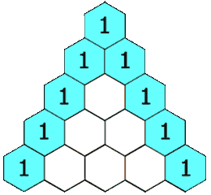

# 118. 杨辉三角

Easy · [力扣原题](https://leetcode.cn/problems/pascals-triangle/)

所在刷题路径：labuladong、灵神突击

| 作者 | 题解 | 动画讲解 |
|---|---|---|
| 灵茶山艾府 | [📄 题解](灵茶山艾府.md) | [▶︎ 0118 杨辉三角 · 灵茶山艾府.mp4](0118%20杨辉三角%20·%20灵茶山艾府.mp4) |
| yiduobo | [📄 题解](yiduobo.md) | [▶︎ 0118 杨辉三角 · yiduobo.mp4](0118%20杨辉三角%20·%20yiduobo.mp4) |

## 题目描述

给定一个非负整数 <em>`numRows`，</em>生成「杨辉三角」的前 <em>`numRows`</em> 行。

在**「杨辉三角」**中，每个数是它左上方和右上方的数的和。



**示例 1:**

```

输入: numRows = 5
输出: [[1],[1,1],[1,2,1],[1,3,3,1],[1,4,6,4,1]]
```

**示例 2:**

```

输入: numRows = 1
输出: [[1]]
```

**提示:**

- `1 <= numRows <= 30`

---
[↑ 返回 0100-0199](../README.md) · [总索引](../../../索引.md) · [仓库首页](../../../README.md)
