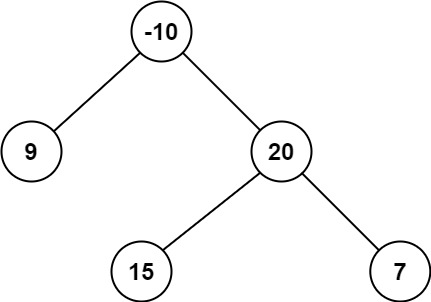

# 【视频】彻底掌握直径 DP！从二叉树到一般树！（Python/Java/C++/C/Go/JS/Rust）

> **[124. 二叉树中的最大路径和](https://leetcode.cn/problems/binary-tree-maximum-path-sum/solutions/2227021/shi-pin-che-di-zhang-wo-zhi-jing-dpcong-n9s91/) · Hard**

> **所属题单**
> - [链表、二叉树与回溯 · 二、二叉树](../../../刷题路径/灵神原版题单/链表、二叉树与回溯/二、二叉树.md) · §2.6 二叉树的直径
> - [动态规划 · 十二、树形 DP](../../../刷题路径/灵神原版题单/动态规划/十二、树形%20DP.md) · §12.1 树的直径
> - [LeetCode 热题 100 · 二叉树](../../../刷题路径/灵神原版题单/LeetCode%20热题%20100/二叉树.md)
> - [面试经典 150 题 · 二叉树](../../../刷题路径/灵神原版题单/面试经典%20150%20题/二叉树.md)

> **题目描述**
> 二叉树中的 **路径** 被定义为一条节点序列，序列中每对相邻节点之间都存在一条边。同一个节点在一条路径序列中 **至多出现一次** 。该路径 **至少包含一个** 节点，且不一定经过根节点。
>
> **路径和** 是路径中各节点值的总和。
>
> 给你一个二叉树的根节点 `root` ，返回其 **最大路径和** 。
>
> **示例 1：**
>
> 
>
> ```
>
> 输入：root = [1,2,3]
> 输出：6
> 解释：最优路径是 2 -> 1 -> 3 ，路径和为 2 + 1 + 3 = 6
> ```
>
> **示例 2：**
>
> 
>
> ```
>
> 输入：root = [-10,9,20,null,null,15,7]
> 输出：42
> 解释：最优路径是 15 -> 20 -> 7 ，路径和为 15 + 20 + 7 = 42
> ```
>
> **提示：**
>
> - 树中节点数目范围是 `[1, 3 * 10⁴]`
>
> - `-1000 <= Node.val <= 1000`

> **题解**
> ## 视频讲解
>
> **递归原理**：[深入理解递归【基础算法精讲 09】](https://www.bilibili.com/video/BV1UD4y1Y769/)。
>
> **本题视频讲解**：[树形 DP【基础算法精讲 23】](https://www.bilibili.com/video/BV17o4y187h1/)，制作不易，欢迎点赞关注~
>
> ## 视频内容补充
>
> 本题有两个关键概念：
>
> - **链**：从下面的某个节点（不一定是叶子）到当前节点的路径。把这条链的节点值之和，作为 $\textit{dfs}$ 的返回值。如果节点值之和是负数，则返回 $0$（和 $0$ 取最大值）。这个思想和 [53. 最大子数组和](https://leetcode.cn/problems/maximum-subarray/) 是一样的，如果左侧子数组的元素和是负数，就不和当前元素拼起来。
> - **直径**：等价于由两条（或者一条）链拼成的路径。我们枚举每个 $\textit{node}$，假设直径在这里「**拐弯**」，也就是计算由左右两条从下面的某个节点（不一定是叶子）到 $\textit{node}$ 的链的节点值之和，去更新答案的最大值。
>
> ⚠**注意**：$\textit{dfs}$ 返回的是**链**的节点值之和，不是**直径**的节点值之和。
>
> ## 答疑
>
> **问**：如果所有节点值都是负数，代码会算出什么结果？
>
> **答**：在所有节点值都为负数的情况下，代码中的 `ans = max(ans, sum_l + node.val + sum_r)` 等价于 `ans = max(ans, node.val)`，我们求的是最大节点值（绝对值最小的负数）。这是符合题目要求的，因为在所有节点值都为负数的情况下，路径只有一个节点是最优的（毕竟节点越多，元素和越小）。类比 [53. 最大子数组和](https://leetcode.cn/problems/maximum-subarray/)，当数组元素都是负数的时候，答案就是 $\max(\textit{nums})$。
>
> ```python
> class Solution:
>     def maxPathSum(self, root: Optional[TreeNode]) -> int:
>         ans = -inf
>
>         def dfs(node: Optional[TreeNode]) -> int:
>             if node is None:
>                 return 0  # 没有节点，和为 0
>             sum_l = dfs(node.left)  # 左子树最大链和
>             sum_r = dfs(node.right)  # 右子树最大链和
>             nonlocal ans
>             ans = max(ans, sum_l + node.val + sum_r)  # 左链 + node + 右链 = 路径
>             return max(max(sum_l, sum_r) + node.val, 0)  # 当前子树最大链和（注意这里和 0 取最大值了）
>
>         dfs(root)
>         return ans
> ```
>
>
> #### 复杂度分析
>
> - 时间复杂度：$\mathcal{O}(n)$，其中 $n$ 是二叉树的节点个数。
> - 空间复杂度：$\mathcal{O}(h)$，其中 $h$ 是二叉树的高度。递归需要 $\mathcal{O}(h)$ 的栈空间。
>
> ## 课上题目
>
> - [543. 二叉树的直径](https://leetcode.cn/problems/diameter-of-binary-tree/)
> - [124. 二叉树中的最大路径和](https://leetcode.cn/problems/binary-tree-maximum-path-sum/)
> - [2246. 相邻字符不同的最长路径](https://leetcode.cn/problems/longest-path-with-different-adjacent-characters/)
>
> ## 课后作业
>
> - [687. 最长同值路径](https://leetcode.cn/problems/longest-univalue-path/)
> - [1617. 统计子树中城市之间最大距离](https://leetcode.cn/problems/count-subtrees-with-max-distance-between-cities/)
> - [2539. 最大价值和与最小价值和的差值](https://leetcode.cn/problems/difference-between-maximum-and-minimum-price-sum/)
>
> ## 分类题单
>
> [如何科学刷题？](https://leetcode.cn/discuss/post/3141566/ru-he-ke-xue-shua-ti-by-endlesscheng-q3yd/)
>
> 1. [滑动窗口与双指针（定长/不定长/单序列/双序列/三指针/分组循环）](https://leetcode.cn/discuss/post/3578981/ti-dan-hua-dong-chuang-kou-ding-chang-bu-rzz7/)
> 2. [二分算法（二分答案/最小化最大值/最大化最小值/第K小）](https://leetcode.cn/discuss/post/3579164/ti-dan-er-fen-suan-fa-er-fen-da-an-zui-x-3rqn/)
> 3. [单调栈（基础/矩形面积/贡献法/最小字典序）](https://leetcode.cn/discuss/post/3579480/ti-dan-dan-diao-zhan-ju-xing-xi-lie-zi-d-u4hk/)
> 4. [网格图（DFS/BFS/综合应用）](https://leetcode.cn/discuss/post/3580195/fen-xiang-gun-ti-dan-wang-ge-tu-dfsbfszo-l3pa/)
> 5. [位运算（基础/性质/拆位/试填/恒等式/思维）](https://leetcode.cn/discuss/post/3580371/fen-xiang-gun-ti-dan-wei-yun-suan-ji-chu-nth4/)
> 6. [图论算法（DFS/BFS/拓扑排序/基环树/最短路/最小生成树/网络流）](https://leetcode.cn/discuss/post/3581143/fen-xiang-gun-ti-dan-tu-lun-suan-fa-dfsb-qyux/)
> 7. [动态规划（入门/背包/划分/状态机/区间/状压/数位/数据结构优化/树形/博弈/概率期望）](https://leetcode.cn/discuss/post/3581838/fen-xiang-gun-ti-dan-dong-tai-gui-hua-ru-007o/)
> 8. [常用数据结构（前缀和/差分/栈/队列/堆/字典树/并查集/树状数组/线段树）](https://leetcode.cn/discuss/post/3583665/fen-xiang-gun-ti-dan-chang-yong-shu-ju-j-bvmv/)
> 9. [数学算法（数论/组合/概率期望/博弈/计算几何/随机算法）](https://leetcode.cn/discuss/post/3584388/fen-xiang-gun-ti-dan-shu-xue-suan-fa-shu-gcai/)
> 10. [贪心与思维（基本贪心策略/反悔/区间/字典序/数学/思维/脑筋急转弯/构造）](https://leetcode.cn/discuss/post/3091107/fen-xiang-gun-ti-dan-tan-xin-ji-ben-tan-k58yb/)
> 11. [链表、树与回溯（前后指针/快慢指针/DFS/BFS/直径/LCA）](https://leetcode.cn/discuss/post/3142882/fen-xiang-gun-ti-dan-lian-biao-er-cha-sh-6srp/)
> 12. [字符串（KMP/Z函数/Manacher/字符串哈希/AC自动机/后缀数组/子序列自动机）](https://leetcode.cn/discuss/post/3144832/fen-xiang-gun-ti-dan-zi-fu-chuan-kmpzhan-ugt4/)
>
> [我的题解精选（已分类）](https://github.com/EndlessCheng/codeforces-go/blob/master/leetcode/SOLUTIONS.md)
>
> 欢迎关注 [B站@灵茶山艾府](https://space.bilibili.com/206214)
