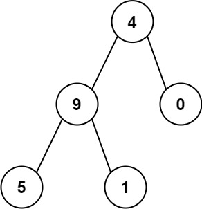

# 129. 求根节点到叶节点数字之和

Medium · [力扣原题](https://leetcode.cn/problems/sum-root-to-leaf-numbers/)

所在刷题路径：labuladong、灵神核心路线、灵神突击、灵神题单·链表树与回溯

| 作者 | 题解 | 动画讲解 |
|---|---|---|
| 灵茶山艾府 | [📄 题解](灵茶山艾府.md) | [▶︎ 动画（GIF）](0129%20求根节点到叶节点数字之和%20·%20灵茶山艾府.gif) · [mp4 文件](0129%20求根节点到叶节点数字之和%20·%20灵茶山艾府.mp4) |
| yiduobo | [📄 题解](yiduobo.md) | [▶︎ 动画（GIF）](0129%20求根节点到叶节点数字之和%20·%20yiduobo.gif) · [mp4 文件](0129%20求根节点到叶节点数字之和%20·%20yiduobo.mp4) |

## 动画讲解

> 动图会循环播放；想暂停、拖进度条请下载上面表格里的 mp4 文件。

### 灵茶山艾府


### yiduobo


## 题目描述

给你一个二叉树的根节点 `root` ，树中每个节点都存放有一个 `0` 到 `9` 之间的数字。

每条从根节点到叶节点的路径都代表一个数字：

- 例如，从根节点到叶节点的路径 `1 -> 2 -> 3` 表示数字 `123` 。

计算从根节点到叶节点生成的 **所有数字之和** 。

**叶节点** 是指没有子节点的节点。

**示例 1：**


```

输入：root = [1,2,3]
输出：25
解释：
从根到叶子节点路径 1->2 代表数字 12
从根到叶子节点路径 1->3 代表数字 13
因此，数字总和 = 12 + 13 = 25
```

**示例 2：**



```

输入：root = [4,9,0,5,1]
输出：1026
解释：
从根到叶子节点路径 4->9->5 代表数字 495
从根到叶子节点路径 4->9->1 代表数字 491
从根到叶子节点路径 4->0 代表数字 40
因此，数字总和 = 495 + 491 + 40 = 1026
```

**提示：**

- 树中节点的数目在范围 `[1, 1000]` 内

- `0 <= Node.val <= 9`

- 树的深度不超过 `10`

---
[↑ 返回 0100-0199](../README.md) · [总索引](../../../索引.md) · [仓库首页](../../../README.md)
