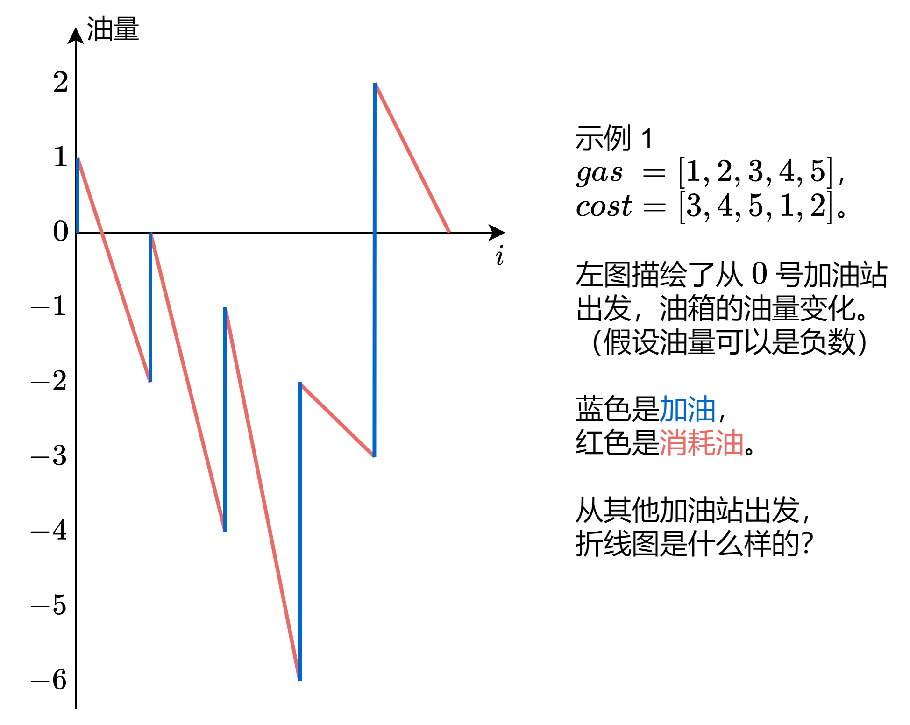
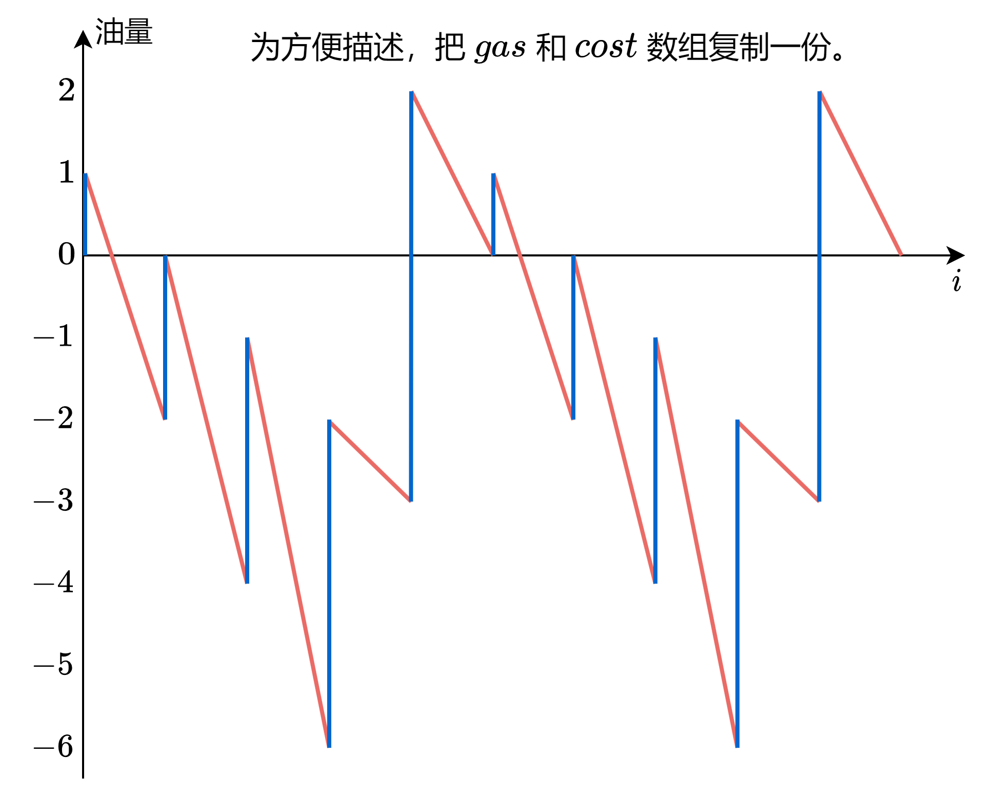
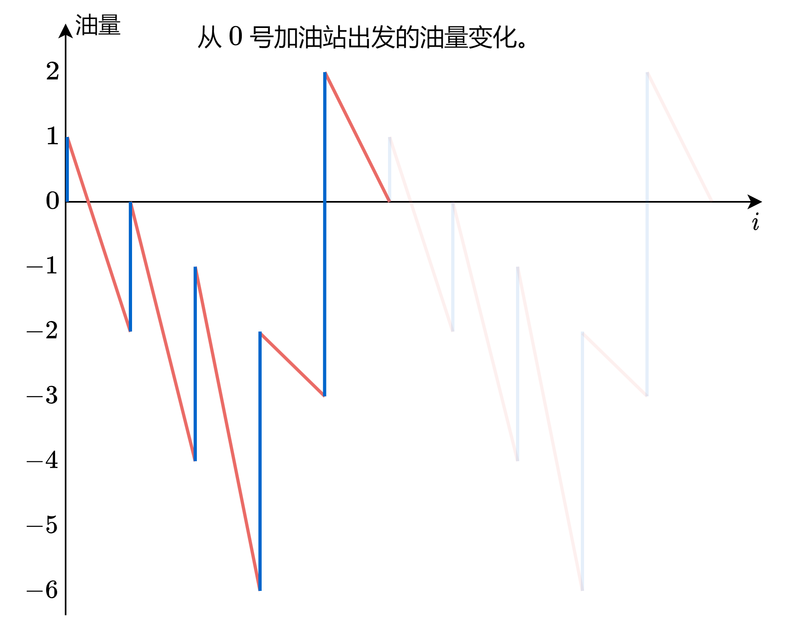
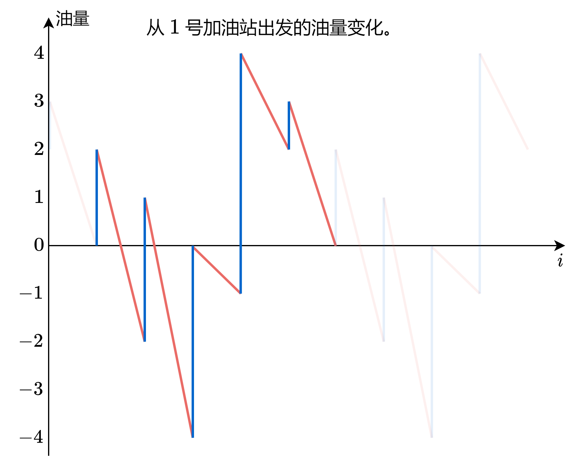
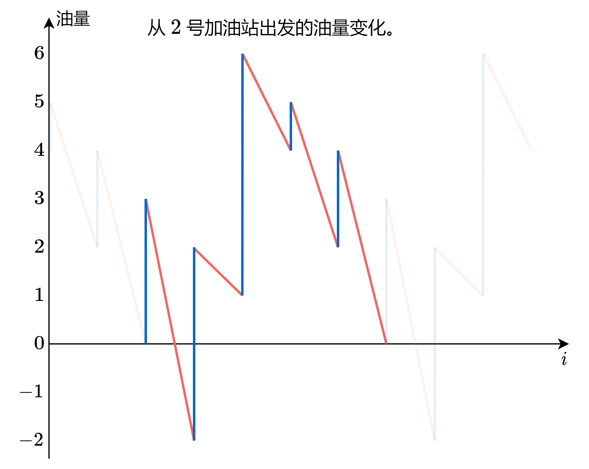
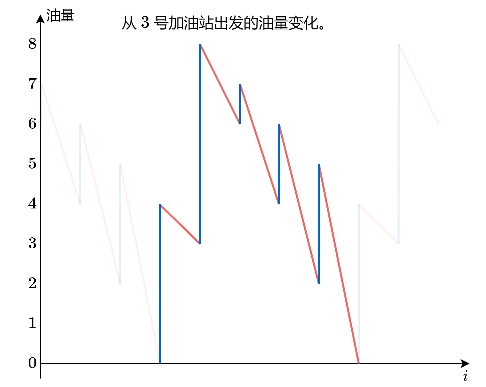
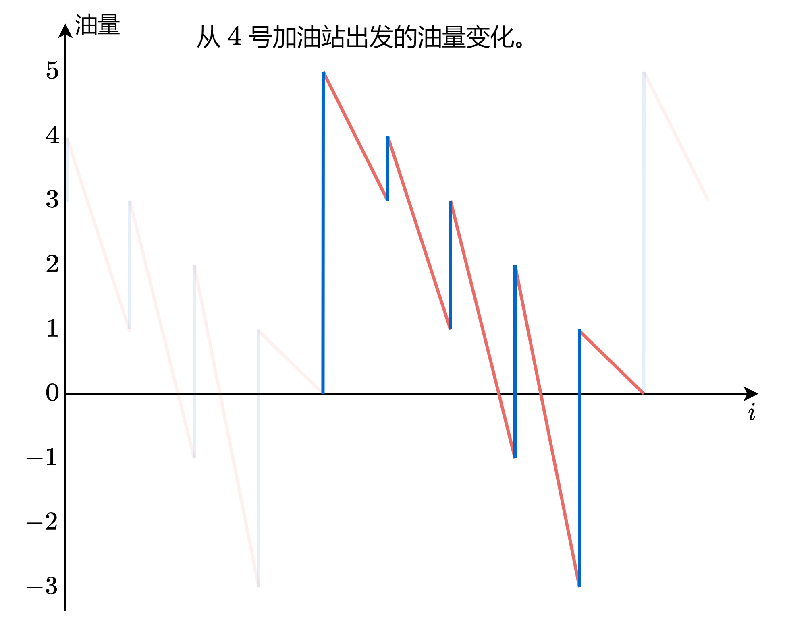
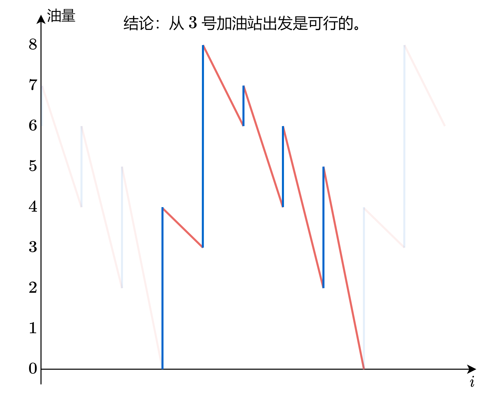
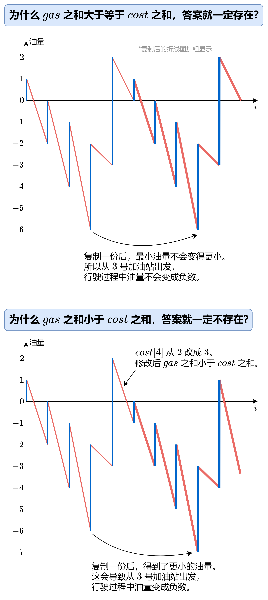

# 用【折线图】直观理解（Python/Java/C++/C/Go/JS/Rust）

> **[134. 加油站](https://leetcode.cn/problems/gas-station/solutions/2933132/yong-zhe-xian-tu-zhi-guan-li-jie-pythonj-qccr/) · Medium**

> **所属题单**
> - [贪心算法 · 八、其他](../../../刷题路径/灵神原版题单/贪心算法/八、其他.md)
> - [面试经典 150 题 · 数组 / 字符串](../../../刷题路径/灵神原版题单/面试经典%20150%20题/数组%20-%20字符串.md)

> **题目描述**
> 在一条环路上有 `n` 个加油站，其中第 `i` 个加油站有汽油 `gas[i]` 升。
>
> 你有一辆油箱容量无限的的汽车，从第 `i` 个加油站开往第 `i+1` 个加油站需要消耗汽油 `cost[i]` 升。你从其中的一个加油站出发，开始时油箱为空。
>
> 给定两个整数数组 `gas` 和 `cost` ，如果你可以按顺序绕环路行驶一周，则返回出发时加油站的编号，否则返回 `-1` 。如果存在解，则 **保证** 它是 **唯一** 的。
>
> **示例 1:**
>
> ```
>
> 输入: gas = [1,2,3,4,5], cost = [3,4,5,1,2]
> 输出: 3
> 解释:
> 从 3 号加油站(索引为 3 处)出发，可获得 4 升汽油。此时油箱有 = 0 + 4 = 4 升汽油
> 开往 4 号加油站，此时油箱有 4 - 1 + 5 = 8 升汽油
> 开往 0 号加油站，此时油箱有 8 - 2 + 1 = 7 升汽油
> 开往 1 号加油站，此时油箱有 7 - 3 + 2 = 6 升汽油
> 开往 2 号加油站，此时油箱有 6 - 4 + 3 = 5 升汽油
> 开往 3 号加油站，你需要消耗 5 升汽油，正好足够你返回到 3 号加油站。
> 因此，3 可为起始索引。
> ```
>
> **示例 2:**
>
> ```
>
> 输入: gas = [2,3,4], cost = [3,4,3]
> 输出: -1
> 解释:
> 你不能从 0 号或 1 号加油站出发，因为没有足够的汽油可以让你行驶到下一个加油站。
> 我们从 2 号加油站出发，可以获得 4 升汽油。 此时油箱有 = 0 + 4 = 4 升汽油
> 开往 0 号加油站，此时油箱有 4 - 3 + 2 = 3 升汽油
> 开往 1 号加油站，此时油箱有 3 - 3 + 3 = 3 升汽油
> 你无法返回 2 号加油站，因为返程需要消耗 4 升汽油，但是你的油箱只有 3 升汽油。
> 因此，无论怎样，你都不可能绕环路行驶一周。
> ```
>
> **提示:**
>
> - `n == gas.length == cost.length`
>
> - `1 <= n <= 10⁵`
>
> - `0 <= gas[i], cost[i] <= 10⁴`
>
> - 输入保证答案唯一。

> **题解**
> **核心思路**：“已经在谷底了，怎么走都是向上。”
>
> 来看看示例 1 是怎么算的（点击下面播放按钮）：
>
> <,,,,,,,>
>
> > 注：把数组复制一份，意思是 $\textit{gas}=\textit{gas}+\textit{gas}=[1,2,3,4,5,1,2,3,4,5]$。
>
> 对于示例 2，由于 $\textit{gas}$ 元素和小于 $\textit{cost}$ 元素和，油量不够我们跑一圈，答案一定是 $-1$。
>
> 如果 $\textit{gas}$ 元素和大于等于 $\textit{cost}$ 元素和，答案是否一定存在？如何找到答案？
>
> 从示例 1 的计算过程可以发现，我们可以先计算从 $0$ 号加油站出发的油量变化，然后从中找到**油量最低**时所处的加油站（$3$ 号加油站），即为答案。
>
> 有没有可能从 $3$ 号加油站出发，某个时刻油量变成负数呢？
>
> 这是不会的，请看下图：
>
> 
>
> ⚠**注意**：$\textit{gas}$ 之和减去 $\textit{cost}$ 之和，对应图中复制的折线图的初始油量。如果不是负数，那么复制后的折线图的最小值，不会比第一段的最小值还小。如果是负数，那么复制后的折线图的最小值，比第一段的最小值还小，这会导致从第一段的最小值出发，行驶过程中油量会变成负数。
>
> ## 答疑
>
> **问**：下面的代码，是否有可能算出 $\textit{ans}=n$？
>
> **答**：不会，如果最后一轮循环 $\textit{s} < \textit{minS}$，那么 $s$ 必然小于 $0$，这会导致最终返回 $-1$。
>
> ```python
> class Solution:
>     def canCompleteCircuit(self, gas: List[int], cost: List[int]) -> int:
>         ans = min_s = s = 0  # s 表示油量，min_s 表示最小油量
>         for i, (g, c) in enumerate(zip(gas, cost)):
>             s += g - c  # 在 i 处加油，然后从 i 到 i+1
>             if s < min_s:
>                 min_s = s  # 更新最小油量
>                 ans = i + 1  # 注意 s 减去 c 之后，汽车在 i+1 而不是 i
>         # 循环结束后，s 即为 gas 之和减去 cost 之和
>         return -1 if s < 0 else ans
> ```
>
>
> #### 复杂度分析
>
> - 时间复杂度：$\mathcal{O}(n)$，其中 $n$ 是 $\textit{gas}$ 的长度。
> - 空间复杂度：$\mathcal{O}(1)$。
>
> ## 分类题单
>
> [如何科学刷题？](https://leetcode.cn/circle/discuss/RvFUtj/)
>
> 1. [滑动窗口与双指针（定长/不定长/单序列/双序列/三指针/分组循环）](https://leetcode.cn/circle/discuss/0viNMK/)
> 2. [二分算法（二分答案/最小化最大值/最大化最小值/第K小）](https://leetcode.cn/circle/discuss/SqopEo/)
> 3. [单调栈（基础/矩形面积/贡献法/最小字典序）](https://leetcode.cn/circle/discuss/9oZFK9/)
> 4. [网格图（DFS/BFS/综合应用）](https://leetcode.cn/circle/discuss/YiXPXW/)
> 5. [位运算（基础/性质/拆位/试填/恒等式/思维）](https://leetcode.cn/circle/discuss/dHn9Vk/)
> 6. [图论算法（DFS/BFS/拓扑排序/最短路/最小生成树/二分图/基环树/欧拉路径）](https://leetcode.cn/circle/discuss/01LUak/)
> 7. [动态规划（入门/背包/状态机/划分/区间/状压/数位/数据结构优化/树形/博弈/概率期望）](https://leetcode.cn/circle/discuss/tXLS3i/)
> 8. [常用数据结构（前缀和/差分/栈/队列/堆/字典树/并查集/树状数组/线段树）](https://leetcode.cn/circle/discuss/mOr1u6/)
> 9. [数学算法（数论/组合/概率期望/博弈/计算几何/随机算法）](https://leetcode.cn/circle/discuss/IYT3ss/)
> 10. [贪心与思维（基本贪心策略/反悔/区间/字典序/数学/思维/脑筋急转弯/构造）](https://leetcode.cn/circle/discuss/g6KTKL/)
> 11. [链表、二叉树与回溯（前后指针/快慢指针/DFS/BFS/直径/LCA/一般树）](https://leetcode.cn/circle/discuss/K0n2gO/)
> 12. [字符串（KMP/Z函数/Manacher/字符串哈希/AC自动机/后缀数组/子序列自动机）](https://leetcode.cn/circle/discuss/SJFwQI/)
>
> [我的题解精选（已分类）](https://github.com/EndlessCheng/codeforces-go/blob/master/leetcode/SOLUTIONS.md)
>
> 欢迎关注 [B站@灵茶山艾府](https://space.bilibili.com/206214)
