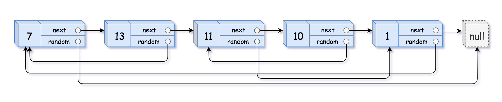

# 不用哈希表，简洁写法（Python/Java/C++/C/Go/JS）

> **[138. 随机链表的复制](https://leetcode.cn/problems/copy-list-with-random-pointer/solutions/2993775/bu-yong-ha-xi-biao-de-zuo-fa-pythonjavac-nzdo/) · Medium**

> **所属题单**
> - [链表、二叉树与回溯 · 一、链表](../../../刷题路径/灵神原版题单/链表、二叉树与回溯/一、链表.md) · §1.11 其他
> - [LeetCode 热题 100 · 链表](../../../刷题路径/灵神原版题单/LeetCode%20热题%20100/链表.md)
> - [面试经典 150 题 · 链表](../../../刷题路径/灵神原版题单/面试经典%20150%20题/链表.md)

> **题目描述**
> 给你一个长度为 `n` 的链表，每个节点包含一个额外增加的随机指针 `random` ，该指针可以指向链表中的任何节点或空节点。
>
> 构造这个链表的 **[深拷贝](https://baike.baidu.com/item/深拷贝/22785317?fr=aladdin)**。 深拷贝应该正好由 `n` 个 **全新** 节点组成，其中每个新节点的值都设为其对应的原节点的值。新节点的 `next` 指针和 `random` 指针也都应指向复制链表中的新节点，并使原链表和复制链表中的这些指针能够表示相同的链表状态。**复制链表中的指针都不应指向原链表中的节点** 。
>
> 例如，如果原链表中有 `X` 和 `Y` 两个节点，其中 `X.random --> Y` 。那么在复制链表中对应的两个节点 `x` 和 `y` ，同样有 `x.random --> y` 。
>
> 返回复制链表的头节点。
>
> 用一个由 `n` 个节点组成的链表来表示输入/输出中的链表。每个节点用一个 `[val, random_index]` 表示：
>
> - `val`：一个表示 `Node.val` 的整数。
>
> - `random_index`：随机指针指向的节点索引（范围从 `0` 到 `n-1`）；如果不指向任何节点，则为  `null` 。
>
> 你的代码 **只** 接受原链表的头节点 `head` 作为传入参数。
>
> **示例 1：**
>
> 
>
> ```
>
> 输入：head = [[7,null],[13,0],[11,4],[10,2],[1,0]]
> 输出：[[7,null],[13,0],[11,4],[10,2],[1,0]]
> ```
>
> **示例 2：**
>
> 
>
> ```
>
> 输入：head = [[1,1],[2,1]]
> 输出：[[1,1],[2,1]]
> ```
>
> **示例 3：**
>
> 
>
> ```
>
> 输入：head = [[3,null],[3,0],[3,null]]
> 输出：[[3,null],[3,0],[3,null]]
> ```
>
> **提示：**
>
> - `0 <= n <= 1000`
>
> - `-10⁴ <= Node.val <= 10⁴`
>
> - `Node.random` 为 `null` 或指向链表中的节点。

> **题解**
> ## 题意
>
> 深拷贝一个链表，要求新链表中的每个节点都是新创建的，并且这些节点的 $\textit{random}$ 指针都指向新链表中的相应节点。
>
> ## 思路
>
> 如果没有 $\textit{random}$ 指针，只需在遍历链表的同时，依次复制每个节点（创建新节点并复制 $\textit{val}$），添加在新链表的末尾。
>
> 有 $\textit{random}$ 指针，问题就变得复杂了，我们需要知道 $\textit{random}$ 指向的那个节点，在新链表中是哪个节点。
>
> 所以必须记录原链表节点到新链表节点的映射（map）。这样可以通过原链表 $\textit{random}$ 指向的节点，知道新链表的 $\textit{random}$ 应该指向哪个节点。
>
> 难道要用哈希表吗？不需要，我们可以把新链表和旧链表「混在一起」。
>
> 例如链表 $1\to 2\to 3$，依次复制每个节点（创建新节点并复制 $\textit{val}$ 和 $\textit{next}$），把新节点直接插到原节点的后面，形成一个**交错链表**：
>
> $$
> 1\to1'\to 2\to 2'\to 3\to 3'
> $$
>
> 如此一来，**原链表节点的下一个节点，就是其对应的新链表节点了**！
>
> 然后遍历这个交错链表，假如节点 $1$ 的 $\textit{random}$ 指向节点 $3$，那么就把新节点 $1'$ 的 $\textit{random}$ 指向节点 $3$ 的下一个节点 $3'$，这样就完成了对 $\textit{random}$ 指针的复制。
>
> 最后，从交错链表中**分离**出 $1'\to 2'\to 3'$，即为深拷贝后的链表。做法类似 [328. 奇偶链表](https://leetcode.cn/problems/odd-even-linked-list/)。
>
> ⚠**注意**：不能只删除节点 $1,2,3$，因为题目要求原链表的 $\textit{next}$ 不能修改。（用 Python 的同学可以先看第一份代码，再看第二份代码）
>
> ```python
> class Solution:
>     def copyRandomList(self, head: 'Optional[Node]') -> 'Optional[Node]':
>         # 复制每个节点，把新节点直接插到原节点的后面
>         cur = head
>         while cur:
>             cur.next = Node(cur.val, cur.next)
>             cur = cur.next.next
>
>         # 遍历交错链表中的原链表节点
>         cur = head
>         while cur:
>             if cur.random:
>                 # 要复制的 random 是 cur.random 的下一个节点
>                 cur.next.random = cur.random.next
>             cur = cur.next.next
>
>         # 删除交错链表中的原链表节点，剩下的节点即为新链表
>         cur = dummy = Node(0, head)
>         while cur.next:
>             # 删除原链表的节点，即当前节点的下一个节点
>             # 如果要恢复原链表，见另一份代码【Python3 写法二】
>             cur.next = cur.next.next
>             cur = cur.next
>
>         return dummy.next
> ```
>
> > [!example]- Python3 写法二
> > ```python
> > class Solution:
> >     def copyRandomList(self, head: 'Optional[Node]') -> 'Optional[Node]':
> >         # 复制每个节点，把新节点直接插到原节点的后面
> >         cur = head
> >         while cur:
> >             cur.next = Node(cur.val, cur.next)
> >             cur = cur.next.next
> >
> >         # 遍历交错链表中的原链表节点
> >         cur = head
> >         while cur:
> >             if cur.random:
> >                 # 要复制的 random 是 cur.random 的下一个节点
> >                 cur.next.random = cur.random.next
> >             cur = cur.next.next
> >
> >         # 把交错链表分离成两个链表
> >         tail = dummy = Node(0, head)
> >         cur = head
> >         while cur:
> >             copy = cur.next  # 新节点
> >             tail.next = copy  # 把新节点插在 tail 的后面，构建新的链表
> >             cur.next = copy.next  # 恢复原节点的 next
> >             cur = cur.next
> >             tail = tail.next
> >
> >         return dummy.next
> > ```
>
>
> #### 复杂度分析
>
> - 时间复杂度：$\mathcal{O}(n)$，其中 $n$ 是链表的长度。
> - 空间复杂度：$\mathcal{O}(1)$。返回值不计入。
>
> ## 分类题单
>
> [如何科学刷题？](https://leetcode.cn/circle/discuss/RvFUtj/)
>
> 1. [滑动窗口与双指针（定长/不定长/单序列/双序列/三指针/分组循环）](https://leetcode.cn/circle/discuss/0viNMK/)
> 2. [二分算法（二分答案/最小化最大值/最大化最小值/第K小）](https://leetcode.cn/circle/discuss/SqopEo/)
> 3. [单调栈（基础/矩形面积/贡献法/最小字典序）](https://leetcode.cn/circle/discuss/9oZFK9/)
> 4. [网格图（DFS/BFS/综合应用）](https://leetcode.cn/circle/discuss/YiXPXW/)
> 5. [位运算（基础/性质/拆位/试填/恒等式/思维）](https://leetcode.cn/circle/discuss/dHn9Vk/)
> 6. [图论算法（DFS/BFS/拓扑排序/基环树/最短路/最小生成树/网络流）](https://leetcode.cn/circle/discuss/01LUak/)
> 7. [动态规划（入门/背包/划分/状态机/区间/状压/数位/数据结构优化/树形/博弈/概率期望）](https://leetcode.cn/circle/discuss/tXLS3i/)
> 8. [常用数据结构（前缀和/差分/栈/队列/堆/字典树/并查集/树状数组/线段树）](https://leetcode.cn/circle/discuss/mOr1u6/)
> 9. [数学算法（数论/组合/概率期望/博弈/计算几何/随机算法）](https://leetcode.cn/circle/discuss/IYT3ss/)
> 10. [贪心与思维（基本贪心策略/反悔/区间/字典序/数学/思维/脑筋急转弯/构造）](https://leetcode.cn/circle/discuss/g6KTKL/)
> 11. [链表、树与回溯（前后指针/快慢指针/DFS/BFS/直径/LCA）](https://leetcode.cn/circle/discuss/K0n2gO/)
> 12. [字符串（KMP/Z函数/Manacher/字符串哈希/AC自动机/后缀数组/子序列自动机）](https://leetcode.cn/circle/discuss/SJFwQI/)
>
> [我的题解精选（已分类）](https://github.com/EndlessCheng/codeforces-go/blob/master/leetcode/SOLUTIONS.md)
>
> 欢迎关注 [B站@灵茶山艾府](https://space.bilibili.com/206214)
