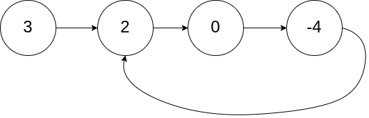

# 没想明白？一个视频讲透快慢指针！（Python/Java/C++/C/Go/JS）

> **[141. 环形链表](https://leetcode.cn/problems/linked-list-cycle/solutions/1999269/mei-xiang-ming-bai-yi-ge-shi-pin-jiang-t-c4sw/) · Easy**

> **所属题单**
> - [链表、二叉树与回溯 · 一、链表](../../../刷题路径/灵神原版题单/链表、二叉树与回溯/一、链表.md) · §1.6 快慢指针
> - [LeetCode 热题 100 · 链表](../../../刷题路径/灵神原版题单/LeetCode%20热题%20100/链表.md)
> - [面试经典 150 题 · 链表](../../../刷题路径/灵神原版题单/面试经典%20150%20题/链表.md)

> **题目描述**
> 给你一个链表的头节点 `head` ，判断链表中是否有环。
>
> 如果链表中有某个节点，可以通过连续跟踪 `next` 指针再次到达，则链表中存在环。 为了表示给定链表中的环，评测系统内部使用整数 `pos` 来表示链表尾连接到链表中的位置（索引从 0 开始）。**注意：`pos` 不作为参数进行传递** 。仅仅是为了标识链表的实际情况。
>
> <em>如果链表中存在环</em> ，则返回 `true` 。 否则，返回 `false` 。
>
> **示例 1：**
>
> 
>
> ```
>
> 输入：head = [3,2,0,-4], pos = 1
> 输出：true
> 解释：链表中有一个环，其尾部连接到第二个节点。
> ```
>
> **示例 2：**
>
> 
>
> ```
>
> 输入：head = [1,2], pos = 0
> 输出：true
> 解释：链表中有一个环，其尾部连接到第一个节点。
> ```
>
> **示例 3：**
>
> 
>
> ```
>
> 输入：head = [1], pos = -1
> 输出：false
> 解释：链表中没有环。
> ```
>
> **提示：**
>
> - 链表中节点的数目范围是 `[0, 10⁴]`
>
> - `-10⁵ <= Node.val <= 10⁵`
>
> - `pos` 为 `-1` 或者链表中的一个 **有效索引** 。
>
> **进阶：**你能用 `O(1)`（即，常量）内存解决此问题吗？

> **题解**
> 想象兔子和乌龟在同一跑道上，一个速度快、另一个速度慢。如果跑道有环，兔子必然在一段时间后追上乌龟。对于链表来说，如果在链表中引入两个以不同速度（一个比另一个快一倍）前进的指针，在链表存在环的情况下，这两个指针必定会相遇。
>
> 视频讲解：[【基础算法精讲 07】](https://www.bilibili.com/video/BV1KG4y1G7cu/)，制作不易，欢迎点赞！
>
> ⚠**注意**：代码比较两个节点的时候，比较的是内存地址是否一致，并没有比较节点的 `val`。
>
> ### 答疑
>
> **问**：兔子会不会「跳过」乌龟，从来不会和乌龟相遇呢？
>
> **答**：这是不可能的。如果有环的话，那么兔子和乌龟都会进入环中。这时用「**相对速度**」思考，乌龟不动，兔子相对乌龟每次只走一步，这样就可以看出兔子一定会和乌龟相遇了。
>
> **问**：为什么代码的 $\texttt{while}$ 循环没有判断 $\textit{slow}$ 是否为空？
>
> **答**：$\textit{slow}$ 在 $\textit{fast}$ 后面，如果 $\textit{fast}$ 不是空，那么 $\textit{slow}$ 也肯定不是空。好比快人先去探路，慢人走的都是快人走过的路。
>
> ```python
> class Solution:
>     def hasCycle(self, head: Optional[ListNode]) -> bool:
>         slow = fast = head  # 乌龟和兔子同时从起点出发
>         while fast and fast.next:
>             slow = slow.next  # 乌龟走一步
>             fast = fast.next.next  # 兔子走两步
>             if fast is slow:  # 兔子追上乌龟（套圈），说明有环
>                 return True
>         return False  # 访问到了链表末尾，无环
> ```
>
>
> #### 复杂度分析
>
> - 时间复杂度：$\mathcal{O}(n)$，其中 $n$ 是链表的长度。理由见 [本题视频讲解【基础算法精讲 07】](https://www.bilibili.com/video/BV1KG4y1G7cu/)。
> - 空间复杂度：$\mathcal{O}(1)$。
>
> ## 进阶题目
>
> 返回入环口。见 [142. 环形链表 II](https://leetcode.cn/problems/linked-list-cycle-ii/)。
>
> ## 分类题单
>
> [如何科学刷题？](https://leetcode.cn/circle/discuss/RvFUtj/)
>
> 1. [滑动窗口与双指针（定长/不定长/单序列/双序列/三指针/分组循环）](https://leetcode.cn/circle/discuss/0viNMK/)
> 2. [二分算法（二分答案/最小化最大值/最大化最小值/第K小）](https://leetcode.cn/circle/discuss/SqopEo/)
> 3. [单调栈（基础/矩形面积/贡献法/最小字典序）](https://leetcode.cn/circle/discuss/9oZFK9/)
> 4. [网格图（DFS/BFS/综合应用）](https://leetcode.cn/circle/discuss/YiXPXW/)
> 5. [位运算（基础/性质/拆位/试填/恒等式/思维）](https://leetcode.cn/circle/discuss/dHn9Vk/)
> 6. [图论算法（DFS/BFS/拓扑排序/基环树/最短路/最小生成树/网络流）](https://leetcode.cn/circle/discuss/01LUak/)
> 7. [动态规划（入门/背包/划分/状态机/区间/状压/数位/数据结构优化/树形/博弈/概率期望）](https://leetcode.cn/circle/discuss/tXLS3i/)
> 8. [常用数据结构（前缀和/差分/栈/队列/堆/字典树/并查集/树状数组/线段树）](https://leetcode.cn/circle/discuss/mOr1u6/)
> 9. [数学算法（数论/组合/概率期望/博弈/计算几何/随机算法）](https://leetcode.cn/circle/discuss/IYT3ss/)
> 10. [贪心与思维（基本贪心策略/反悔/区间/字典序/数学/思维/脑筋急转弯/构造）](https://leetcode.cn/circle/discuss/g6KTKL/)
> 11. [链表、二叉树与回溯（前后指针/快慢指针/DFS/BFS/直径/LCA/一般树）](https://leetcode.cn/circle/discuss/K0n2gO/)
> 12. [字符串（KMP/Z函数/Manacher/字符串哈希/AC自动机/后缀数组/子序列自动机）](https://leetcode.cn/circle/discuss/SJFwQI/)
>
> [我的题解精选（已分类）](https://github.com/EndlessCheng/codeforces-go/blob/master/leetcode/SOLUTIONS.md)
>
> 欢迎关注 [B站@灵茶山艾府](https://space.bilibili.com/206214)
