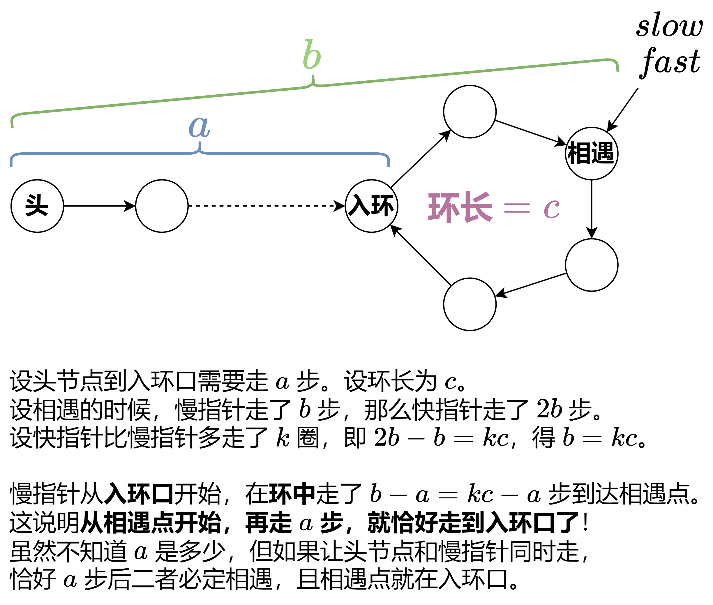

# 【图解】一张图秒懂环形链表 II，Floyd 判圈算法（Python/Java/C++/C/Go/JS）

> **[142. 环形链表 II](https://leetcode.cn/problems/linked-list-cycle-ii/solutions/1999271/mei-xiang-ming-bai-yi-ge-shi-pin-jiang-t-nvsq/) · Medium**

> **所属题单**
> - [链表、二叉树与回溯 · 一、链表](../../../刷题路径/灵神原版题单/链表、二叉树与回溯/一、链表.md) · §1.6 快慢指针
> - [LeetCode 热题 100 · 链表](../../../刷题路径/灵神原版题单/LeetCode%20热题%20100/链表.md)

> **题目描述**
> 给定一个链表的头节点  `head` ，返回链表开始入环的第一个节点。 <em>如果链表无环，则返回 `null`。</em>
>
> 如果链表中有某个节点，可以通过连续跟踪 `next` 指针再次到达，则链表中存在环。 为了表示给定链表中的环，评测系统内部使用整数 `pos` 来表示链表尾连接到链表中的位置（**索引从 0 开始**）。如果 `pos` 是 `-1`，则在该链表中没有环。**注意：`pos` 不作为参数进行传递**，仅仅是为了标识链表的实际情况。
>
> **不允许修改** 链表。
>
> **示例 1：**
>
> 
>
> ```
>
> 输入：head = [3,2,0,-4], pos = 1
> 输出：返回索引为 1 的链表节点
> 解释：链表中有一个环，其尾部连接到第二个节点。
> ```
>
> **示例 2：**
>
> 
>
> ```
>
> 输入：head = [1,2], pos = 0
> 输出：返回索引为 0 的链表节点
> 解释：链表中有一个环，其尾部连接到第一个节点。
> ```
>
> **示例 3：**
>
> 
>
> ```
>
> 输入：head = [1], pos = -1
> 输出：返回 null
> 解释：链表中没有环。
> ```
>
> **提示：**
>
> - 链表中节点的数目范围在范围 `[0, 10⁴]` 内
>
> - `-10⁵ <= Node.val <= 10⁵`
>
> - `pos` 的值为 `-1` 或者链表中的一个有效索引
>
> **进阶：**你是否可以使用 `O(1)` 空间解决此题？

> **题解**
> 请先完成上一题 [141. 环形链表](https://leetcode.cn/problems/linked-list-cycle/)。本题继续使用快慢指针的做法。
>
> 
>
> **注 1**：$kc-a$ 是从**入环口**开始的步数。由于 $(kc-a) + a = kc$，所以从 $kc-a$ 开始，再走 $a$ 步，就恰好走了 $k$ 圈，回到入环口。
>
> **注 2**：慢指针从相遇点开始，移动 $a$ 步后恰好走到入环口，但在这个过程中，可能会多次经过入环口。
>
> **注 3**：这个算法叫做 **Floyd 判圈算法**。
>
> [本题视频讲解【基础算法精讲 07】](https://www.bilibili.com/video/BV1KG4y1G7cu/)
>
> ```python
> class Solution:
>     def detectCycle(self, head: Optional[ListNode]) -> Optional[ListNode]:
>         slow = fast = head
>         while fast and fast.next:
>             slow = slow.next
>             fast = fast.next.next
>             if fast is slow:  # 相遇
>                 while slow is not head:  # 再走 a 步
>                     slow = slow.next
>                     head = head.next
>                 return slow
>         return None
> ```
>
>
> #### 复杂度分析
>
> - 时间复杂度：$\mathcal{O}(n)$，其中 $n$ 是链表的长度。理由见 [本题视频讲解【基础算法精讲 07】](https://www.bilibili.com/video/BV1KG4y1G7cu/)。
> - 空间复杂度：$\mathcal{O}(1)$。
>
> ## 专题训练
>
> 见下面链表题单的「**§1.6 快慢指针**」。
>
> ## 分类题单
>
> [如何科学刷题？](https://leetcode.cn/circle/discuss/RvFUtj/)
>
> 1. [滑动窗口与双指针（定长/不定长/单序列/双序列/三指针/分组循环）](https://leetcode.cn/circle/discuss/0viNMK/)
> 2. [二分算法（二分答案/最小化最大值/最大化最小值/第K小）](https://leetcode.cn/circle/discuss/SqopEo/)
> 3. [单调栈（基础/矩形面积/贡献法/最小字典序）](https://leetcode.cn/circle/discuss/9oZFK9/)
> 4. [网格图（DFS/BFS/综合应用）](https://leetcode.cn/circle/discuss/YiXPXW/)
> 5. [位运算（基础/性质/拆位/试填/恒等式/思维）](https://leetcode.cn/circle/discuss/dHn9Vk/)
> 6. [图论算法（DFS/BFS/拓扑排序/基环树/最短路/最小生成树/网络流）](https://leetcode.cn/circle/discuss/01LUak/)
> 7. [动态规划（入门/背包/划分/状态机/区间/状压/数位/数据结构优化/树形/博弈/概率期望）](https://leetcode.cn/circle/discuss/tXLS3i/)
> 8. [常用数据结构（前缀和/差分/栈/队列/堆/字典树/并查集/树状数组/线段树）](https://leetcode.cn/circle/discuss/mOr1u6/)
> 9. [数学算法（数论/组合/概率期望/博弈/计算几何/随机算法）](https://leetcode.cn/circle/discuss/IYT3ss/)
> 10. [贪心与思维（基本贪心策略/反悔/区间/字典序/数学/思维/脑筋急转弯/构造）](https://leetcode.cn/circle/discuss/g6KTKL/)
> 11. [链表、二叉树与回溯（前后指针/快慢指针/DFS/BFS/直径/LCA/一般树）](https://leetcode.cn/circle/discuss/K0n2gO/)
> 12. [字符串（KMP/Z函数/Manacher/字符串哈希/AC自动机/后缀数组/子序列自动机）](https://leetcode.cn/circle/discuss/SJFwQI/)
>
> [我的题解精选（已分类）](https://github.com/EndlessCheng/codeforces-go/blob/master/leetcode/SOLUTIONS.md)
>
> 欢迎关注 [B站@灵茶山艾府](https://space.bilibili.com/206214)
