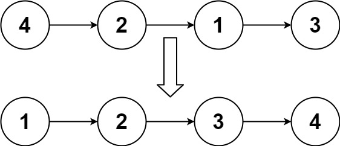
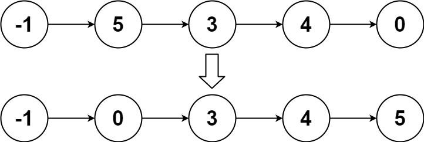

# 两种方法：分治/迭代，模块化设计，代码可读性高（Python/Java/C++/C/Go/JS/Rust）

> **[148. 排序链表](https://leetcode.cn/problems/sort-list/solutions/2993518/liang-chong-fang-fa-fen-zhi-die-dai-mo-k-caei/) · Medium**

> **所属题单**
> - [链表、二叉树与回溯 · 一、链表](../../../刷题路径/灵神原版题单/链表、二叉树与回溯/一、链表.md) · §1.9 分治
> - [LeetCode 热题 100 · 链表](../../../刷题路径/灵神原版题单/LeetCode%20热题%20100/链表.md)
> - [面试经典 150 题 · 分治](../../../刷题路径/灵神原版题单/面试经典%20150%20题/分治.md)

> **题目描述**
> 给你链表的头结点 `head` ，请将其按 **升序** 排列并返回 **排序后的链表** 。
>
> **示例 1：**
>
> 
>
> ```
>
> 输入：head = [4,2,1,3]
> 输出：[1,2,3,4]
> ```
>
> **示例 2：**
>
> 
>
> ```
>
> 输入：head = [-1,5,3,4,0]
> 输出：[-1,0,3,4,5]
> ```
>
> **示例 3：**
>
> ```
>
> 输入：head = []
> 输出：[]
> ```
>
> **提示：**
>
> - 链表中节点的数目在范围 `[0, 5 * 10⁴]` 内
>
> - `-10⁵ <= Node.val <= 10⁵`
>
> **进阶：**你可以在 `O(n log n)` 时间复杂度和常数级空间复杂度下，对链表进行排序吗？

> **题解**
> ## 前置题目
>
> - [876. 链表的中间结点](https://leetcode.cn/problems/middle-of-the-linked-list/)
> - [21. 合并两个有序链表](https://leetcode.cn/problems/merge-two-sorted-lists/)
>
> ## 方法一：归并排序（分治）
>
> 1. 找到**链表的中间结点** $\textit{head}_2$ 的**前一个节点**，并断开 $\textit{head}_2$ 与其前一个节点的连接。这样我们就把原链表均分成了两段更短的链表。原理见[【基础算法精讲 07】](https://www.bilibili.com/video/BV1KG4y1G7cu/)。
> 2. 分治，递归调用 $\texttt{sortList}$，分别排序 $\textit{head}$（只有前一半）和 $\textit{head}_2$。
> 3. 排序后，我们得到了两个有序链表，那么**合并两个有序链表**，得到排序后的链表，返回链表头节点。原理见 [我的题解](../../0000-0099/0021%20合并两个有序链表/灵茶山艾府.md)。
>
> ```python
> class Solution:
>     # 876. 链表的中间结点（快慢指针）
>     def middleNode(self, head: Optional[ListNode]) -> Optional[ListNode]:
>         slow = fast = head
>         while fast and fast.next:
>             pre = slow  # 记录 slow 的前一个节点
>             slow = slow.next
>             fast = fast.next.next
>         pre.next = None  # 断开 slow 的前一个节点和 slow 的连接
>         return slow
>
>     # 21. 合并两个有序链表（双指针）
>     def mergeTwoLists(self, list1: Optional[ListNode], list2: Optional[ListNode]) -> Optional[ListNode]:
>         cur = dummy = ListNode()  # 用哨兵节点简化代码逻辑
>         while list1 and list2:
>             if list1.val < list2.val:
>                 cur.next = list1  # 把 list1 加到新链表中
>                 list1 = list1.next
>             else:  # 注：相等的情况加哪个节点都是可以的
>                 cur.next = list2  # 把 list2 加到新链表中
>                 list2 = list2.next
>             cur = cur.next
>         cur.next = list1 if list1 else list2  # 拼接剩余链表
>         return dummy.next
>
>     def sortList(self, head: Optional[ListNode]) -> Optional[ListNode]:
>         # 如果链表为空或者只有一个节点，无需排序
>         if head is None or head.next is None:
>             return head
>         # 找到中间节点 head2，并断开 head2 与其前一个节点的连接
>         # 比如 head=[4,2,1,3]，那么 middleNode 调用结束后 head=[4,2] head2=[1,3]
>         head2 = self.middleNode(head)
>         # 分治
>         head = self.sortList(head)
>         head2 = self.sortList(head2)
>         # 合并
>         return self.mergeTwoLists(head, head2)
> ```
>
>
> #### 复杂度分析
>
> - 时间复杂度：$\mathcal{O}(n\log n)$，其中 $n$ 是链表长度。递归式 $T(n) = 2T(n/2) + \mathcal{O}(n)$，由主定理可得时间复杂度为 $\mathcal{O}(n\log n)$。从图形上理解，递归深度是 $\mathcal{O}(\log n)$，每一层的链表长度之和是 $\mathcal{O}(n)$。计算高为 $\mathcal{O}(\log n)$，底边长为 $\mathcal{O}(n)$ 的矩形面积，得到 $\mathcal{O}(n\log n)$。
> - 空间复杂度：$\mathcal{O}(\log n)$。递归需要 $\mathcal{O}(\log n)$ 的栈开销。
>
> ## 方法二：归并排序（迭代）
>
> 方法一的归并是**自顶向下**计算，需要 $\mathcal{O}(\log n)$ 的递归栈开销。
>
> 方法二将其改成**自底向上**计算，空间复杂度优化成 $\mathcal{O}(1)$。
>
> 自底向上的意思是：
>
> - 首先，归并长度为 $1$ 的子链表。例如 $[4,2,1,3]$，把第一个节点和第二个节点归并，第三个节点和第四个节点归并，得到 $[2,4,1,3]$。
> - 然后，归并长度为 $2$ 的子链表。例如 $[2,4,1,3]$，把前两个节点和后两个节点归并，得到 $[1,2,3,4]$。
> - 然后，归并长度为 $4$ 的子链表。
> - 依此类推，直到归并的长度大于等于链表长度为止，此时链表已经是有序的了。
>
> 具体算法：
>
> 1. 遍历链表，获取链表长度 $\textit{length}$。
> 2. 初始化步长 $\textit{step}=1$。
> 3. 循环直到 $\textit{step} \ge \textit{length}$。
> 4. 每轮循环，从链表头节点开始。
> 5. 分割出两段长为 $\textit{step}$ 的链表，合并，把合并后的链表插到新链表的末尾。重复该步骤，直到链表遍历完毕。
> 6. 把 $\textit{step}$ 扩大一倍。回到第 $4$ 步。
>
> 具体细节见代码。
>
> ```python
> class Solution:
>     # 获取链表长度
>     def getListLength(self, head: Optional[ListNode]) -> int:
>         length = 0
>         while head:
>             length += 1
>             head = head.next
>         return length
>
>     # 分割链表
>     # 如果链表长度 <= size，不做任何操作，返回空节点
>     # 如果链表长度 > size，把链表的前 size 个节点分割出来（断开连接），并返回剩余链表的头节点
>     def splitList(self, head: Optional[ListNode], size: int) -> Optional[ListNode]:
>         # 先找到 next_head 的前一个节点
>         cur = head
>         for _ in range(size - 1):
>             if cur is None:
>                 break
>             cur = cur.next
>
>         # 如果链表长度 <= size
>         if cur is None or cur.next is None:
>             return None  # 不做任何操作，返回空节点
>
>         next_head = cur.next
>         cur.next = None  # 断开 next_head 的前一个节点和 next_head 的连接
>         return next_head
>
>     # 21. 合并两个有序链表（双指针）
>     # 返回合并后的链表的头节点和尾节点
>     def mergeTwoLists(self, list1: Optional[ListNode], list2: Optional[ListNode]) -> Optional[ListNode]:
>         cur = dummy = ListNode()  # 用哨兵节点简化代码逻辑
>         while list1 and list2:
>             if list1.val < list2.val:
>                 cur.next = list1  # 把 list1 加到新链表中
>                 list1 = list1.next
>             else:  # 注：相等的情况加哪个节点都是可以的
>                 cur.next = list2  # 把 list2 加到新链表中
>                 list2 = list2.next
>             cur = cur.next
>         cur.next = list1 or list2  # 拼接剩余链表
>         while cur.next:
>             cur = cur.next
>         # 循环结束后，cur 是合并后的链表的尾节点
>         return dummy.next, cur
>
>     def sortList(self, head: Optional[ListNode]) -> Optional[ListNode]:
>         length = self.getListLength(head)  # 获取链表长度
>         dummy = ListNode(next=head)  # 用哨兵节点简化代码逻辑
>         step = 1  # 步长（参与合并的链表长度）
>         while step < length:
>             new_list_tail = dummy  # 新链表的末尾
>             cur = dummy.next  # 每轮循环的起始节点
>             while cur:
>                 # 从 cur 开始，分割出两段长为 step 的链表，头节点分别为 head1 和 head2
>                 head1 = cur
>                 head2 = self.splitList(head1, step)
>                 cur = self.splitList(head2, step)  # 下一轮循环的起始节点
>                 # 合并两段长为 step 的链表
>                 head, tail = self.mergeTwoLists(head1, head2)
>                 # 合并后的头节点 head，插到 new_list_tail 的后面
>                 new_list_tail.next = head
>                 new_list_tail = tail  # tail 现在是新链表的末尾
>             step *= 2
>         return dummy.next
> ```
>
>
> #### 复杂度分析
>
> - 时间复杂度：$\mathcal{O}(n\log n)$，其中 $n$ 是链表长度。
> - 空间复杂度：$\mathcal{O}(1)$。
>
> ## 分类题单
>
> [如何科学刷题？](https://leetcode.cn/circle/discuss/RvFUtj/)
>
> 1. [滑动窗口与双指针（定长/不定长/单序列/双序列/三指针/分组循环）](https://leetcode.cn/circle/discuss/0viNMK/)
> 2. [二分算法（二分答案/最小化最大值/最大化最小值/第K小）](https://leetcode.cn/circle/discuss/SqopEo/)
> 3. [单调栈（基础/矩形面积/贡献法/最小字典序）](https://leetcode.cn/circle/discuss/9oZFK9/)
> 4. [网格图（DFS/BFS/综合应用）](https://leetcode.cn/circle/discuss/YiXPXW/)
> 5. [位运算（基础/性质/拆位/试填/恒等式/思维）](https://leetcode.cn/circle/discuss/dHn9Vk/)
> 6. [图论算法（DFS/BFS/拓扑排序/最短路/最小生成树/二分图/基环树/欧拉路径）](https://leetcode.cn/circle/discuss/01LUak/)
> 7. [动态规划（入门/背包/状态机/划分/区间/状压/数位/数据结构优化/树形/博弈/概率期望）](https://leetcode.cn/circle/discuss/tXLS3i/)
> 8. [常用数据结构（前缀和/差分/栈/队列/堆/字典树/并查集/树状数组/线段树）](https://leetcode.cn/circle/discuss/mOr1u6/)
> 9. [数学算法（数论/组合/概率期望/博弈/计算几何/随机算法）](https://leetcode.cn/circle/discuss/IYT3ss/)
> 10. [贪心与思维（基本贪心策略/反悔/区间/字典序/数学/思维/脑筋急转弯/构造）](https://leetcode.cn/circle/discuss/g6KTKL/)
> 11. [链表、二叉树与回溯（前后指针/快慢指针/DFS/BFS/直径/LCA/一般树）](https://leetcode.cn/circle/discuss/K0n2gO/)
> 12. [字符串（KMP/Z函数/Manacher/字符串哈希/AC自动机/后缀数组/子序列自动机）](https://leetcode.cn/circle/discuss/SJFwQI/)
>
> [我的题解精选（已分类）](https://github.com/EndlessCheng/codeforces-go/blob/master/leetcode/SOLUTIONS.md)
>
> 欢迎关注 [B站@灵茶山艾府](https://space.bilibili.com/206214)
