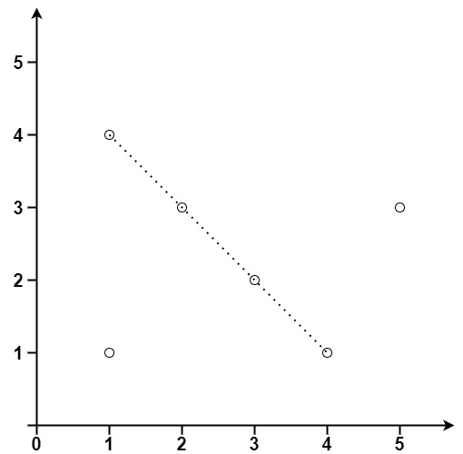

# 149. 直线上最多的点数

Hard · [力扣原题](https://leetcode.cn/problems/max-points-on-a-line/)

所在刷题路径：灵神突击

| 作者 | 题解 | 动画讲解 |
|---|---|---|
| 灵茶山艾府 | [📄 题解](灵茶山艾府.md) | [▶︎ 动画（GIF）](0149%20直线上最多的点数%20·%20灵茶山艾府.gif) · [mp4 文件](0149%20直线上最多的点数%20·%20灵茶山艾府.mp4) |
| yiduobo | [📄 题解](yiduobo.md) | [▶︎ 动画（GIF）](0149%20直线上最多的点数%20·%20yiduobo.gif) · [mp4 文件](0149%20直线上最多的点数%20·%20yiduobo.mp4) |

## 动画讲解

> 动图会循环播放；想暂停、拖进度条请下载上面表格里的 mp4 文件。

### 灵茶山艾府


### yiduobo


## 题目描述

给你一个数组 `points` ，其中 `points[i] = [x_i, y_i]` 表示 **X-Y** 平面上的一个点。求最多有多少个点在同一条直线上。

**示例 1：**


```

输入：points = [[1,1],[2,2],[3,3]]
输出：3
```

**示例 2：**



```

输入：points = [[1,1],[3,2],[5,3],[4,1],[2,3],[1,4]]
输出：4
```

**提示：**

- `1 <= points.length <= 300`

- `points[i].length == 2`

- `-10⁴ <= x_i, y_i <= 10⁴`

- `points` 中的所有点 **互不相同**

---
[↑ 返回 0100-0199](../README.md) · [总索引](../../../索引.md) · [仓库首页](../../../README.md)
