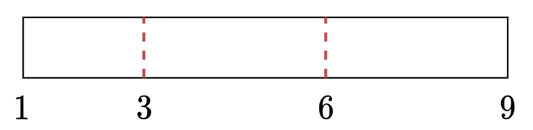

# 详细解释 O(n) 分桶法（Python/Java/C++/C/Go/JS/Rust）

> **[164. 最大间距](https://leetcode.cn/problems/maximum-gap/solutions/2772242/xiang-xi-jie-shi-on-fen-tong-fa-pythonja-mi5s/) · Medium**

> **题目描述**
> 给定一个无序的数组 `nums`，返回 <em>数组在排序之后，相邻元素之间最大的差值</em> 。如果数组元素个数小于 2，则返回 `0` 。
>
> 您必须编写一个在「线性时间」内运行并使用「线性额外空间」的算法。
>
> **示例 1:**
>
> ```
>
> 输入: nums = [3,6,9,1]
> 输出: 3
> 解释: 排序后的数组是 [1,3,6,9], 其中相邻元素 (3,6) 和 (6,9) 之间都存在最大差值 3。
> ```
>
> **示例 2:**
>
> ```
>
> 输入: nums = [10]
> 输出: 0
> 解释: 数组元素个数小于 2，因此返回 0。
> ```
>
> **提示:**
>
> - `1 <= nums.length <= 10⁵`
>
> - `0 <= nums[i] <= 10⁹`

> **题解**
> ## 题意
>
> 
>
> 看示例 1，想象有一根木棍，其左端点位置为 $1$，右端点位置为 $9$，长度为 $9-1=8$。我们在位置 $3$ 和 $6$ 处各切一刀，分成 $3$ 个小木棍。问：最长小木棍的长度是多少？
>
> ## 下界
>
> 最长小木棍的长度，**至少**是多少？
>
> 设 $n$ 为 $\textit{nums}$ 的长度，$m$ 为 $\textit{nums}$ 的最小值，$M$ 为 $\textit{nums}$ 的最大值。
>
> $m=M$ 时，直接返回 $0$；$m+1=M$ 时，直接返回 $1$。下面讨论 $m+1<M$ 的情况，注意这意味着 $n\ge 2$。
>
> 木棍的长度为 $M-m$，我们要切 $n-2$ 刀，分成 $n-1$ 个小木棍，那么小木棍的**平均长度**为
>
> $$
> \dfrac{M-m}{n-1}
> $$
>
> 由于**最大值不低于平均值**（见下面答疑），所以最长小木棍的长度至少为 $\dfrac{M-m}{n-1}$。由于小木棍的长度是整数，所以最长小木棍的长度至少为 
>
> $$
> d = \left\lceil\dfrac{M-m}{n-1}\right\rceil = \left\lfloor\dfrac{M-m+n-2}{n-1}\right\rfloor
> $$
>
> 证明见 [上取整下取整转换公式的证明](https://zhuanlan.zhihu.com/p/1890356682149838951)。
>
> 示例 1 的 $d = \left\lceil\dfrac{9-1}{4-1}\right\rceil = 3$，这意味着答案至少是 $3$。
>
> ## 分桶
>
> 怎么利用「答案至少为 $d$」这一性质呢？
>
> 如果把两两之差小于 $d$ 的数，分到同一组（桶）中，那么答案一定不会是同一个桶内的两数之差，而是**不同的桶的两数之差**！
>
> 示例 1 的 $\textit{nums}=[3,6,9,1]$，分到三个桶中：第一个桶装入 $1$ 和 $3$，第二个桶装入 $6$，第三个桶装入 $9$。答案一定不会是第一个桶的两数之差，因为 $3-1=2<d=3$。所以我们**只需要考虑不同的桶之间的两数之差**。由于题目要计算的是排序后相邻元素之间的差值，所以应当取第一个桶的最大值，和第二个桶的最小值作差；取第二个桶的最大值，和第三个桶的最小值作差；依此类推。这些差值中的最大值即为答案。对于示例 1 来说，答案为 $\max(6-3,9-6)=3$。
>
> 一般地，从 $m$ 开始，把元素值在 $[m,m+d-1]$ 中的数分到第一个桶，把元素值在 $[m+d,m+2d-1]$ 中的数分到第二个桶，依此类推。
>
> 以 $n=4$ 为例。下面用闭区间 $[a,b]$ 表示要放到这个桶中的元素的范围。
>
> - 如果 $m=1,\ M=3$，那么 $d=\left\lceil 2/3\right\rceil = 1$，分成三个桶 $[1,1],[2,2],[3,3]$。
> - 如果 $m=1,\ M=4$，那么 $d=\left\lceil 3/3\right\rceil = 1$，分成四个桶 $[1,1],[2,2],[3,3],[4,4]$。
> - 如果 $m=1,\ M=5$，那么 $d=\left\lceil 4/3\right\rceil = 2$，分成三个桶 $[1,2],[3,4],[5,5]$。
> - 如果 $m=1,\ M=6$，那么 $d=\left\lceil 5/3\right\rceil = 2$，分成三个桶 $[1,2],[3,4],[5,6]$。
> - 如果 $m=1,\ M=7$，那么 $d=\left\lceil 6/3\right\rceil = 2$，分成四个桶 $[1,2],[3,4],[5,6],[7,7]$。
> - 如果 $m=1,\ M=8$，那么 $d=\left\lceil 7/3\right\rceil = 3$，分成三个桶 $[1,3],[4,6],[7,8]$。
> - 如果 $m=1,\ M=9$，那么 $d=\left\lceil 8/3\right\rceil = 3$，分成三个桶 $[1,3],[4,6],[7,9]$。
> - 如果 $m=1,\ M=10$，那么 $d=\left\lceil 9/3\right\rceil = 3$，分成四个桶 $[1,3],[4,6],[7,9,[10,10]$。
> - 如果 $m=1,\ M=11$，那么 $d=\left\lceil 10/3\right\rceil = 4$，分成三个桶 $[1,4],[5,8],[9,11]$。
>
> 在上面这些例子中，桶内的最大元素减最小元素，都是小于 $d$ 的。我们只需看相邻两个非空桶的最小值和最大值的差。注意最左边的桶包含 $m$，最右边的桶包含 $M$，不会出现只有一个非空桶的情况。
>
> 一般地，对于 $x=\textit{nums}[i]$，我们将其放入下标为
>
> $$
> \left\lfloor\dfrac{x-m}{d}\right\rfloor
> $$
>
> 的桶中。
>
> 这也意味着，我们需要
>
> $$
> \left\lfloor\dfrac{M-m}{d}\right\rfloor + 1 \le n
> $$
>
> 个桶。当且仅当 $M-m$ 是 $n-1$ 的倍数时取等号。
>
> 对于每个桶，只需维护桶内元素的最小值和最大值。
>
> ## 答疑
>
> **问**：为什么最大值不低于平均值？
>
> **答**：比如一个班级平均身高 1m8，最高的人可能比 1m8 还矮吗？如果最大值低于平均值 $\textit{avg}$，意味着所有数都小于 $\textit{avg}$，但如果这样，平均值也会小于 $\textit{avg}$。所以用反证法可以证明，最大值不低于平均值。
>
> ```python
> class Solution:
>     def maximumGap(self, nums: List[int]) -> int:
>         m = min(nums)
>         M = max(nums)
>         if M - m <= 1:
>             return M - m
>
>         n = len(nums)
>         ans = d = (M - m + n - 2) // (n - 1)  # 答案至少是 d
>         buckets = [[inf, -inf] for _ in range((M - m) // d + 1)]
>         for x in nums:
>             b = buckets[(x - m) // d]
>             b[0] = min(b[0], x)  # 维护桶内元素的最小值和最大值
>             b[1] = max(b[1], x)
>
>         pre_max = inf
>         for mn, mx in buckets:
>             if mn != inf:  # 非空桶
>                 # 桶内最小值，减去上一个非空桶的最大值
>                 ans = max(ans, mn - pre_max)
>                 pre_max = mx
>         return ans
> ```
>
>
> #### 复杂度分析
>
> - 时间复杂度：$\mathcal{O}(n)$，其中 $n$ 为 $\textit{nums}$ 的长度。
> - 空间复杂度：$\mathcal{O}(n)$。
>
> ## 分类题单
>
> [如何科学刷题？](https://leetcode.cn/circle/discuss/RvFUtj/)
>
> 1. [滑动窗口与双指针（定长/不定长/单序列/双序列/三指针/分组循环）](https://leetcode.cn/circle/discuss/0viNMK/)
> 2. [二分算法（二分答案/最小化最大值/最大化最小值/第K小）](https://leetcode.cn/circle/discuss/SqopEo/)
> 3. [单调栈（基础/矩形面积/贡献法/最小字典序）](https://leetcode.cn/circle/discuss/9oZFK9/)
> 4. [网格图（DFS/BFS/综合应用）](https://leetcode.cn/circle/discuss/YiXPXW/)
> 5. [位运算（基础/性质/拆位/试填/恒等式/思维）](https://leetcode.cn/circle/discuss/dHn9Vk/)
> 6. [图论算法（DFS/BFS/拓扑排序/基环树/最短路/最小生成树/网络流）](https://leetcode.cn/circle/discuss/01LUak/)
> 7. [动态规划（入门/背包/划分/状态机/区间/状压/数位/数据结构优化/树形/博弈/概率期望）](https://leetcode.cn/circle/discuss/tXLS3i/)
> 8. [常用数据结构（前缀和/差分/栈/队列/堆/字典树/并查集/树状数组/线段树）](https://leetcode.cn/circle/discuss/mOr1u6/)
> 9. [数学算法（数论/组合/概率期望/博弈/计算几何/随机算法）](https://leetcode.cn/circle/discuss/IYT3ss/)
> 10. [贪心与思维（基本贪心策略/反悔/区间/字典序/数学/思维/脑筋急转弯/构造）](https://leetcode.cn/circle/discuss/g6KTKL/)
> 11. [链表、树与回溯（前后指针/快慢指针/DFS/BFS/直径/LCA）](https://leetcode.cn/circle/discuss/K0n2gO/)
> 12. [字符串（KMP/Z函数/Manacher/字符串哈希/AC自动机/后缀数组/子序列自动机）](https://leetcode.cn/circle/discuss/SJFwQI/)
>
> [我的题解精选（已分类）](https://github.com/EndlessCheng/codeforces-go/blob/master/leetcode/SOLUTIONS.md)
>
> 欢迎关注 [B站@灵茶山艾府](https://space.bilibili.com/206214)
