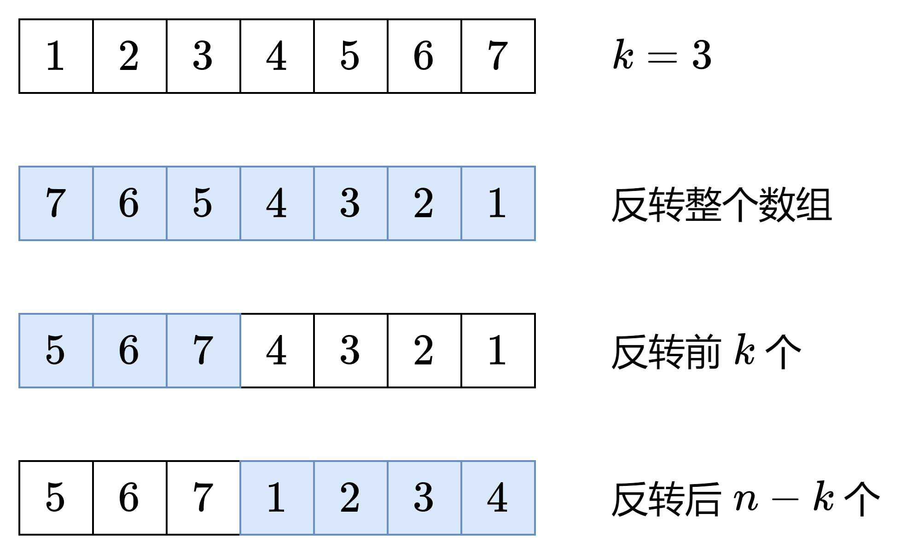

# 【图解】负负得正，一图秒懂！（Python/Java/C++/C/Go/JS/Rust）

> **[189. 轮转数组](https://leetcode.cn/problems/rotate-array/solutions/2784427/tu-jie-yuan-di-zuo-fa-yi-tu-miao-dong-py-ryfv/) · Medium**

> **所属题单**
> - [LeetCode 热题 100 · 普通数组](../../../刷题路径/灵神原版题单/LeetCode%20热题%20100/普通数组.md)
> - [面试经典 150 题 · 数组 / 字符串](../../../刷题路径/灵神原版题单/面试经典%20150%20题/数组%20-%20字符串.md)

> **题目描述**
> 给定一个整数数组 `nums`，将数组中的元素向右轮转 `k` 个位置，其中 `k` 是非负数。
>
> **示例 1:**
>
> ```
>
> 输入: nums = [1,2,3,4,5,6,7], k = 3
> 输出: [5,6,7,1,2,3,4]
> 解释:
> 向右轮转 1 步: [7,1,2,3,4,5,6]
> 向右轮转 2 步: [6,7,1,2,3,4,5]
> 向右轮转 3 步: [5,6,7,1,2,3,4]
> ```
>
> **示例 2:**
>
> ```
>
> 输入：nums = [-1,-100,3,99], k = 2
> 输出：[3,99,-1,-100]
> 解释:
> 向右轮转 1 步: [99,-1,-100,3]
> 向右轮转 2 步: [3,99,-1,-100]
> ```
>
> **提示：**
>
> - `1 <= nums.length <= 10⁵`
>
> - `-2³¹ <= nums[i] <= 2³¹ - 1`
>
> - `0 <= k <= 10⁵`
>
> **进阶：**
>
> - 尽可能想出更多的解决方案，至少有 **三种** 不同的方法可以解决这个问题。
>
> - 你可以使用空间复杂度为 `O(1)` 的 **原地** 算法解决这个问题吗？

> **题解**
> ## 思路讲解
>
> 看示例 1，我们要把 $[1,2,3,4,5,6,7]$ 变成 $[5,6,7,1,2,3,4]$。
>
> 把 $[5,6,7,1,2,3,4]$ 视作 $[5,6,7] + [1,2,3,4]$。我们**首先要保证** $[5,6,7]$ **在** $[1,2,3,4]$ **前面**，这可以通过反转 $[1,2,3,4,5,6,7]$ 得到。
>
> 反转后数组变成 $[7,6,5,4,3,2,1]$，即 $[7,6,5] + [4,3,2,1]$。对比最终目标，只需把 $[7,6,5]$ 反转，把 $[4,3,2,1]$ 反转，就得到了 $[5,6,7,1,2,3,4]$。
>
> {:width=500px}
>
> 这用到了「负负得正」的想法：**把一个子数组反转两次，子数组不变**。
>
> 在第一次反转中，我们不仅反转了子数组 $[1,2,3,4]$ 和 $[5,6,7]$，还交换了这两个子数组的位置。然后，把这两个子数组分别再反转一次，就抵消掉了反转，相当于我们只交换了 $[1,2,3,4]$ 和 $[5,6,7]$，得到 $[5,6,7,1,2,3,4]$。
>
> ## 算法
>
> > 这里假设 $0\le k < n$，对于 $k\ge n$ 的情况，可以转换成 $0\le k < n$ 的情况（证明见后文）。
>
> 设 $\textit{nums}=A+B$，其中 $A$ 是 $\textit{nums}$ 的前 $n-k$ 个数，$B$ 是后 $k$ 个数。在上例中，$A=[1,2,3,4]$，$B=[5,6,7]$。
>
> 题目要求把 $A+B$ 变成 $B+A$，这可以用**三次反转**实现：
>
> 1. 把 $\textit{nums} = A+B$ 反转，我们得到了 $\text{rev}(B) + \text{rev}(A)$，其中 $\text{rev}(A)$ 表示数组 $A$ 反转后的结果。在上例中，$\text{rev}(B) + \text{rev}(A) = [7,6,5] + [4,3,2,1]$。
> 2. 单独反转 $\text{rev}(B)$，因为一个数组反转两次是不变的，所以 $\text{rev}(\text{rev}(B))=B$，我们得到了 $B$。
> 3. 单独反转 $\text{rev}(A)$，得到 $\text{rev}(\text{rev}(A))=A$。
> 4. 现在数组变成 $B+A$。在上例中，$B+A = [5,6,7] + [1,2,3,4]$，这正是我们想要的结果。
>
> ```python
> # 注：请勿使用切片，会产生额外空间
> class Solution:
>     def rotate(self, nums: List[int], k: int) -> None:
>         def reverse(i: int, j: int) -> None:
>             while i < j:
>                 nums[i], nums[j] = nums[j], nums[i]
>                 i += 1
>                 j -= 1
>
>         n = len(nums)
>         k %= n  # 轮转 k 次等同于轮转 k % n 次
>         reverse(0, n - 1)
>         reverse(0, k - 1)
>         reverse(k, n - 1)
> ```
>
>
> #### 复杂度分析
>
> - 时间复杂度：$\mathcal{O}(n)$，其中 $n$ 是 $\textit{nums}$ 的长度。
> - 空间复杂度：$\mathcal{O}(1)$。
>
> ## 附：正确性证明
>
> 向右轮转 $k$ 个位置后，下标 $i$ 的元素移动到下标 $(i+k)\bmod n$ 上，其中 $n$ 是 $\textit{nums}$ 的长度。
>
> 下面证明「三次反转法」的正确性。
>
> 假设 $0\le k < n$，也就是 $0\le k \le n-1$，分类讨论：
>
> - 如果 $n-k \le i \le n-1$，那么第一次反转（整个数组的反转）会把下标 $i$ 的元素交换到下标 $n-1-i$ 上（注意 $0\le n-1-i\le k-1$，在第二次反转的范围中），第二次反转会把下标 $n-1-i$ 的元素交换到下标 $k-1-(n-1-i)=i+k-n$ 上。根据 $n-k \le i \le n-1$ 可得 $0\le i+k-n \le k-1$，所以 $i+k-n = (i+k)\bmod n$，符合题目要求。
> - 如果 $0\le i \le n-k-1$，那么第一次反转（整个数组的反转）会把下标 $i$ 的元素交换到下标 $n-1-i$ 上（注意 $k\le n-1-i\le n-1$，在第三次反转的范围中），第三次反转会把下标 $n-1-i$ 的元素交换到下标 $k+n-1-(n-1-i)=i+k$ 上（注*）。根据 $0\le i \le n-k-1$ 可得 $k\le i+k \le n-1$，所以 $i+k = (i+k)\bmod n$，符合题目要求。
>
> 对于 $k\ge n$ 的情况，由于轮转 $n$ 次等同于没有轮转，轮转 $n+1$ 等同于轮转 $1$ 次……依此类推，轮转 $k$ 次等同于轮转 $k\bmod n$ 次。由于 $0\le k\bmod n\le n-1$，所以 $k\ge n$ 的情况也是正确的。
>
> 综上所述，对于任意非负整数 $k$，按照图中三次反转的方法，可以把下标 $i$ 的元素移动到下标 $(i+k)\bmod n$ 上。
>
> **注**：对于下标区间 $[L,R]$ 的反转，由于 $i=L$ 会反转到 $R$，$i=L+1$ 会反转到 $R-1$，$i=L+2$ 会反转到 $R-2$，依此类推，下标 $i$ 和反转后的位置 $j$ 满足 $i+j=L+R$，所以 $i$ 会反转到 $L+R-i$。
>
> ## 变形题
>
> 1. 改成向左轮转 $k$ 个位置。
> 2. 如果 $\textit{nums}$ 是个二维数组呢？见 [1260. 二维网格迁移](https://leetcode.cn/problems/shift-2d-grid/)。
>
> ## 分类题单
>
> [如何科学刷题？](https://leetcode.cn/discuss/post/3141566/ru-he-ke-xue-shua-ti-by-endlesscheng-q3yd/)
>
> 1. [滑动窗口与双指针（定长/不定长/单序列/双序列/三指针/分组循环）](https://leetcode.cn/discuss/post/3578981/ti-dan-hua-dong-chuang-kou-ding-chang-bu-rzz7/)
> 2. [二分算法（二分答案/最小化最大值/最大化最小值/第K小）](https://leetcode.cn/discuss/post/3579164/ti-dan-er-fen-suan-fa-er-fen-da-an-zui-x-3rqn/)
> 3. [单调栈（基础/矩形面积/贡献法/最小字典序）](https://leetcode.cn/discuss/post/3579480/ti-dan-dan-diao-zhan-ju-xing-xi-lie-zi-d-u4hk/)
> 4. [网格图（DFS/BFS/综合应用）](https://leetcode.cn/discuss/post/3580195/fen-xiang-gun-ti-dan-wang-ge-tu-dfsbfszo-l3pa/)
> 5. [位运算（基础/性质/拆位/试填/恒等式/思维）](https://leetcode.cn/discuss/post/3580371/fen-xiang-gun-ti-dan-wei-yun-suan-ji-chu-nth4/)
> 6. [图论算法（DFS/BFS/拓扑排序/基环树/最短路/最小生成树/网络流）](https://leetcode.cn/discuss/post/3581143/fen-xiang-gun-ti-dan-tu-lun-suan-fa-dfsb-qyux/)
> 7. [动态规划（入门/背包/划分/状态机/区间/状压/数位/数据结构优化/树形/博弈/概率期望）](https://leetcode.cn/discuss/post/3581838/fen-xiang-gun-ti-dan-dong-tai-gui-hua-ru-007o/)
> 8. [常用数据结构（前缀和/差分/栈/队列/堆/字典树/并查集/树状数组/线段树）](https://leetcode.cn/discuss/post/3583665/fen-xiang-gun-ti-dan-chang-yong-shu-ju-j-bvmv/)
> 9. [数学算法（数论/组合/概率期望/博弈/计算几何/随机算法）](https://leetcode.cn/discuss/post/3584388/fen-xiang-gun-ti-dan-shu-xue-suan-fa-shu-gcai/)
> 10. [贪心与思维（基本贪心策略/反悔/区间/字典序/数学/思维/脑筋急转弯/构造）](https://leetcode.cn/discuss/post/3091107/fen-xiang-gun-ti-dan-tan-xin-ji-ben-tan-k58yb/)
> 11. [链表、树与回溯（前后指针/快慢指针/DFS/BFS/直径/LCA）](https://leetcode.cn/discuss/post/3142882/fen-xiang-gun-ti-dan-lian-biao-er-cha-sh-6srp/)
> 12. [字符串（KMP/Z函数/Manacher/字符串哈希/AC自动机/后缀数组/子序列自动机）](https://leetcode.cn/discuss/post/3144832/fen-xiang-gun-ti-dan-zi-fu-chuan-kmpzhan-ugt4/)
>
> [我的题解精选（已分类）](https://github.com/EndlessCheng/codeforces-go/blob/master/leetcode/SOLUTIONS.md)
>
> 欢迎关注 [B站@灵茶山艾府](https://space.bilibili.com/206214)
