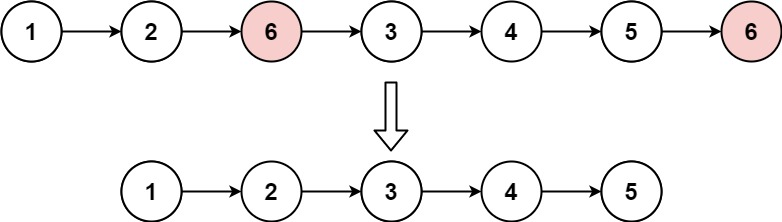

# 203. 移除链表元素

Easy · [力扣原题](https://leetcode.cn/problems/remove-linked-list-elements/)

所在刷题路径：灵神题单·链表树与回溯

| 作者 | 题解 | 动画讲解 |
|---|---|---|
| 灵茶山艾府 | [📄 题解](灵茶山艾府.md) | [▶︎ 动画（GIF）](0203%20移除链表元素%20·%20灵茶山艾府.gif) · [mp4 文件](0203%20移除链表元素%20·%20灵茶山艾府.mp4) |
| yiduobo | [📄 题解](yiduobo.md) | [▶︎ 动画（GIF）](0203%20移除链表元素%20·%20yiduobo.gif) · [mp4 文件](0203%20移除链表元素%20·%20yiduobo.mp4) |

## 动画讲解

> 动图会循环播放；想暂停、拖进度条请下载上面表格里的 mp4 文件。

### 灵茶山艾府


### yiduobo


## 题目描述

给你一个链表的头节点 `head` 和一个整数 `val` ，请你删除链表中所有满足 `Node.val == val` 的节点，并返回 **新的头节点** 。

**示例 1：**



```

输入：head = [1,2,6,3,4,5,6], val = 6
输出：[1,2,3,4,5]
```

**示例 2：**

```

输入：head = [], val = 1
输出：[]
```

**示例 3：**

```

输入：head = [7,7,7,7], val = 7
输出：[]
```

**提示：**

- 列表中的节点数目在范围 `[0, 10⁴]` 内

- `1 <= Node.val <= 50`

- `0 <= val <= 50`

---
[↑ 返回 0200-0299](../README.md) · [总索引](../../../索引.md) · [仓库首页](../../../README.md)
