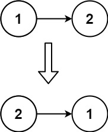

# 206. 反转链表

Easy · [力扣原题](https://leetcode.cn/problems/reverse-linked-list/)

所在刷题路径：labuladong、灵神突击、灵神题单·链表树与回溯

| 作者 | 题解 | 动画讲解 |
|---|---|---|
| 灵茶山艾府 | [📄 题解](灵茶山艾府.md) | [▶︎ 动画（GIF）](0206%20反转链表%20·%20灵茶山艾府.gif) · [mp4 文件](0206%20反转链表%20·%20灵茶山艾府.mp4) |
| yiduobo | [📄 题解](yiduobo.md) | [▶︎ 动画（GIF）](0206%20反转链表%20·%20yiduobo.gif) · [mp4 文件](0206%20反转链表%20·%20yiduobo.mp4) |

## 动画讲解

> 动图会循环播放；想暂停、拖进度条请下载上面表格里的 mp4 文件。

### 灵茶山艾府


### yiduobo


## 题目描述

给你单链表的头节点 `head` ，请你反转链表，并返回反转后的链表。

**示例 1：**


```

输入：head = [1,2,3,4,5]
输出：[5,4,3,2,1]
```

**示例 2：**



```

输入：head = [1,2]
输出：[2,1]
```

**示例 3：**

```

输入：head = []
输出：[]
```

**提示：**

- 链表中节点的数目范围是 `[0, 5000]`

- `-5000 <= Node.val <= 5000`

**进阶：**链表可以选用迭代或递归方式完成反转。你能否用两种方法解决这道题？

---
[↑ 返回 0200-0299](../README.md) · [总索引](../../../索引.md) · [仓库首页](../../../README.md)
