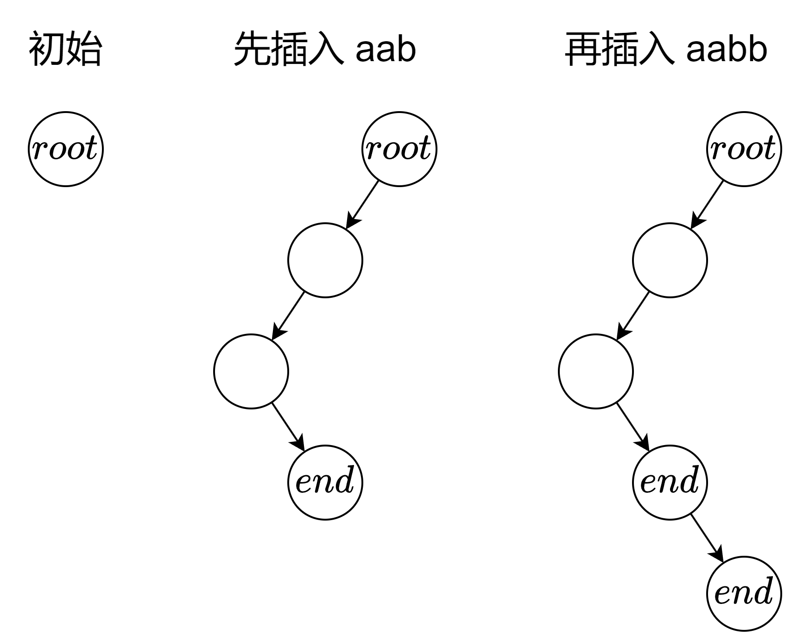

# 从二叉树到二十六叉树（Python/Java/C++/C/Go/JS/Rust）

> **[208. 实现 Trie (前缀树)](https://leetcode.cn/problems/implement-trie-prefix-tree/solutions/2993894/cong-er-cha-shu-dao-er-shi-liu-cha-shu-p-xsj4/) · Medium**

> **所属题单**
> - [常用数据结构 · 六、字典树（trie）](../../../刷题路径/灵神原版题单/常用数据结构/六、字典树（trie）.md) · §6.1 基础
> - [LeetCode 热题 100 · 图论](../../../刷题路径/灵神原版题单/LeetCode%20热题%20100/图论.md)
> - [面试经典 150 题 · 字典树](../../../刷题路径/灵神原版题单/面试经典%20150%20题/字典树.md)

> **题目描述**
> **[Trie](https://baike.baidu.com/item/字典树/9825209?fr=aladdin)**（发音类似 "try"）或者说 **前缀树** 是一种树形数据结构，用于高效地存储和检索字符串数据集中的键。这一数据结构有相当多的应用情景，例如自动补全和拼写检查。
>
> 请你实现 Trie 类：
>
> - `Trie()` 初始化前缀树对象。
>
> - `void insert(String word)` 向前缀树中插入字符串 `word` 。
>
> - `boolean search(String word)` 如果字符串 `word` 在前缀树中，返回 `true`（即，在检索之前已经插入）；否则，返回 `false` 。
>
> - `boolean startsWith(String prefix)` 如果之前已经插入的字符串 `word` 的前缀之一为 `prefix` ，返回 `true` ；否则，返回 `false` 。
>
> **示例：**
>
> ```
>
> 输入
> ["Trie", "insert", "search", "search", "startsWith", "insert", "search"]
> [[], ["apple"], ["apple"], ["app"], ["app"], ["app"], ["app"]]
> 输出
> [null, null, true, false, true, null, true]
>
> 解释
> Trie trie = new Trie();
> trie.insert("apple");
> trie.search("apple");   // 返回 True
> trie.search("app");     // 返回 False
> trie.startsWith("app"); // 返回 True
> trie.insert("app");
> trie.search("app");     // 返回 True
> ```
>
> **提示：**
>
> - `1 <= word.length, prefix.length <= 2000`
>
> - `word` 和 `prefix` 仅由小写英文字母组成
>
> - `insert`、`search` 和 `startsWith` 调用次数 **总计** 不超过 `3 * 10⁴` 次

> **题解**
> ## 思路
>
> > “若我俩都走过同样的路，则我俩心意相通。”
>
> 假设字符串里面只有 $\texttt{a}$ 和 $\texttt{b}$ 两种字符。
>
> 从左到右遍历字符串，把 $\texttt{a}$ 视作往左走，把 $\texttt{b}$ 视作往右走。怎么记录路径？怎么区分不同的路径？用二叉树记录。
>
> - $\texttt{insert}$：例如先插入字符串 $\texttt{aab}$，相当于生成了一条移动方向为「左-左-右」的路径。标记最后一个节点为终止节点。再插入字符串 $\texttt{aabb}$，相当于生成了一条移动方向为「左-左-右-右」的路径。标记最后一个节点为终止节点。
> - $\texttt{search}$：例如查找字符串 $\texttt{aab}$，相当于查找二叉树中是否存在一条移动方向为「左-左-右」的路径，且最后一个节点是终止节点。
> - $\texttt{startsWith}$：例如查找前缀 $\texttt{aa}$，相当于查找二叉树中是否存在一条移动方向为「左-左」的路径，无其他要求。
>
> {:width=500}
>
> 推广到 $26$ 种字母，其实就是一棵 $26$ 叉树，对于 $26$ 叉树的每个节点，可以用哈希表，或者长为 $26$ 的数组来存储子节点。
>
> ## 算法
>
> - 初始化：创建一棵 $26$ 叉树，一开始只有一个根节点 $\textit{root}$。$26$ 叉树的每个节点包含一个长为 $26$ 的儿子节点列表 $\textit{son}$，以及一个布尔值 $\textit{end}$，表示是否为终止节点。
> - $\texttt{insert}$：
>     1. 遍历字符串 $\textit{word}$，同时用一个变量 $\textit{cur}$ 表示当前在 $26$ 叉树的哪个节点，初始值为 $\textit{root}$。
>     2. 如果 $\textit{word}[i]$ 不是 $\textit{cur}$ 的儿子，那么创建一个新的节点 $\textit{node}$ 作为 $\textit{cur}$ 的儿子。如果 $\textit{word}[i]=\texttt{a}$，那么把 $\textit{node}$ 记录到 $\textit{cur}$ 的 $\textit{son}[0]$ 中。如果 $\textit{word}[i]=\texttt{b}$，那么把 $\textit{node}$ 记录到 $\textit{cur}$ 的 $\textit{son}[1]$ 中。依此类推。
>     3. 更新 $\textit{cur}$ 为儿子列表中的相应节点。
>     4. 遍历结束，把 $\textit{cur}$ 的 $\textit{end}$ 标记为 $\texttt{true}$。
> - $\texttt{search}$ 和 $\texttt{startsWith}$ 可以复用同一个函数 $\textit{find}$：
>     1. 遍历字符串 $\textit{word}$，同时用一个变量 $\textit{cur}$ 表示当前在 $26$ 叉树的哪个节点，初始值为 $\textit{root}$。
>     2. 如果 $\textit{word}[i]$ 不是 $\textit{cur}$ 的儿子，返回 $0$。$\texttt{search}$ 和 $\texttt{startsWith}$ 收到 $0$ 之后返回 $\texttt{false}$。
>     3. 更新 $\textit{cur}$ 为儿子列表中的相应节点。
>     4. 遍历结束，如果 $\textit{cur}$ 的 $\textit{end}$ 是 $\texttt{false}$，返回 $1$，否则返回 $2$。$\texttt{search}$ 如果收到的是 $2$，返回 $\texttt{true}$，否则返回 $\texttt{false}$。$\texttt{startsWith}$ 如果收到的是非 $0$ 数字，返回 $\texttt{true}$，否则返回 $\texttt{false}$。
>
>
> > [!example]+ Python3 dict
> > ```python
> > class Node:
> >     __slots__ = 'son', 'end'
> >
> >     def __init__(self):
> >         self.son = {}
> >         self.end = False
> >
> > class Trie:
> >     def __init__(self):
> >         self.root = Node()
> >
> >     def insert(self, word: str) -> None:
> >         cur = self.root
> >         for c in word:
> >             if c not in cur.son:  # 无路可走？
> >                 cur.son[c] = Node()  # 那就造路！
> >             cur = cur.son[c]
> >         cur.end = True
> >
> >     def find(self, word: str) -> int:
> >         cur = self.root
> >         for c in word:
> >             if c not in cur.son:  # 道不同，不相为谋
> >                 return 0
> >             cur = cur.son[c]
> >         # 走过同样的路（2=完全匹配，1=前缀匹配）
> >         return 2 if cur.end else 1
> >
> >     def search(self, word: str) -> bool:
> >         return self.find(word) == 2
> >
> >     def startsWith(self, prefix: str) -> bool:
> >         return self.find(prefix) != 0
> > ```
>
>
> > [!example]- Python3 list
> > ```python
> > class Node:
> >     __slots__ = 'son', 'end'
> >
> >     def __init__(self):
> >         self.son = [None] * 26
> >         self.end = False
> >
> > class Trie:
> >     def __init__(self):
> >         self.root = Node()
> >
> >     def insert(self, word: str) -> None:
> >         cur = self.root
> >         for c in word:
> >             c = ord(c) - ord('a')
> >             if cur.son[c] is None:  # 无路可走？
> >                 cur.son[c] = Node()  # 那就造路！
> >             cur = cur.son[c]
> >         cur.end = True
> >
> >     def find(self, word: str) -> int:
> >         cur = self.root
> >         for c in word:
> >             c = ord(c) - ord('a')
> >             if cur.son[c] is None:  # 道不同，不相为谋
> >                 return 0
> >             cur = cur.son[c]
> >         # 走过同样的路（2=完全匹配，1=前缀匹配）
> >         return 2 if cur.end else 1
> >
> >     def search(self, word: str) -> bool:
> >         return self.find(word) == 2
> >
> >     def startsWith(self, prefix: str) -> bool:
> >         return self.find(prefix) != 0
> > ```
>
>
> #### 复杂度分析
>
> - 时间复杂度：初始化为 $\mathcal{O}(1)$，$\texttt{insert}$ 为 $\mathcal{O}(n|\Sigma|)$，其余为 $\mathcal{O}(n)$，其中 $n$ 是 $\textit{word}$ 的长度，$|\Sigma|=26$ 是字符集合的大小。注意创建一个节点需要 $\mathcal{O}(|\Sigma|)$ 的时间（如果用的是数组）。
> - 空间复杂度：$\mathcal{O}(qn|\Sigma|)$。其中 $q$ 是 $\texttt{insert}$ 的调用次数。
>
> ## 分类题单
>
> [如何科学刷题？](https://leetcode.cn/circle/discuss/RvFUtj/)
>
> 1. [滑动窗口与双指针（定长/不定长/单序列/双序列/三指针/分组循环）](https://leetcode.cn/circle/discuss/0viNMK/)
> 2. [二分算法（二分答案/最小化最大值/最大化最小值/第K小）](https://leetcode.cn/circle/discuss/SqopEo/)
> 3. [单调栈（基础/矩形面积/贡献法/最小字典序）](https://leetcode.cn/circle/discuss/9oZFK9/)
> 4. [网格图（DFS/BFS/综合应用）](https://leetcode.cn/circle/discuss/YiXPXW/)
> 5. [位运算（基础/性质/拆位/试填/恒等式/思维）](https://leetcode.cn/circle/discuss/dHn9Vk/)
> 6. [图论算法（DFS/BFS/拓扑排序/最短路/最小生成树/二分图/基环树/欧拉路径）](https://leetcode.cn/circle/discuss/01LUak/)
> 7. [动态规划（入门/背包/状态机/划分/区间/状压/数位/数据结构优化/树形/博弈/概率期望）](https://leetcode.cn/circle/discuss/tXLS3i/)
> 8. [常用数据结构（前缀和/差分/栈/队列/堆/字典树/并查集/树状数组/线段树）](https://leetcode.cn/circle/discuss/mOr1u6/)
> 9. [数学算法（数论/组合/概率期望/博弈/计算几何/随机算法）](https://leetcode.cn/circle/discuss/IYT3ss/)
> 10. [贪心与思维（基本贪心策略/反悔/区间/字典序/数学/思维/脑筋急转弯/构造）](https://leetcode.cn/circle/discuss/g6KTKL/)
> 11. [链表、二叉树与回溯（前后指针/快慢指针/DFS/BFS/直径/LCA/一般树）](https://leetcode.cn/circle/discuss/K0n2gO/)
> 12. [字符串（KMP/Z函数/Manacher/字符串哈希/AC自动机/后缀数组/子序列自动机）](https://leetcode.cn/circle/discuss/SJFwQI/)
>
> [我的题解精选（已分类）](https://github.com/EndlessCheng/codeforces-go/blob/master/leetcode/SOLUTIONS.md)
>
> 欢迎关注 [B站@灵茶山艾府](https://space.bilibili.com/206214)
