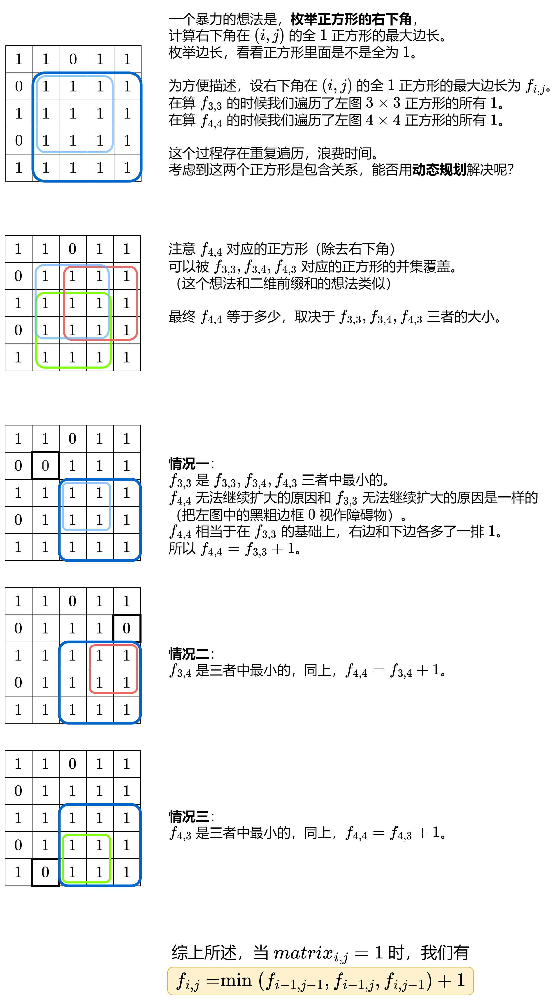

# 【图解】两种方法：动态规划/单调栈（Python/Java/C++/C/Go/JS/Rust）

> **[221. 最大正方形](https://leetcode.cn/problems/maximal-square/solutions/3704858/he-85-ti-yi-yang-de-zuo-fa-pythonjavaccg-az54/) · Medium**

> **所属题单**
> - [动态规划 · 七、其他线性 DP](../../../刷题路径/灵神原版题单/动态规划/七、其他线性%20DP.md) · §7.5 子矩形 DP
> - [单调栈 · 二、矩形](../../../刷题路径/灵神原版题单/单调栈/二、矩形.md)
> - [面试经典 150 题 · 多维动态规划](../../../刷题路径/灵神原版题单/面试经典%20150%20题/多维动态规划.md)

> **题目描述**
> 在一个由 `'0'` 和 `'1'` 组成的二维矩阵内，找到只包含 `'1'` 的最大正方形，并返回其面积。
>
> **示例 1：**
>
> 
>
> ```
>
> 输入：matrix = [["1","0","1","0","0"],["1","0","1","1","1"],["1","1","1","1","1"],["1","0","0","1","0"]]
> 输出：4
> ```
>
> **示例 2：**
>
> 
>
> ```
>
> 输入：matrix = [["0","1"],["1","0"]]
> 输出：1
> ```
>
> **示例 3：**
>
> ```
>
> 输入：matrix = [["0"]]
> 输出：0
> ```
>
> **提示：**
>
> - `m == matrix.length`
>
> - `n == matrix[i].length`
>
> - `1 <= m, n <= 300`
>
> - `matrix[i][j]` 为 `'0'` 或 `'1'`

> **题解**
> ## 方法一：动态规划
>
> 思路启发：学习 [二维前缀和](../../0300-0399/0304%20二维区域和检索%20-%20矩阵不可变/灵茶山艾府.md) 对于想出本题的转移方程有帮助。
>
> 
>
> 整理上图中的结论。定义 $f_{i,j}$ 为右下角在 $(i,j)$ 的全 $1$ 正方形的最大边长。我们有
>
> $$
> f_{i,j} =
> \begin{cases}
> 0, & \textit{matrix}_{i,j} = 0     \\
> \min(f_{i-1,j-1},f_{i-1,j},f_{i,j-1}) + 1, & \textit{matrix}_{i,j} = 1     \\
> \end{cases}
> $$
>
> 然而，当 $i=0$ 或者 $j=0$ 时，上式会产生负数下标 $-1$。
>
> 为避免出现负数下标，可以在 $f$ 矩阵的最上边添加一行 $0$，最左边添加一列 $0$，对应下标出界的状态（正方形的最大边长为 $0$）。
>
> 由于修改了 $f$，状态转移方程中的 $f$ 的下标要加一，即
>
> $$
> f_{i+1,j+1} =
> \begin{cases}
> 0, & \textit{matrix}_{i,j} = 0     \\
> \min(f_{i,j},f_{i,j+1},f_{i+1,j}) + 1, & \textit{matrix}_{i,j} = 1     \\
> \end{cases}
> $$
>
> > 注意 $\textit{matrix}$ 的下标是不用变的，因为我们只是在 $f$ 矩阵的上边和左边插入了 $0$，所以只有 $f$ 的下标受此影响需要加一。
>
> 初始值 $f_{0,j} = f_{i,0} = 0$。
>
> 答案为整个 $f$ 矩阵的最大值的平方。（注意动态规划求的是最大值，求面积需要算平方。）
>
> ```python
> class Solution:
>     def maximalSquare(self, matrix: List[List[str]]) -> int:
>         m, n = len(matrix), len(matrix[0])
>         f = [[0] * (n + 1) for _ in range(m + 1)]
>         for i, row in enumerate(matrix):
>             for j, ch in enumerate(row):
>                 if ch == '1':
>                     f[i + 1][j + 1] = min(f[i][j], f[i][j + 1], f[i + 1][j]) + 1
>         return max(map(max, f)) ** 2
> ```
>
>
> ### 空间优化
>
> 类似 [1143. 最长公共子序列](https://leetcode.cn/problems/longest-common-subsequence/) 的空间优化方法，只用一个长为 $n+1$ 的一维数组，原理讲解请看 [最长公共子序列 编辑距离【基础算法精讲 19】](https://www.bilibili.com/video/BV1TM4y1o7ug/)。
>
> ```python
> class Solution:
>     def maximalSquare(self, matrix: List[List[str]]) -> int:
>         f = [0] * (len(matrix[0]) + 1)
>         ans = 0
>         for row in matrix:
>             pre = 0  # f[i][0] = 0
>             for j, ch in enumerate(row):
>                 if ch == '1':
>                     tmp = f[j + 1]
>                     f[j + 1] = min(pre, f[j + 1], f[j]) + 1  # 此时 pre = f[i][j]
>                     pre = tmp  # 此时 pre = f[i][j+1]
>                 else:
>                     f[j + 1] = 0
>                     pre = 0
>             ans = max(ans, max(f))
>         return ans * ans
> ```
>
>
> #### 复杂度分析
>
> - 时间复杂度：$\mathcal{O}(mn)$，其中 $m$ 和 $n$ 分别为 $\textit{matrix}$ 的行数和列数。
> - 空间复杂度：优化前 $\mathcal{O}(mn)$，优化后 $\mathcal{O}(n)$。
>
> ## 方法二：单调栈
>
> 做法和 [85. 最大矩形](https://leetcode.cn/problems/maximal-rectangle/) 是一样的，请看 [我的题解](../../0000-0099/0085%20最大矩形/灵茶山艾府.md)。
>
> 本题是正方形，也就是矩形的长宽相同。在计算矩形面积时，取长和宽的最小值，作为正方形的边长。其余逻辑与 85 题一致。
>
> 小优化：改成维护正方形边长的最大值，仅在最终返回时才计算面积（边长的平方），从而减少乘法计算次数。
>
> ```python
> class Solution:
>     # 84. 柱状图中最大的矩形
>     # 改成计算最大正方形的边长
>     def largestSize(self, heights: List[int]) -> int:
>         st = [-1]  # 在栈中只有一个数的时候，栈顶的「下面那个数」是 -1，对应 left[i] = -1 的情况
>         ans = 0
>         for right, h in enumerate(heights):
>             while len(st) > 1 and heights[st[-1]] >= h:
>                 i = st.pop()  # 矩形的高（的下标）
>                 left = st[-1]  # 栈顶下面那个数就是 left
>                 ans = max(ans, min(heights[i], right - left - 1))
>             st.append(right)
>         return ans
>
>     def maximalSquare(self, matrix: List[List[str]]) -> int:
>         n = len(matrix[0])
>         heights = [0] * (n + 1)  # 末尾多一个 0，理由见我 84 题题解
>         ans = 0
>         for row in matrix:
>             # 计算底边为 row 的柱子高度
>             for j, c in enumerate(row):
>                 if c == '0':
>                     heights[j] = 0  # 柱子高度为 0
>                 else:
>                     heights[j] += 1  # 柱子高度加一
>             ans = max(ans, self.largestSize(heights))
>         return ans * ans  # 最后再计算面积
> ```
>
>
> #### 复杂度分析
>
> - 时间复杂度：$\mathcal{O}(mn)$，其中 $m$ 和 $n$ 分别为 $\textit{matrix}$ 的行数和列数。做 $m$ 次 84 题，每次 $\mathcal{O}(n)$。
> - 空间复杂度：$\mathcal{O}(n)$。
>
> ## 专题训练
>
> 1. 动态规划题单的「**§7.5 子矩形 DP**」
> 2. 单调栈题单的「**二、矩形**」。
>
> ## 分类题单
>
> [如何科学刷题？](https://leetcode.cn/circle/discuss/RvFUtj/)
>
> 1. [滑动窗口与双指针（定长/不定长/单序列/双序列/三指针/分组循环）](https://leetcode.cn/circle/discuss/0viNMK/)
> 2. [二分算法（二分答案/最小化最大值/最大化最小值/第K小）](https://leetcode.cn/circle/discuss/SqopEo/)
> 3. [单调栈（基础/矩形面积/贡献法/最小字典序）](https://leetcode.cn/circle/discuss/9oZFK9/)
> 4. [网格图（DFS/BFS/综合应用）](https://leetcode.cn/circle/discuss/YiXPXW/)
> 5. [位运算（基础/性质/拆位/试填/恒等式/思维）](https://leetcode.cn/circle/discuss/dHn9Vk/)
> 6. [图论算法（DFS/BFS/拓扑排序/基环树/最短路/最小生成树/网络流）](https://leetcode.cn/circle/discuss/01LUak/)
> 7. [动态规划（入门/背包/划分/状态机/区间/状压/数位/数据结构优化/树形/博弈/概率期望）](https://leetcode.cn/circle/discuss/tXLS3i/)
> 8. [常用数据结构（前缀和/差分/栈/队列/堆/字典树/并查集/树状数组/线段树）](https://leetcode.cn/circle/discuss/mOr1u6/)
> 9. [数学算法（数论/组合/概率期望/博弈/计算几何/随机算法）](https://leetcode.cn/circle/discuss/IYT3ss/)
> 10. [贪心与思维（基本贪心策略/反悔/区间/字典序/数学/思维/脑筋急转弯/构造）](https://leetcode.cn/circle/discuss/g6KTKL/)
> 11. [链表、二叉树与回溯（前后指针/快慢指针/DFS/BFS/直径/LCA/一般树）](https://leetcode.cn/circle/discuss/K0n2gO/)
> 12. [字符串（KMP/Z函数/Manacher/字符串哈希/AC自动机/后缀数组/子序列自动机）](https://leetcode.cn/circle/discuss/SJFwQI/)
>
> [我的题解精选（已分类）](https://github.com/EndlessCheng/codeforces-go/blob/master/leetcode/SOLUTIONS.md)
>
> 欢迎关注 [B站@灵茶山艾府](https://space.bilibili.com/206214)
