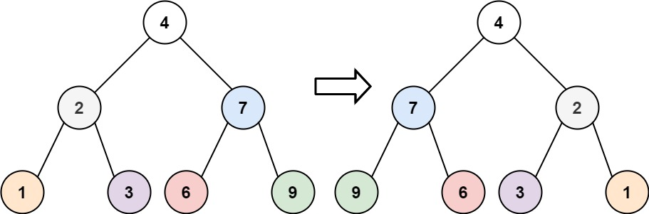

# 226. 翻转二叉树

Easy · [力扣原题](https://leetcode.cn/problems/invert-binary-tree/)

所在刷题路径：labuladong、灵神核心路线、灵神突击、灵神题单·链表树与回溯

| 作者 | 题解 | 动画讲解 |
|---|---|---|
| 灵茶山艾府 | [📄 题解](灵茶山艾府.md) | [▶︎ 0226 翻转二叉树 · 灵茶山艾府.mp4](0226%20翻转二叉树%20·%20灵茶山艾府.mp4) |
| yiduobo | [📄 题解](yiduobo.md) | [▶︎ 0226 翻转二叉树 · yiduobo.mp4](0226%20翻转二叉树%20·%20yiduobo.mp4) |

## 题目描述

给你一棵二叉树的根节点 `root` ，翻转这棵二叉树，并返回其根节点。

**示例 1：**



```

输入：root = [4,2,7,1,3,6,9]
输出：[4,7,2,9,6,3,1]
```

**示例 2：**


```

输入：root = [2,1,3]
输出：[2,3,1]
```

**示例 3：**

```

输入：root = []
输出：[]
```

**提示：**

- 树中节点数目范围在 `[0, 100]` 内

- `-100 <= Node.val <= 100`

---
[↑ 返回 0200-0299](../README.md) · [总索引](../../../索引.md) · [仓库首页](../../../README.md)
