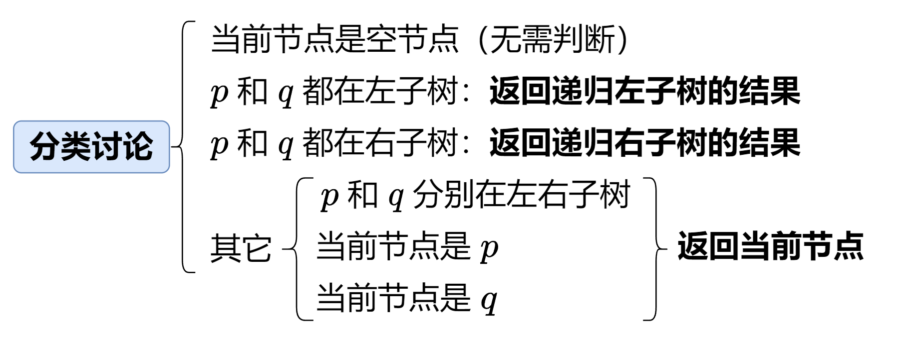

# 【视频】分类讨论乱如麻？一个视频讲透！（Python/Java/C++/C/Go/JS/Rust）

> **[235. 二叉搜索树的最近公共祖先](https://leetcode.cn/problems/lowest-common-ancestor-of-a-binary-search-tree/solutions/2023873/zui-jin-gong-gong-zu-xian-yi-ge-shi-pin-8h2zc/) · Medium**

> **所属题单**
> - [链表、二叉树与回溯 · 二、二叉树](../../../刷题路径/灵神原版题单/链表、二叉树与回溯/二、二叉树.md) · §2.8 最近公共祖先

> **题目描述**
> 给定一个二叉搜索树, 找到该树中两个指定节点的最近公共祖先。
>
> [百度百科](https://baike.baidu.com/item/%E6%9C%80%E8%BF%91%E5%85%AC%E5%85%B1%E7%A5%96%E5%85%88/8918834?fr=aladdin)中最近公共祖先的定义为：“对于有根树 T 的两个结点 p、q，最近公共祖先表示为一个结点 x，满足 x 是 p、q 的祖先且 x 的深度尽可能大（**一个节点也可以是它自己的祖先**）。”
>
> 例如，给定如下二叉搜索树:  root = [6,2,8,0,4,7,9,null,null,3,5]
>
> 
>
> **示例 1:**
>
> ```
> 输入: root = [6,2,8,0,4,7,9,null,null,3,5], p = 2, q = 8
> 输出: 6
> 解释: 节点 2 和节点 8 的最近公共祖先是 6。
> ```
>
> **示例 2:**
>
> ```
> 输入: root = [6,2,8,0,4,7,9,null,null,3,5], p = 2, q = 4
> 输出: 2
> 解释: 节点 2 和节点 4 的最近公共祖先是 2, 因为根据定义最近公共祖先节点可以为节点本身。
> ```
>
> **说明:**
>
> - 所有节点的值都是唯一的。
>
> - p、q 为不同节点且均存在于给定的二叉搜索树中。

> **题解**
> ## 视频讲解
>
> 请看[【基础算法精讲 12】](https://www.bilibili.com/video/BV1W44y1Z7AR/)，制作不易，欢迎点赞~
>
> 
>
> ### 答疑
>
> **问**：为什么本题无需判断节点是空节点？而 [236. 二叉树的最近公共祖先](https://leetcode.cn/problems/lowest-common-ancestor-of-a-binary-tree/) 这题却需要判断？
>
> **答**：在二叉搜索树的情况下，只有发现 $p$（或者 $q$）在左/右子树中才会递归左/右子树，这**间接说明递归到的节点一定不是空节点**（注意题目保证 $p$ 和 $q$ 一定在树中）。236 题不是二叉搜索树，虽然题目保证 $p$ 和 $q$ 一定在树中，但却无法保证 $p$（或者 $q$）一定在我们目前递归到的子树中（因为无法像本题提前判断），所以 236 题无法保证当前节点一定非空。
>
> ```python
> class Solution:
>     def lowestCommonAncestor(self, root: 'TreeNode', p: 'TreeNode', q: 'TreeNode') -> 'TreeNode':
>         x = root.val
>         if p.val < x and q.val < x:  # p 和 q 都在左子树
>             return self.lowestCommonAncestor(root.left, p, q)
>         if p.val > x and q.val > x:  # p 和 q 都在右子树
>             return self.lowestCommonAncestor(root.right, p, q)
>         return root  # 其它
> ```
>
>
> #### 复杂度分析
>
> - 时间复杂度：$\mathcal{O}(n)$，其中 $n$ 是二叉搜索树的节点个数。注意题目没有保证树是平衡树。最坏情况下，树退化成一条链，且 $p$ 和 $q$ 在底部，那么递归就需要 $\mathcal{O}(n)$ 的时间。
> - 空间复杂度：$\mathcal{O}(n)$。最坏情况下，二叉搜索树退化成一条链（注意题目没有保证树是**平衡**树），因此递归需要 $\mathcal{O}(n)$ 的栈空间。
>
> ## 分类题单
>
> [如何科学刷题？](https://leetcode.cn/discuss/post/3141566/ru-he-ke-xue-shua-ti-by-endlesscheng-q3yd/)
>
> 1. [滑动窗口与双指针（定长/不定长/单序列/双序列/三指针/分组循环）](https://leetcode.cn/discuss/post/3578981/ti-dan-hua-dong-chuang-kou-ding-chang-bu-rzz7/)
> 2. [二分算法（二分答案/最小化最大值/最大化最小值/第K小）](https://leetcode.cn/discuss/post/3579164/ti-dan-er-fen-suan-fa-er-fen-da-an-zui-x-3rqn/)
> 3. [单调栈（基础/矩形面积/贡献法/最小字典序）](https://leetcode.cn/discuss/post/3579480/ti-dan-dan-diao-zhan-ju-xing-xi-lie-zi-d-u4hk/)
> 4. [网格图（DFS/BFS/综合应用）](https://leetcode.cn/discuss/post/3580195/fen-xiang-gun-ti-dan-wang-ge-tu-dfsbfszo-l3pa/)
> 5. [位运算（基础/性质/拆位/试填/恒等式/思维）](https://leetcode.cn/discuss/post/3580371/fen-xiang-gun-ti-dan-wei-yun-suan-ji-chu-nth4/)
> 6. [图论算法（DFS/BFS/拓扑排序/基环树/最短路/最小生成树/网络流）](https://leetcode.cn/discuss/post/3581143/fen-xiang-gun-ti-dan-tu-lun-suan-fa-dfsb-qyux/)
> 7. [动态规划（入门/背包/划分/状态机/区间/状压/数位/数据结构优化/树形/博弈/概率期望）](https://leetcode.cn/discuss/post/3581838/fen-xiang-gun-ti-dan-dong-tai-gui-hua-ru-007o/)
> 8. [常用数据结构（前缀和/差分/栈/队列/堆/字典树/并查集/树状数组/线段树）](https://leetcode.cn/discuss/post/3583665/fen-xiang-gun-ti-dan-chang-yong-shu-ju-j-bvmv/)
> 9. [数学算法（数论/组合/概率期望/博弈/计算几何/随机算法）](https://leetcode.cn/discuss/post/3584388/fen-xiang-gun-ti-dan-shu-xue-suan-fa-shu-gcai/)
> 10. [贪心与思维（基本贪心策略/反悔/区间/字典序/数学/思维/脑筋急转弯/构造）](https://leetcode.cn/discuss/post/3091107/fen-xiang-gun-ti-dan-tan-xin-ji-ben-tan-k58yb/)
> 11. [链表、树与回溯（前后指针/快慢指针/DFS/BFS/直径/LCA）](https://leetcode.cn/discuss/post/3142882/fen-xiang-gun-ti-dan-lian-biao-er-cha-sh-6srp/)
> 12. [字符串（KMP/Z函数/Manacher/字符串哈希/AC自动机/后缀数组/子序列自动机）](https://leetcode.cn/discuss/post/3144832/fen-xiang-gun-ti-dan-zi-fu-chuan-kmpzhan-ugt4/)
>
> [我的题解精选（已分类）](https://github.com/EndlessCheng/codeforces-go/blob/master/leetcode/SOLUTIONS.md)
>
> 欢迎关注 [B站@灵茶山艾府](https://space.bilibili.com/206214)
