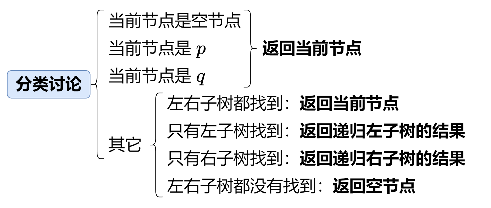

# 【视频讲解】简洁写法（Python/Java/C++/C/Go/JS/Rust）

> **[236. 二叉树的最近公共祖先](https://leetcode.cn/problems/lowest-common-ancestor-of-a-binary-tree/solutions/2023872/fen-lei-tao-lun-luan-ru-ma-yi-ge-shi-pin-2r95/) · Medium**

> **所属题单**
> - [链表、二叉树与回溯 · 二、二叉树](../../../刷题路径/灵神原版题单/链表、二叉树与回溯/二、二叉树.md) · §2.8 最近公共祖先
> - [LeetCode 热题 100 · 二叉树](../../../刷题路径/灵神原版题单/LeetCode%20热题%20100/二叉树.md)
> - [面试经典 150 题 · 二叉树](../../../刷题路径/灵神原版题单/面试经典%20150%20题/二叉树.md)

> **题目描述**
> 给定一个二叉树, 找到该树中两个指定节点的最近公共祖先。
>
> [百度百科](https://baike.baidu.com/item/%E6%9C%80%E8%BF%91%E5%85%AC%E5%85%B1%E7%A5%96%E5%85%88/8918834?fr=aladdin)中最近公共祖先的定义为：“对于有根树 T 的两个节点 p、q，最近公共祖先表示为一个节点 x，满足 x 是 p、q 的祖先且 x 的深度尽可能大（**一个节点也可以是它自己的祖先**）。”
>
> **示例 1：**
>
> 
>
> ```
>
> 输入：root = [3,5,1,6,2,0,8,null,null,7,4], p = 5, q = 1
> 输出：3
> 解释：节点 5 和节点 1 的最近公共祖先是节点 3 。
> ```
>
> **示例 2：**
>
> 
>
> ```
>
> 输入：root = [3,5,1,6,2,0,8,null,null,7,4], p = 5, q = 4
> 输出：5
> 解释：节点 5 和节点 4 的最近公共祖先是节点 5 。因为根据定义最近公共祖先节点可以为节点本身。
> ```
>
> **示例 3：**
>
> ```
>
> 输入：root = [1,2], p = 1, q = 2
> 输出：1
> ```
>
> **提示：**
>
> - 树中节点数目在范围 `[2, 10⁵]` 内。
>
> - `-10⁹ <= Node.val <= 10⁹`
>
> - 所有 `Node.val` `互不相同` 。
>
> - `p != q`
>
> - `p` 和 `q` 均存在于给定的二叉树中。

> **题解**
> ## 视频讲解
>
> 请看[【基础算法精讲 12】](https://www.bilibili.com/video/BV1W44y1Z7AR/)，制作不易，欢迎点赞！
>
> 晕递归的同学请先看 [深刻理解递归](https://www.bilibili.com/video/BV1UD4y1Y769/)。
>
> 
>
> ## 答疑
>
> **问**：$\texttt{lowestCommonAncestor}$ 函数的返回值是什么意思？
>
> **答**：返回值的准确含义是「**最近公共祖先的候选项**」。对于最外层的递归调用者来说，返回值是最近公共祖先的意思。但是，**在递归过程中**，返回值可能是最近公共祖先，也可能是空节点（表示子树内没找到任何有用信息）、节点 $p$ 或者节点 $q$（可能成为最近公共祖先，或者用来**辅助判断**上面的某个节点是否为最近公共祖先）。
>
> **问**：为什么发现当前节点是 $p$ 或者 $q$ 就不再往下递归了？万一下面有 $q$ 或者 $p$ 呢？
>
> **答**：如果下面有 $q$ 或者 $p$，那么当前节点就是最近公共祖先，直接返回当前节点。如果下面没有，那既然都没有要找的节点了，也不需要递归，直接返回当前节点。（注意题目保证 $p$ 和 $q$ 都在二叉树中）
>
> ```python
> class Solution:
>     def lowestCommonAncestor(self, root: 'TreeNode', p: 'TreeNode', q: 'TreeNode') -> 'TreeNode':
>         if root in (None, p, q):  # 找到 p 或 q 就不往下递归了，原因见上面答疑
>             return root
>         left = self.lowestCommonAncestor(root.left, p, q)
>         right = self.lowestCommonAncestor(root.right, p, q)
>         if left and right:  # 左右都找到
>             return root  # 当前节点是最近公共祖先
>         # 如果只有左子树找到，就返回左子树的返回值
>         # 如果只有右子树找到，就返回右子树的返回值
>         # 如果左右子树都没有找到，就返回 None（注意此时 right = None）
>         return left or right
> ```
>
>
> #### 复杂度分析
>
> - 时间复杂度：$\mathcal{O}(n)$，其中 $n$ 为二叉树的节点个数。
> - 空间复杂度：$\mathcal{O}(n)$。最坏情况下，二叉树是一条链，因此递归需要 $\mathcal{O}(n)$ 的栈空间。
>
> ## 分类题单
>
> [如何科学刷题？](https://leetcode.cn/circle/discuss/RvFUtj/)
>
> 1. [滑动窗口与双指针（定长/不定长/单序列/双序列/三指针/分组循环）](https://leetcode.cn/circle/discuss/0viNMK/)
> 2. [二分算法（二分答案/最小化最大值/最大化最小值/第K小）](https://leetcode.cn/circle/discuss/SqopEo/)
> 3. [单调栈（基础/矩形面积/贡献法/最小字典序）](https://leetcode.cn/circle/discuss/9oZFK9/)
> 4. [网格图（DFS/BFS/综合应用）](https://leetcode.cn/circle/discuss/YiXPXW/)
> 5. [位运算（基础/性质/拆位/试填/恒等式/思维）](https://leetcode.cn/circle/discuss/dHn9Vk/)
> 6. [图论算法（DFS/BFS/拓扑排序/基环树/最短路/最小生成树/网络流）](https://leetcode.cn/circle/discuss/01LUak/)
> 7. [动态规划（入门/背包/划分/状态机/区间/状压/数位/数据结构优化/树形/博弈/概率期望）](https://leetcode.cn/circle/discuss/tXLS3i/)
> 8. [常用数据结构（前缀和/差分/栈/队列/堆/字典树/并查集/树状数组/线段树）](https://leetcode.cn/circle/discuss/mOr1u6/)
> 9. [数学算法（数论/组合/概率期望/博弈/计算几何/随机算法）](https://leetcode.cn/circle/discuss/IYT3ss/)
> 10. [贪心与思维（基本贪心策略/反悔/区间/字典序/数学/思维/脑筋急转弯/构造）](https://leetcode.cn/circle/discuss/g6KTKL/)
> 11. [链表、二叉树与回溯（前后指针/快慢指针/DFS/BFS/直径/LCA/一般树）](https://leetcode.cn/circle/discuss/K0n2gO/)
> 12. [字符串（KMP/Z函数/Manacher/字符串哈希/AC自动机/后缀数组/子序列自动机）](https://leetcode.cn/circle/discuss/SJFwQI/)
>
> [我的题解精选（已分类）](https://github.com/EndlessCheng/codeforces-go/blob/master/leetcode/SOLUTIONS.md)
>
> 欢迎关注 [B站@灵茶山艾府](https://space.bilibili.com/206214)
