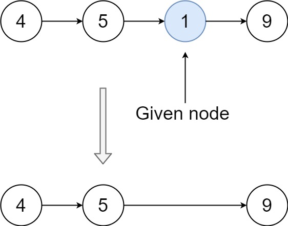

# 237. 删除链表中的节点

Medium · [力扣原题](https://leetcode.cn/problems/delete-node-in-a-linked-list/)

所在刷题路径：灵神题单·链表树与回溯

| 作者 | 题解 | 动画讲解 |
|---|---|---|
| 灵茶山艾府 | [📄 题解](灵茶山艾府.md) | [▶︎ 动画（GIF）](0237%20删除链表中的节点%20·%20灵茶山艾府.gif) · [mp4 文件](0237%20删除链表中的节点%20·%20灵茶山艾府.mp4) |
| yiduobo | [📄 题解](yiduobo.md) | [▶︎ 动画（GIF）](0237%20删除链表中的节点%20·%20yiduobo.gif) · [mp4 文件](0237%20删除链表中的节点%20·%20yiduobo.mp4) |

## 动画讲解

> 动图会循环播放；想暂停、拖进度条请下载上面表格里的 mp4 文件。

### 灵茶山艾府


### yiduobo


## 题目描述

有一个单链表的 `head`，我们想删除它其中的一个节点 `node`。

给你一个需要删除的节点 `node` 。你将 **无法访问** 第一个节点  `head`。

链表的所有值都是 **唯一的**，并且保证给定的节点 `node` 不是链表中的最后一个节点。

删除给定的节点。注意，删除节点并不是指从内存中删除它。这里的意思是：

- 给定节点的值不应该存在于链表中。

- 链表中的节点数应该减少 1。

- `node` 前面的所有值顺序相同。

- `node` 后面的所有值顺序相同。

**自定义测试：**

- 对于输入，你应该提供整个链表 `head` 和要给出的节点 `node`。`node` 不应该是链表的最后一个节点，而应该是链表中的一个实际节点。

- 我们将构建链表，并将节点传递给你的函数。

- 输出将是调用你函数后的整个链表。

**示例 1：**


```

输入：head = [4,5,1,9], node = 5
输出：[4,1,9]
解释：指定链表中值为 5 的第二个节点，那么在调用了你的函数之后，该链表应变为 4 -> 1 -> 9
```

**示例 2：**



```

输入：head = [4,5,1,9], node = 1
输出：[4,5,9]
解释：指定链表中值为 1 的第三个节点，那么在调用了你的函数之后，该链表应变为 4 -> 5 -> 9
```

**提示：**

- 链表中节点的数目范围是 `[2, 1000]`

- `-1000 <= Node.val <= 1000`

- 链表中每个节点的值都是 **唯一** 的

- 需要删除的节点 `node` 是 **链表中的节点** ，且 **不是末尾节点**

---
[↑ 返回 0200-0299](../README.md) · [总索引](../../../索引.md) · [仓库首页](../../../README.md)
