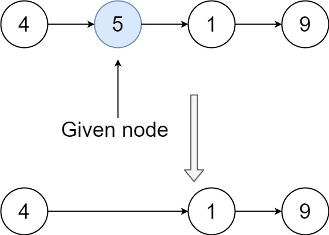

# 脑筋急转弯+简洁写法（Python/Java/C++/C/Go/JS）

> **[237. 删除链表中的节点](https://leetcode.cn/problems/delete-node-in-a-linked-list/solutions/2004056/ru-he-shan-chu-jie-dian-liu-fen-zhong-ga-x3kn/) · Medium**

> **所属题单**
> - [链表、二叉树与回溯 · 一、链表](../../../刷题路径/灵神原版题单/链表、二叉树与回溯/一、链表.md) · §1.2 删除节点

> **题目描述**
> 有一个单链表的 `head`，我们想删除它其中的一个节点 `node`。
>
> 给你一个需要删除的节点 `node` 。你将 **无法访问** 第一个节点  `head`。
>
> 链表的所有值都是 **唯一的**，并且保证给定的节点 `node` 不是链表中的最后一个节点。
>
> 删除给定的节点。注意，删除节点并不是指从内存中删除它。这里的意思是：
>
> - 给定节点的值不应该存在于链表中。
>
> - 链表中的节点数应该减少 1。
>
> - `node` 前面的所有值顺序相同。
>
> - `node` 后面的所有值顺序相同。
>
> **自定义测试：**
>
> - 对于输入，你应该提供整个链表 `head` 和要给出的节点 `node`。`node` 不应该是链表的最后一个节点，而应该是链表中的一个实际节点。
>
> - 我们将构建链表，并将节点传递给你的函数。
>
> - 输出将是调用你函数后的整个链表。
>
> **示例 1：**
>
> 
>
> ```
>
> 输入：head = [4,5,1,9], node = 5
> 输出：[4,1,9]
> 解释：指定链表中值为 5 的第二个节点，那么在调用了你的函数之后，该链表应变为 4 -> 1 -> 9
> ```
>
> **示例 2：**
>
> 
>
> ```
>
> 输入：head = [4,5,1,9], node = 1
> 输出：[4,5,9]
> 解释：指定链表中值为 1 的第三个节点，那么在调用了你的函数之后，该链表应变为 4 -> 5 -> 9
> ```
>
> **提示：**
>
> - 链表中节点的数目范围是 `[2, 1000]`
>
> - `-1000 <= Node.val <= 1000`
>
> - 链表中每个节点的值都是 **唯一** 的
>
> - 需要删除的节点 `node` 是 **链表中的节点** ，且 **不是末尾节点**

> **题解**
> **视频讲解**：请看[【基础算法精讲 08】](https://www.bilibili.com/video/BV1VP4y1Q71e/)，制作不易，欢迎点赞~
>
> 要想直接删除节点 $\textit{node}$，必须修改 $\textit{node}$ 的前一个节点的 $\textit{next}$ 为 $\textit{node}.\textit{next}$。
>
> 比如示例 1，把 $4$ 的 $\textit{next}$ 改成 $1$，就把 $5$ 删掉了。
>
> {:width=350px}
>
> 然而，本题只告诉我们当前节点 $\textit{node}$，我们不知道 $\textit{node}$ 的前一个节点是谁。难道就没法删除了吗？
>
> 注意题目的要求：我们只需让链表「看上去」删除了 $\textit{node}$。比如按顺序打印这个链表的值，就是 $4,1,9$ 这三个节点值，就可以认为我们成功删除了 $5$。
>
> 比如示例 1，我们可以先把第二个节点的值**替换**为第三个节点的值，得到 $4\to 1\to 1\to 9$；然后删除第三个节点，得到 $4\to 1\to 9$。
>
> 具体来说，先把 $\textit{node}.\textit{val}$ 更新成 $\textit{node}.\textit{next}.\textit{val}$，然后删除 $\textit{node}$ 的下一个节点，也就是把 $\textit{node}.\textit{next}$ 更新成 $\textit{node}.\textit{next}.\textit{next}$。
>
> **注**：如果语言支持指针操作，可以通过**解引用**直接把 $\textit{node}$ 更新成下一个节点。
>
> ```python
> class Solution:
>     def deleteNode(self, node: ListNode) -> None:
>         node.val = node.next.val
>         node.next = node.next.next
> ```
>
>
> #### 复杂度分析
>
> - 时间复杂度：$\mathcal{O}(1)$。
> - 空间复杂度：$\mathcal{O}(1)$。
>
> ## 分类题单
>
> [如何科学刷题？](https://leetcode.cn/circle/discuss/RvFUtj/)
>
> 1. [滑动窗口与双指针（定长/不定长/单序列/双序列/三指针/分组循环）](https://leetcode.cn/circle/discuss/0viNMK/)
> 2. [二分算法（二分答案/最小化最大值/最大化最小值/第K小）](https://leetcode.cn/circle/discuss/SqopEo/)
> 3. [单调栈（基础/矩形面积/贡献法/最小字典序）](https://leetcode.cn/circle/discuss/9oZFK9/)
> 4. [网格图（DFS/BFS/综合应用）](https://leetcode.cn/circle/discuss/YiXPXW/)
> 5. [位运算（基础/性质/拆位/试填/恒等式/思维）](https://leetcode.cn/circle/discuss/dHn9Vk/)
> 6. [图论算法（DFS/BFS/拓扑排序/基环树/最短路/最小生成树/网络流）](https://leetcode.cn/circle/discuss/01LUak/)
> 7. [动态规划（入门/背包/划分/状态机/区间/状压/数位/数据结构优化/树形/博弈/概率期望）](https://leetcode.cn/circle/discuss/tXLS3i/)
> 8. [常用数据结构（前缀和/差分/栈/队列/堆/字典树/并查集/树状数组/线段树）](https://leetcode.cn/circle/discuss/mOr1u6/)
> 9. [数学算法（数论/组合/概率期望/博弈/计算几何/随机算法）](https://leetcode.cn/circle/discuss/IYT3ss/)
> 10. [贪心与思维（基本贪心策略/反悔/区间/字典序/数学/思维/脑筋急转弯/构造）](https://leetcode.cn/circle/discuss/g6KTKL/)
> 11. [链表、二叉树与回溯（前后指针/快慢指针/DFS/BFS/直径/LCA/一般树）](https://leetcode.cn/circle/discuss/K0n2gO/)
> 12. [字符串（KMP/Z函数/Manacher/字符串哈希/AC自动机/后缀数组/子序列自动机）](https://leetcode.cn/circle/discuss/SJFwQI/)
>
> [我的题解精选（已分类）](https://github.com/EndlessCheng/codeforces-go/blob/master/leetcode/SOLUTIONS.md)
>
> 欢迎关注 [B站@灵茶山艾府](https://space.bilibili.com/206214)
